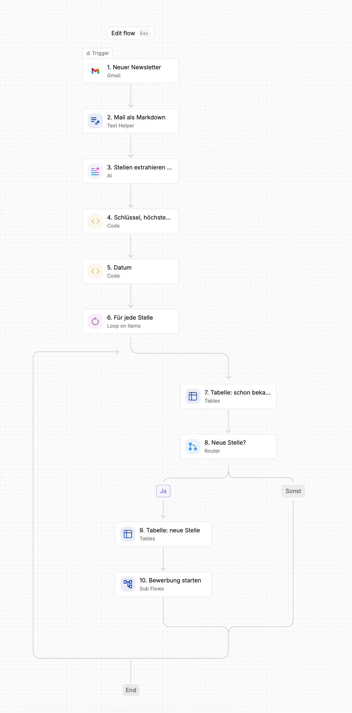
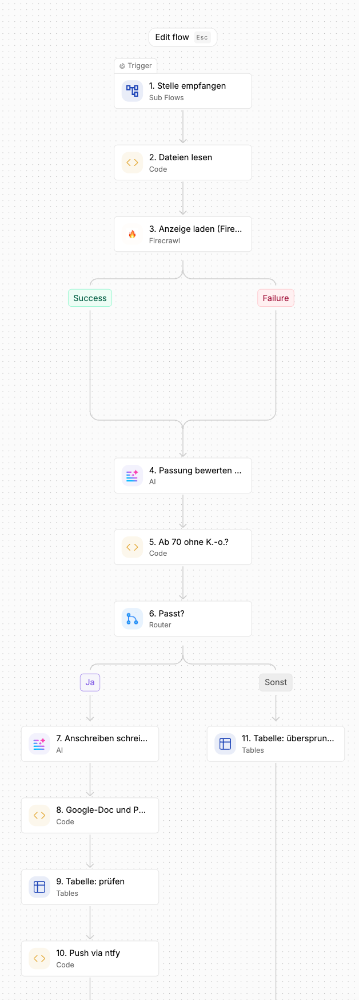
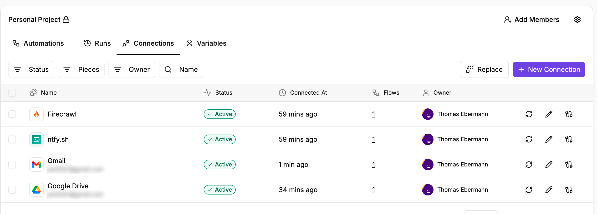
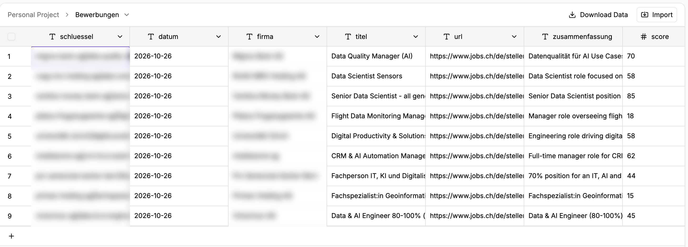

**Stand:** Oktober 2026 · **Autor:** Thomas Ebermann · **Lesedauer:** ca. 7 Minuten

<!-- serie:start -->
> **Serie „Agenten 2026“** · Teil 1: Bewerbungs-Agenten mit festem Ablauf, fünfmal derselbe Agent
>
> - Klicken: [Wie weit kommt man mit Klicken? (n8n)](/blog/2026-09-29-bewerbungs-agent-n8n/) · **Klicken, aber womit? (n8n gegen Activepieces)** ← du bist hier
> - Code mit Plattform: [Was bringt echter Code? (Windmill)](/blog/2026-10-13-bewerbungs-agent-windmill/) · [Braucht es einen Orchestrierer? (Kestra)](/blog/2026-10-20-bewerbungs-agent-kestra/)
> - Code ohne Plattform: [Braucht es überhaupt eine Plattform? (DBOS)](/blog/2026-10-27-bewerbungs-agent-dbos/)
> - Teil 2: Agenten, die selbst planen (folgt)
<!-- serie:end -->

Im [ersten Teil dieser Serie](/blog/2026-09-29-bewerbungs-agent-n8n/) habe ich einen Bewerbungs-Agenten mit n8n gebaut: Er liest jeden Morgen meine Job-Newsletter, bewertet jede Stelle gegen meinen Lebenslauf und entwirft nur für die passenden ein Anschreiben. Die Frage, die mir danach sofort gestellt wurde: Und wie sieht das mit der Konkurrenz aus?

Also habe ich genau denselben Agenten noch einmal gebaut, diesmal mit **Activepieces**. Gleiche Newsletter, gleiche Modelle, gleiche Schwelle von 7 von 10, gleiche Briefvorlage. Was sich unterscheidet, ist nur der Baukasten. Und genau darum geht es in diesem Beitrag: nicht noch einmal die ganze Bauanleitung, sondern was anders ist – und was ich dabei gelernt habe.

## Was ist Activepieces überhaupt?

Activepieces ist der nächste Verwandte von n8n: ebenfalls ein Baukasten im Browser, hier heissen die Bausteine „Pieces“. Zwei Dinge machen es interessant:

- **Es ist wirklich Open Source.** Die Community Edition steht unter MIT-Lizenz. n8n nennt sich „fair-code“: Der Quellcode ist offen, aber die Sustainable Use License schränkt ein, was du damit machen darfst. Für ein privates Projekt ist das egal, für ein Produkt, das du weiterverkaufen willst, nicht.
- **Die Cloud rechnet anders ab.** Activepieces zählt aktive Flows, nicht Ausführungen. Bis zu zehn aktive Flows sind kostenlos. Mein Agent braucht drei, ich zahle also nur die Tokens. Bei n8n Cloud bist du ab 20 € im Monat dabei.

Ich habe es aber, wie n8n, lokal mit Docker betrieben.

## Derselbe Agent, drei Flows

Der Aufbau ist fast eins zu eins derselbe wie bei n8n. Der **Job-Scan** startet, sobald ein Newsletter von jobs.ch oder x28 ankommt, wandelt ihn in Markdown um, lässt DeepSeek die Stellen herausziehen und prüft für jede Stelle in einer Tabelle, ob sie schon bekannt ist. Neue Stellen landen in der Tabelle und starten den zweiten Flow:



Die **Bewerbung** liest meine Markdown-Dateien, holt die Anzeige über Firecrawl, bewertet sie mit DeepSeek und entscheidet: ab 70 ohne K.-o.-Kriterium schreibt Opus das Anschreiben, das in meine Google-Docs-Vorlage gesetzt und als PDF abgelegt wird, dann kommt die Push-Nachricht. Sonst wird die Stelle mit Begründung als „übersprungen“ markiert.



Der dritte Flow, **Antworten**, nimmt die Knopf-Klicks vom Handy entgegen. Spannend daran: Activepieces hat einen fertigen ntfy-Auslöser. In n8n musste ich dafür selbst alle zehn Minuten das ntfy-Thema abfragen.

## Der Vergleich auf einen Blick

| | n8n | Activepieces |
| --- | --- | --- |
| Lizenz | Sustainable Use License (fair-code) | MIT (Community Edition) |
| Cloud-Preis für diesen Agenten | ab 20 € im Monat | 0 € (3 von 10 freien Flows) plus Tokens |
| Lokal betreiben | 1 Container mit SQLite | 4 Container: App, Worker, Postgres, Redis |
| Gmail und Google Drive, selbst gehostet | eigenes Google-Cloud-Projekt mit OAuth-Client | ein Klick über die Google-App von Activepieces |
| Gmail-Rechte | auf `gmail.readonly` beschränkbar | feste Rechte, inklusive Senden |
| Auslöser | Zeitplan, bei mir 7 Uhr | neue Mail startet den Lauf (alle 5 Minuten abgefragt) |
| Tracking | Google Sheets (Data Tables gäbe es auch) | eingebaute Tables |
| Fertige Bausteine | Firecrawl und ntfy über HTTP-Knoten | Pieces für Firecrawl und ntfy, inklusive ntfy-Auslöser |
| KI-Modelle | OpenRouter-Knoten pro Workflow | OpenRouter als zentraler KI-Anbieter der Plattform |
| Per Code bauen | CLI-Import, Knotendefinitionen liegen im Container | REST-API mit Flow-JSON |

Und das Ergebnis? Praktisch gleich. Dieselben Stellen wurden gefunden, die Scores lagen im selben Bereich, und die Anschreiben sehen identisch aus, weil beide Varianten am Ende denselben Code nutzen, um den Brief in meine Vorlage zu setzen. Die Unterschiede liegen also nicht im Was, sondern im Wie.

## Lessons learned

### 1. Google mit einem Klick – das ist der grösste Unterschied

Erinnerst du dich an die Google-Cloud-Console aus dem n8n-Beitrag? Projekt anlegen, vier APIs aktivieren, Zustimmungsbildschirm, OAuth-Client, App veröffentlichen, und das alles in einer Oberfläche, die sich gefühlt jeden Tag ändert.

In Activepieces: „New Connection“, „Gmail“, „Connect“, mit Google anmelden. Fertig. Dasselbe für Google Drive. Das funktioniert auch selbst gehostet, weil Activepieces eine eigene, bei Google registrierte App mitbringt.



Ehrlicherweise hat das zwei Seiten. Du vertraust dabei der Google-App von Activepieces, und die verlangt feste Rechte, inklusive E-Mails senden. In n8n konnte ich Gmail auf reines Lesen beschränken. „Sende nie eine E-Mail“ ist bei Activepieces also wieder nur eine Regel in meinem Ablauf und keine technische Grenze mehr. Für mein Postfach finde ich das vertretbar, für ein Firmenpostfach würde ich zweimal hinschauen.

### 2. Die offizielle Docker-Konfiguration hat eine Falle

Das hat mich am meisten Zeit gekostet. Activepieces besteht aus einer App und einem separaten Worker, der die Flows ausführt. Mit der offiziellen Compose-Datei und `AP_FRONTEND_URL=http://localhost:8080` schlug jeder Versuch, eine Verbindung anzulegen, fehl. Die Fehlermeldung: „fetch failed“. Mehr nicht.

Was ist da passiert, fragst du dich vielleicht? Die App gibt dem Worker ihre öffentliche Adresse mit, damit er darüber die Pieces herunterlädt. Nur ist `localhost` im Container des Workers eben der Worker selbst und nicht die App. Der Worker hat also brav bei sich selbst angeklopft :)

Die Lösung: Der Worker teilt sich das Netzwerk mit der App, und die App lauscht direkt auf Port 8080. Dann ist `localhost:8080` für Browser, App und Worker dieselbe Adresse:

```yaml
  app:
    ports: ["127.0.0.1:8080:8080"]
    environment: [AP_CONTAINER_TYPE=APP, AP_PORT=8080]
  worker:
    network_mode: "service:app"
    environment: [AP_CONTAINER_TYPE=WORKER, AP_PORT=8081]
```

Auf einem Server mit richtiger Domain hast du das Problem nicht. Lokal auf dem Mac schon.

### 3. Eingebaute Tabellen sind praktisch, aber kein Anschreiben

Activepieces bringt Tabellen mit, und für den Tracker ist das wunderbar: Duplikate prüfen, Status setzen, alles ohne Google Sheets.



Mein erster Gedanke war, auch das Anschreiben einfach in eine Tabellenzelle zu schreiben. Das war ein Fehler. Ein Brief als nackter Text in einer Zelle bringt dir nichts, wenn du ihn verschicken willst. Am Ende kopieren jetzt beide Varianten mein eigenes Google-Docs-Template mit Unterschrift, setzen den Brief ein und legen ein PDF daneben. Die Logik dafür liegt in einer einzigen JavaScript-Datei, die n8n und Activepieces gemeinsam nutzen. Lesson learned: Werkzeuge vergleichen ist das eine, aber das Endprodukt muss für den Menschen am Ende brauchbar sein.

### 4. Freie Modellwahl gibt es auch hier

In Activepieces trägst du OpenRouter einmal als KI-Anbieter für die ganze Plattform ein, danach wählt jeder KI-Baustein sein Modell: DeepSeek für Extraktion und Abgleich, Opus für das Anschreiben. Das ist sogar etwas aufgeräumter als in n8n, wo jeder Modell-Knoten seine eigenen Zugangsdaten hat.

Hier bin ich auch über die versteckteste Falle des ganzen Projekts gestolpert: Briefe, die mitten im Satz aufhörten. Opus denkt vor dem Schreiben nach, und diese Denk-Tokens zählen zum Token-Limit. Bei 4'096 Tokens blieben für einen Brief manchmal 162 Wörter übrig. Das betrifft beide Werkzeuge gleich. Seit das Limit bei 16'000 liegt und ein Brief, der nicht mit meinem Namen endet, den Lauf abbricht, ist Ruhe.

### 5. Ereignisse statt Zeitplan

In n8n läuft der Scan jeden Morgen um 7 Uhr. In Activepieces startet er, sobald ein Newsletter da ist. Das fühlt sich moderner an, aber „sobald“ heisst in Wahrheit: Activepieces fragt Gmail alle fünf Minuten. Dasselbe gilt für die Knopf-Klicks vom Handy. Bis ein „Merken“ im Tracker steht, können also fünf Minuten vergehen. Für Bewerbungen ist das egal, für einen Chatbot wäre es das nicht.

### 6. Die Scores schwanken, egal mit welchem Werkzeug

Ein Punkt, der nichts mit n8n oder Activepieces zu tun hat, aber beim Vergleich sofort auffällt: DeepSeek bewertet dieselbe Stelle nicht jedes Mal gleich. Eine Bank-Stelle bekam je nach Lauf zwischen 70 und 74 Punkte, eine andere zwischen 80 und 85. Eine dritte rutschte von 70 auf 62 und damit unter die Schwelle. Wer eine harte Grenze bei 70 zieht, muss damit leben, dass Stellen knapp darum herum mal durchkommen und mal nicht. Ich würde mittlerweile den Score immer speichern und Stellen zwischen 60 und 70 einmal pro Woche selbst überfliegen.

## Wann nehme ich was?

Ich persönlich würde es so zusammenfassen:

**Nimm Activepieces, wenn …**

- du Google, Microsoft und Co. ohne eigenes OAuth-Projekt anbinden willst,
- echte Open-Source-Lizenz für dich zählt, etwa weil du das Ganze in ein eigenes Produkt einbauen willst,
- du in der Cloud starten willst und nur ein paar Flows brauchst – dann ist es gratis.

**Nimm n8n, wenn …**

- du es schlank selbst betreiben willst: ein Container, SQLite, fertig,
- du Rechte fein steuern willst, wie Gmail nur lesend,
- du eine grosse Community, viele Beispiele und Integrationen brauchst.

Für meinen Bewerbungs-Agenten ist es ehrlich gesagt ein Unentschieden. Beide liefern dasselbe Ergebnis, und die Unterschiede liegen beim Einrichten und Betreiben. Wenn ich heute neu anfangen müsste, würde ich wegen der Google-Anbindung zu Activepieces greifen und mir das Geklicke durch die Google-Cloud-Console sparen.

## Was kommt als Nächstes?

Beide Werkzeuge sind sich am Ende ähnlicher, als ich gedacht hätte. Richtig anders wird es im nächsten Schritt: **Code statt Klicks**. Ich baue denselben Agenten mit Windmill, wo jeder Schritt ein Python-Skript ist, und als eigenen Python-Prozess mit DBOS, der nach einem Absturz genau dort weitermacht, wo er aufgehört hat. Und danach wechseln wir die Seite und lassen den Agenten selbst planen.

<!-- serie:next -->
**Weiter in der Serie:** [Was bringt echter Code? Der Bewerbungs-Agent mit Windmill](/blog/2026-10-13-bewerbungs-agent-windmill/)
<!-- serie:next-end -->

Ich freue mich auf eure Kommentare und Anregungen – und falls du einen der beiden Baukästen schon produktiv einsetzt, erzähl mir gern, wie es dir damit geht!
