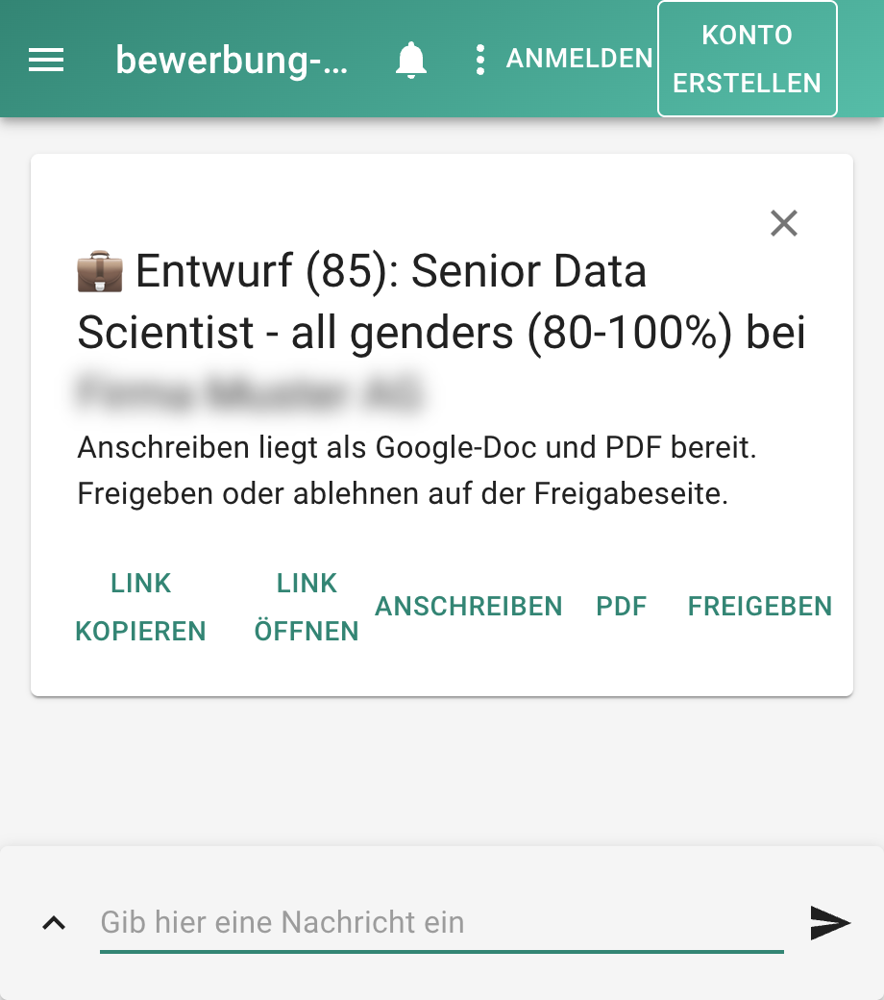
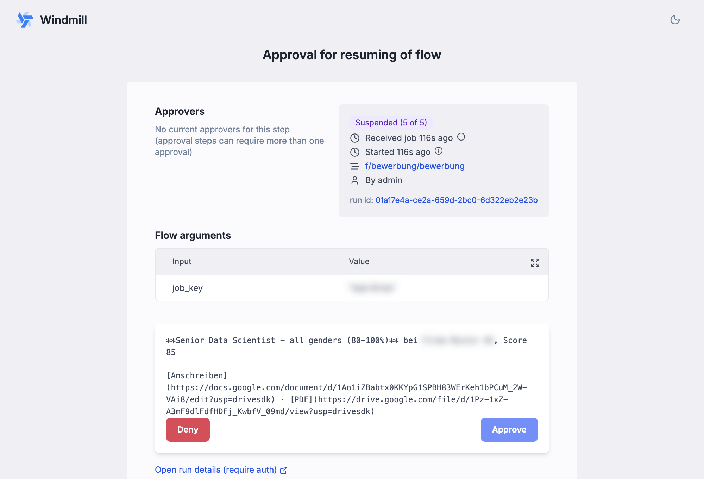

**Stand:** Oktober 2026 · **Autor:** Thomas Ebermann · **Lesedauer:** ca. 8 Minuten

<!-- serie:start -->
> **Serie „Agenten 2026“** · Teil 1: Bewerbungs-Agenten mit festem Ablauf, fünfmal derselbe Agent
>
> - Klicken: [Wie weit kommt man mit Klicken? (n8n)](/blog/2026-09-29-bewerbungs-agent-n8n/) · [Klicken, aber womit? (n8n gegen Activepieces)](/blog/2026-10-06-n8n-vs-activepieces/)
> - Code mit Plattform: **Was bringt echter Code? (Windmill)** ← du bist hier · [Braucht es einen Orchestrierer? (Kestra)](/blog/2026-10-20-bewerbungs-agent-kestra/)
> - Code ohne Plattform: [Braucht es überhaupt eine Plattform? (DBOS)](/blog/2026-10-27-bewerbungs-agent-dbos/)
> - Teil 2: Agenten, die selbst planen (folgt)
<!-- serie:end -->

In den ersten beiden Beiträgen dieser Serie habe ich meinen Bewerbungs-Agenten mit Werkzeugen gebaut, die zum Zusammenklicken gedacht sind, erst [mit n8n](/blog/2026-09-29-bewerbungs-agent-n8n/) und dann [im Vergleich mit Activepieces](/blog/2026-10-06-n8n-vs-activepieces/). Ehrlich gesagt habe ich dabei aber gar nichts zusammengeklickt: Claude hat die Workflows als Code geschrieben und eingespielt, und ich habe von Hand praktisch nichts mehr gemacht. Das ist irgendwie paradox, denn wozu brauche ich einen Baukasten zum Klicken, wenn ohnehin ein Agent den Code erzeugt? Man kann sich ernsthaft fragen, ob sich das Zusammenklicken von Workflows damit nicht überholt hat.

Ich glaube trotzdem nicht, dass die visuellen Werkzeuge damit überflüssig sind. Ihr grösster Vorteil liegt aus meiner Sicht woanders, nämlich in der Transparenz: Eine Kette aus Knoten, in der man jeden Schritt sieht und anklicken kann, verstehen auch Leute, die nie eine Zeile Code lesen würden, und genau das macht einen Prozess für das ganze Team nachvollziehbar.

Für mich als jemanden, der den Code ohnehin lesen will, stellt sich aber die umgekehrte Frage: Was passiert, wenn der Agent nicht Knoten, sondern **ganz normalen Python-Code** schreibt? Derselbe Agent – Newsletter lesen, Stellen gegen meinen Lebenslauf bewerten, ab 7 von 10 ein Anschreiben in meine Vorlage setzen, auf meine Freigabe warten – diesmal als Skripte, und die Plattform, die drumherum Zeitplan, Wiederholungen, Zwischenergebnisse und die Freigabe übernimmt, heisst **Windmill**.

## Die Idee: Code, aber mit Oberfläche

Wo liegt eigentlich der Unterschied zu n8n? In n8n ist der Workflow das eigentliche Produkt, und Code kommt nur ausnahmsweise vor, als kleiner Schnipsel in einem einzelnen Knoten. In Windmill ist es genau umgekehrt: Dort ist der Code das Produkt, und der Workflow dient nur noch dazu, die einzelnen Skripte miteinander zu verbinden.

Konkret heisst das, dass jeder Schritt ein eigenes Python-Skript mit einer `main`-Funktion ist. Die Skripte liegen als ganz normale Dateien in einem Ordner auf meinem Mac, landen in Git und werden über die Kommandozeile in Windmill eingespielt:

```bash
wmill generate-metadata --yes   # Abhängigkeiten aus den Imports auflösen
wmill sync push --yes           # alles in den Workspace schieben
```

Windmill ergänzt dann genau das, was ich in reinem Python mühsam selbst bauen müsste: einen Zeitplan, Wiederholungen bei Fehlern, eine Weboberfläche mit den Logs zu jedem Lauf und gespeicherte Zwischenergebnisse. Und, was ich besonders schön finde, eine eingebaute Freigabeseite, auf der ein Flow tagelang auf meine Entscheidung warten kann, ohne dass in der Zwischenzeit etwas läuft.

## Der Aufbau

Die Anleitung, nach der ich die ganze Serie baue, hatte die Windmill-Variante schon skizziert. Ich habe mich daran gehalten und nur übernommen, was ich in den anderen Varianten gelernt habe (Firecrawl für die Anzeigen, DeepSeek und Opus über OpenRouter, meine Google-Docs-Vorlage).

| Teil | Was es tut |
| --- | --- |
| `config`, `gmail`, `posting`, `llm`, `notify` | Module, die von den anderen Skripten importiert werden: Zugangsdaten, Gmail (nur lesend), Firecrawl, Modellaufrufe, Push |
| `scan` | Liest neue Newsletter, zieht die Stellen heraus, legt neue in einer Datentabelle an und startet pro Stelle einen Flow |
| Flow `bewerbung` | Fünf Schritte: bewerten → schreiben → Doc und PDF → Push und Freigabe → Abschluss |

So sieht der Flow in Windmill aus. Schön finde ich die kleinen Kästchen dazwischen: Windmill erkennt von selbst, welcher Schritt welche Spalten der Tabelle `bewerbungen` liest oder schreibt.


Und so sieht ein Schritt aus – kein Knoten mit Formularfeldern, sondern eine Datei, die ich genauso gut in meinem Editor öffnen könnte:


Die Module importieren sich gegenseitig wie in jedem Python-Projekt, mit `from .llm import score_match`. Welche Pakete ein Skript braucht, leitet Windmill aus den Imports ab und schreibt eine Lock-Datei daneben. Ich musste nirgends ein `requirements.txt` pflegen.

## Die drei Dinge, die Windmill mir abnimmt

### 1. Wiederholen und früh aufhören

Jeder Schritt kann bei einem Fehler wiederholen, bei mir dreimal mit zehn Sekunden Abstand. Das ist wichtig, weil DeepSeek als Reasoning-Modell gelegentlich so lange nachdenkt, dass die Antwort leer bleibt.

Noch eleganter finde ich den „Early Stop“. Dazu muss man wissen, dass Windmill die Schritte eines Flows mit Buchstaben benennt: Bei mir ist **a** das Bewerten, **b** das Schreiben des Anschreibens, **c** das Google-Doc mit PDF, **d** der Push mit der Freigabe und **e** der Abschluss. Der Schritt a gibt als Ergebnis unter anderem den Score zurück und ein Feld `passed`, das nur dann wahr ist, wenn die Stelle mindestens 70 Punkte hat und kein K.-o.-Kriterium greift.

In der Flow-Definition steht beim Schritt a dann eine einzige zusätzliche Zeile:

```yaml
stop_after_if:
  expr: '!result.passed'   # "wenn die Stelle NICHT passt"
```

Windmill wertet diesen kleinen Ausdruck direkt nach dem Schritt aus, `result` ist dabei das Ergebnis von a, und das Ausrufezeichen bedeutet „nicht“. Passt die Stelle also nicht, beendet Windmill den Flow an genau dieser Stelle und markiert ihn trotzdem als erfolgreich. Die Schritte b bis e werden gar nicht erst gestartet, und vor allem wird Opus nicht angefragt, was bei Dutzenden unpassenden Stellen pro Woche bares Geld spart. Ausprobiert habe ich das mit einer Stelle als Fachspezialist für Geoinformation, die bei mir verständlicherweise nur 10 Punkte bekam: Im Lauf war Schritt a grün, und die Schritte b bis e standen einfach als „nicht ausgeführt“ da.

### 2. Warten, ohne dass etwas läuft

Nach dem Push pausiert der Flow im Schritt d, und zwar bis zu 14 Tage lang. Während er wartet, läuft kein Prozess und es entstehen keine Kosten. Auf dem Handy bekomme ich in dieser Zeit eine Push-Nachricht über ntfy, die so aussieht:



Mit „Anschreiben“ und „PDF“ öffne ich den Entwurf als Google-Doc beziehungsweise als fertiges PDF, und „Freigeben“ führt auf die **Freigabeseite** von Windmill. Diese Seite erzeugt Windmill für jeden pausierten Flow automatisch, ich musste dafür nichts bauen. Sie zeigt, welcher Flow wartet, mit welchen Eingaben er gestartet wurde, und den kurzen Text, den mein Schritt d mitgibt, hier also Stelle, Score und die Links zu den Dokumenten:



Ein Klick auf „Approve“, und der Flow macht weiter und setzt im Schritt e den Status auf `freigegeben`, mit „Deny“ entsprechend auf `abgelehnt`. Einen Haken hat das Ganze bei mir: Weil Windmill lokal läuft, zeigt der Link auf `localhost`, und die Freigabe funktioniert deshalb nur am Mac. Auf einem Server mit richtiger Adresse ginge das auch unterwegs am Handy.


Diese 2 Minuten 47 sind übrigens fast komplett meine eigene Reaktionszeit. Die eigentliche Arbeit ging schnell: Bewerten 9,9 Sekunden, Anschreiben 21,9 Sekunden, Doc und PDF 9 Sekunden, Push 0,6 Sekunden, Abschluss 0,2 Sekunden.

### 3. Mehrere Sprachen in einem Flow

Den Schritt, der den Brief in meine Google-Docs-Vorlage setzt, habe ich nicht in Python geschrieben, sondern in TypeScript. Der Grund: Die Logik dafür existierte schon als JavaScript-Datei, die auch n8n und Activepieces nutzen. Windmill führt den Schritt einfach mit Bun aus, mitten zwischen den Python-Schritten. Drei Werkzeuge, ein und derselbe Code für die Briefe – das gefällt mir.

## Wo es weh tat

Ganz reibungslos lief es natürlich nicht :)

- **Die Images sind riesig.** Das Windmill-Image ist rund 6 GB gross, und der optionale Zusatzdienst für die Code-Vervollständigung im Editor bringt noch einmal 8 GB mit. Den habe ich weggelassen, weil ich die Skripte ohnehin nicht im Browser schreibe.
- **Datentabellen muss man erst einschalten.** Die Anleitung war unsicher, ob es die eingebauten Datentabellen in der Community Edition überhaupt gibt. Es gibt sie, aber erst nachdem man eine Datenbank dafür angelegt und im Workspace eingetragen hat. Danach ist es wunderbar: `wmill.datatable().query(...)` direkt im Skript.

Und eine nette Überraschung am Rande: Beim Einrichten des Projekts hat die Windmill-Kommandozeile gleich Anleitungen für KI-Coding-Agenten mit angelegt, eine Datei `AGENTS.md` und 31 sogenannte Skills, also Anleitungen für einzelne Aufgaben wie „Python-Skript schreiben“, „Flow bauen“ oder „Zeitplan anlegen“. So beginnt die Datei:

```markdown
# Windmill CLI Agent Instructions

You are a helpful assistant that can help with Windmill scripts, flows, apps,
and resources management.

## Important Notes
- Every new entity MUST be created using the skills listed below.
- Every modification of an entity MUST be done using the skills listed below.

## Flow Writing Guide

You MUST use the `write-flow` skill to create or modify flows.
When a new flow needs to be created, YOU run `wmill flow new <path>` yourself …
```

Windmill rechnet also schon fest damit, dass nicht ein Mensch, sondern ein Agent die Skripte und Flows schreibt, und gibt ihm gleich die Spielregeln mit. Genau so habe ich es auch gemacht.

## Windmill oder n8n?

| | n8n / Activepieces | Windmill |
| --- | --- | --- |
| Die Logik steckt in | Knoten und Formularfeldern | Python- oder TypeScript-Dateien |
| Versionskontrolle | Export als JSON | Dateien in Git, `wmill sync` |
| Testen | im Editor, Knoten für Knoten | jedes Skript einzeln mit Eingaben, auch lokal |
| Google und Co. | n8n: eigener OAuth-Client, Activepieces: ein Klick | eigener OAuth-Client (ich habe den von n8n wiederverwendet) |
| Warten auf Freigabe | Telegram/ntfy oder Approval-Piece | eingebaute Freigabeseite |
| Lokal betreiben | 1 bzw. 4 Container | 5 Container, ~6 GB Image |
| Kosten pro Monat | gleich: nur die Tokens und Firecrawl | gleich |

Ich persönlich finde: Sobald du Python schreiben kannst und der Agent mehr als eine Spielerei ist, fühlt sich Windmill richtiger an. Die Prompts liegen in Dateien, jede Änderung ist ein Diff, und ich kann einen einzelnen Schritt mit echten Eingaben testen, ohne den ganzen Flow anzuwerfen. Der Preis ist eine schwerere Installation und etwas mehr Einarbeitung.

Wenn du dagegen nie Code anfassen willst, bleibt n8n oder Activepieces die bessere Wahl, und das gilt auch dann, wenn ein Prozess für Leute ohne technischen Hintergrund nachvollziehbar sein soll: Eine Kette aus Knoten versteht man auf einen Blick, eine Sammlung von Python-Dateien nicht.

## Was kommt als Nächstes?

Windmill macht aus Klicks Code, aber der Ablauf selbst bleibt eine Kette von Skripten. Im nächsten Beitrag geht es noch einen Schritt weiter: Mit **Kestra** wird der ganze Ablauf deklarativ in YAML beschrieben, und jeder Schritt läuft in seinem eigenen Container – eine Ebene mehr Infrastruktur, aber auch eine Ebene mehr Kontrolle. Danach kommt der reine Code ohne Plattform, und dann wechseln wir die Seite und lassen den Agenten selbst planen.

<!-- serie:next -->
**Weiter in der Serie:** [Braucht es einen Orchestrierer? Der Bewerbungs-Agent mit Kestra](/blog/2026-10-20-bewerbungs-agent-kestra/)
<!-- serie:next-end -->

Ich freue mich auf eure Kommentare und Anregungen!
