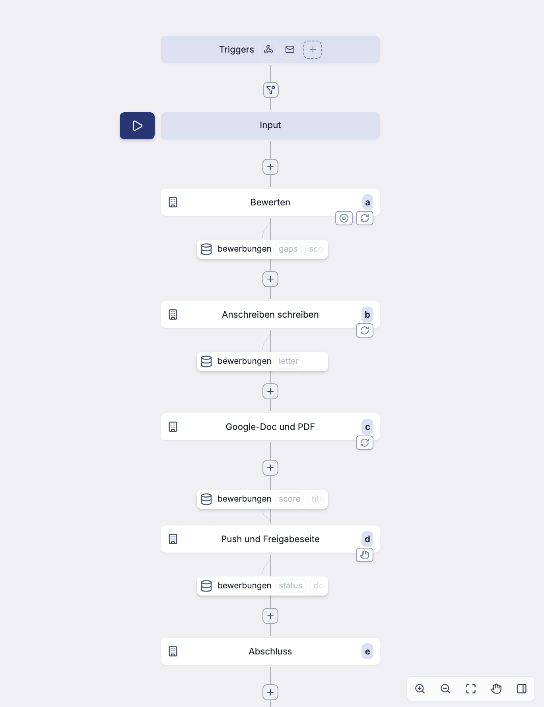
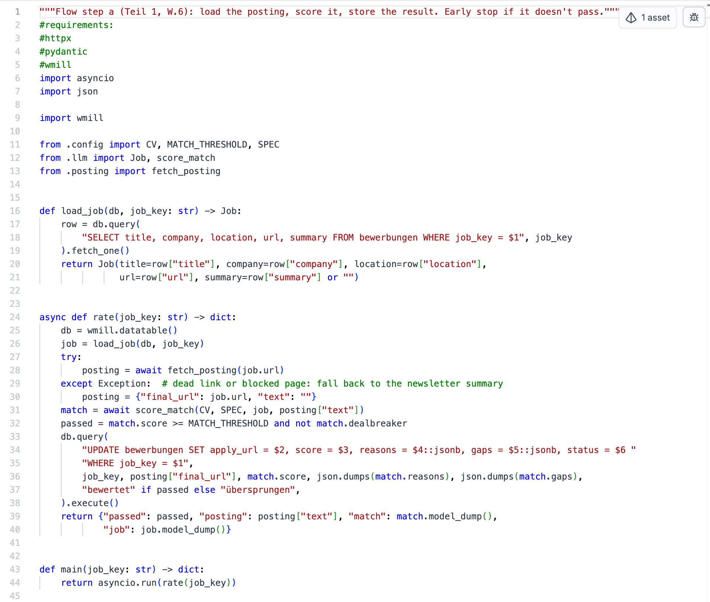
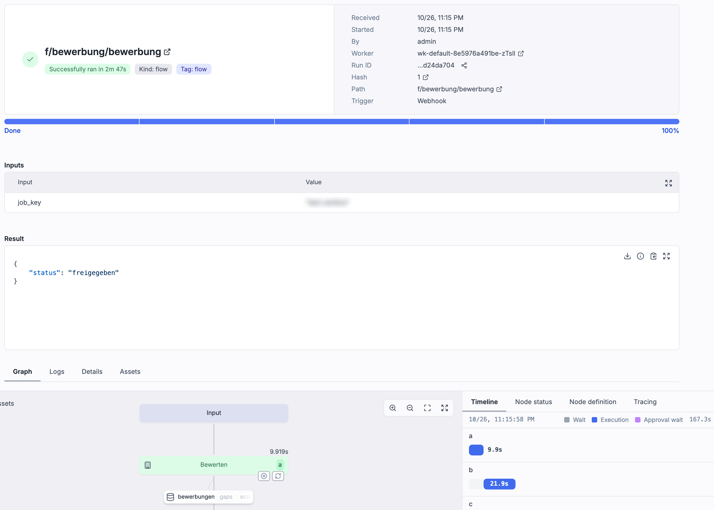

**Stand:** Oktober 2026 · **Autor:** Thomas Ebermann · **Lesedauer:** ca. 6 Minuten

<!-- serie:start -->
> **Serie „Agenten 2026“** · Teil 1: Bewerbungs-Agenten mit festem Ablauf, fünfmal derselbe Agent
>
> - Klicken: [Wie weit kommt man mit Klicken? (n8n)](/blog/2026-09-29-bewerbungs-agent-n8n/) · [Klicken, aber womit? (n8n gegen Activepieces)](/blog/2026-10-06-n8n-vs-activepieces/)
> - Code mit Plattform: **Was bringt echter Code? (Windmill)** ← du bist hier · [Braucht es einen Orchestrierer? (Kestra)](/blog/2026-10-20-bewerbungs-agent-kestra/)
> - Code ohne Plattform: [Braucht es überhaupt eine Plattform? (DBOS)](/blog/2026-10-27-bewerbungs-agent-dbos/)
> - Teil 2: Agenten, die selbst planen (folgt)
<!-- serie:end -->

Bisher habe ich in dieser Serie meinen Bewerbungs-Agenten zusammengeklickt – erst [mit n8n](/blog/2026-09-29-bewerbungs-agent-n8n/), dann [im Vergleich mit Activepieces](/blog/2026-10-06-n8n-vs-activepieces/). Beide Male bestand der Agent aus Knoten im Browser, in denen hier und da ein Code-Schnipsel steckte. Das funktioniert, aber irgendwann stört mich genau das: Die Logik verteilt sich auf Dutzende Einstellungsfelder, und eine Änderung am Prompt lässt sich weder sauber vergleichen noch testen.

Heute drehe ich das um. Derselbe Agent – Newsletter lesen, Stellen gegen meinen Lebenslauf bewerten, ab 7 von 10 ein Anschreiben in meine Vorlage setzen, auf meine Freigabe warten – diesmal als **ganz normaler Python-Code**. Und die Plattform, die drumherum Zeitplan, Wiederholungen, Zwischenergebnisse und die Freigabe übernimmt, heisst **Windmill**.

## Die Idee: Code, aber mit Oberfläche

Wo liegt eigentlich der Unterschied zu n8n? Die kurze Antwort: In n8n ist der Workflow das Produkt, und Code ist die Ausnahme. In Windmill ist der Code das Produkt, und der Workflow verbindet nur noch die Skripte.

Konkret heisst das: Jeder Schritt ist ein eigenes Python-Skript mit einer `main`-Funktion. Die Skripte liegen als Dateien in einem Ordner auf meinem Mac, landen in Git und werden per Kommandozeile eingespielt:

```bash
wmill generate-metadata --yes   # Abhängigkeiten aus den Imports auflösen
wmill sync push --yes           # alles in den Workspace schieben
```

Windmill ergänzt dann genau das, was ich in reinem Python mühsam selbst bauen müsste: einen Zeitplan, Wiederholungen bei Fehlern, eine Weboberfläche mit Logs zu jedem Lauf, gespeicherte Zwischenergebnisse und – das ist das Schöne – eine eingebaute Freigabeseite, auf der ein Flow tagelang auf mich warten kann.

## Der Aufbau

Die Anleitung, nach der ich die ganze Serie baue, hatte die Windmill-Variante schon skizziert. Ich habe mich daran gehalten und nur übernommen, was ich in den anderen Varianten gelernt habe (Firecrawl für die Anzeigen, DeepSeek und Opus über OpenRouter, meine Google-Docs-Vorlage).

| Teil | Was es tut |
| --- | --- |
| `config`, `gmail`, `posting`, `llm`, `notify` | Module, die von den anderen Skripten importiert werden: Zugangsdaten, Gmail (nur lesend), Firecrawl, Modellaufrufe, Push |
| `scan` | Liest neue Newsletter, zieht die Stellen heraus, legt neue in einer Datentabelle an und startet pro Stelle einen Flow |
| Flow `bewerbung` | Fünf Schritte: bewerten → schreiben → Doc und PDF → Push und Freigabe → Abschluss |

So sieht der Flow in Windmill aus. Schön finde ich die kleinen Kästchen dazwischen: Windmill erkennt von selbst, welcher Schritt welche Spalten der Tabelle `bewerbungen` liest oder schreibt.



Und so sieht ein Schritt aus – kein Knoten mit Formularfeldern, sondern eine Datei, die ich genauso gut in meinem Editor öffnen könnte:



Die Module importieren sich gegenseitig wie in jedem Python-Projekt, mit `from .llm import score_match`. Welche Pakete ein Skript braucht, leitet Windmill aus den Imports ab und schreibt eine Lock-Datei daneben. Ich musste nirgends ein `requirements.txt` pflegen.

## Die drei Dinge, die Windmill mir abnimmt

### 1. Wiederholen und früh aufhören

Jeder Schritt kann bei einem Fehler wiederholen, bei mir dreimal mit zehn Sekunden Abstand. Das ist wichtig, weil DeepSeek als Reasoning-Modell gelegentlich so lange nachdenkt, dass die Antwort leer bleibt.

Noch eleganter ist der „Early Stop“: Nach dem Bewerten steht in der Flow-Definition eine einzige Zeile, `stop_after_if: "!result.passed"`. Passt die Stelle nicht, endet der Flow dort, ohne dass Opus überhaupt angefragt wird. Bei meinem Test mit einer Stelle in der Geoinformation (Score 10) liefen die Schritte b bis e schlicht nicht.

### 2. Warten, ohne dass etwas läuft

Nach dem Push „pausiert“ der Flow im Schritt d – bis zu 14 Tage lang. Während er wartet, läuft kein Prozess und nichts kostet. Ich bekomme eine Push-Nachricht mit drei Links: das Anschreiben als Google-Doc, das PDF und die **Freigabeseite** von Windmill. Ein Klick auf „Freigeben“, und der Flow macht weiter und setzt den Status auf `freigegeben`.



Diese 2 Minuten 47 sind übrigens fast komplett meine eigene Reaktionszeit. Die eigentliche Arbeit ging schnell: Bewerten 9,9 Sekunden, Anschreiben 21,9 Sekunden, Doc und PDF 9 Sekunden, Push 0,6 Sekunden, Abschluss 0,2 Sekunden.

### 3. Mehrere Sprachen in einem Flow

Den Schritt, der den Brief in meine Google-Docs-Vorlage setzt, habe ich nicht in Python geschrieben, sondern in TypeScript. Der Grund: Die Logik dafür existierte schon als JavaScript-Datei, die auch n8n und Activepieces nutzen. Windmill führt den Schritt einfach mit Bun aus, mitten zwischen den Python-Schritten. Drei Werkzeuge, ein und derselbe Code für die Briefe – das gefällt mir.

## Wo es weh tat

Ganz reibungslos lief es natürlich nicht :)

- **Die Images sind riesig.** Das Windmill-Image ist rund 6 GB gross, der optionale Zusatzdienst für die Code-Vervollständigung im Editor weitere 8 GB. Weil die offizielle Compose-Datei bei jedem Start neu herunterlädt, lag ich zwischenzeitlich bei 4 GB freiem Speicher auf dem Mac. Die Lösung: Zusatzdienst raus, Download nur, wenn das Image fehlt.
- **Datentabellen muss man erst einschalten.** Die Anleitung war unsicher, ob es die eingebauten Datentabellen in der Community Edition überhaupt gibt. Es gibt sie, aber erst nachdem man eine Datenbank dafür angelegt und im Workspace eingetragen hat. Danach ist es wunderbar: `wmill.datatable().query(...)` direkt im Skript.
- **Die Freigabeseite hat kein Formular.** Laut Doku kann ich das Anschreiben in Windmill Cloud und in der Enterprise Edition direkt auf der Freigabeseite korrigieren, in der Community Edition nicht. Für mich egal, weil ich ohnehin im Google-Doc korrigiere.
- **Die Freigabeseite läuft auf `localhost`.** Am Handy öffne ich also Doc und PDF, freigeben kann ich nur am Mac. Für den Betrieb auf einem Server müsste die Seite hinter eine richtige Adresse.
- **Kleinkram bei der Kommandozeile.** Die Konfiguration erwartete Flows in Ordnern namens `name__flow` statt `name.flow`, und damit die Links zur Freigabeseite stimmen, muss die Basis-URL der Instanz gesetzt sein.

Und eine nette Überraschung am Rande: Beim Einrichten des Projekts hat die Windmill-Kommandozeile gleich Anleitungen für KI-Coding-Agenten mit angelegt. Windmill rechnet also schon damit, dass nicht ein Mensch, sondern ein Agent die Skripte schreibt. Genau so habe ich es gemacht.

## Windmill oder n8n?

| | n8n / Activepieces | Windmill |
| --- | --- | --- |
| Die Logik steckt in | Knoten und Formularfeldern | Python- oder TypeScript-Dateien |
| Versionskontrolle | Export als JSON | Dateien in Git, `wmill sync` |
| Testen | im Editor, Knoten für Knoten | jedes Skript einzeln mit Eingaben, auch lokal |
| Google und Co. | n8n: eigener OAuth-Client, Activepieces: ein Klick | eigener OAuth-Client (ich habe den von n8n wiederverwendet) |
| Warten auf Freigabe | Telegram/ntfy oder Approval-Piece | eingebaute Freigabeseite |
| Lokal betreiben | 1 bzw. 4 Container | 5 Container, ~6 GB Image |
| Kosten pro Monat | gleich: nur die Tokens und Firecrawl | gleich |

Ich persönlich finde: Sobald du Python schreiben kannst und der Agent mehr als eine Spielerei ist, fühlt sich Windmill richtiger an. Die Prompts liegen in Dateien, jede Änderung ist ein Diff, und ich kann einen einzelnen Schritt mit echten Eingaben testen, ohne den ganzen Flow anzuwerfen. Der Preis ist eine schwerere Installation und etwas mehr Einarbeitung.

Wenn du dagegen nie Code anfassen willst, bleibt n8n oder Activepieces die bessere Wahl. Das ist keine Schwäche, sondern eine andere Zielgruppe.

## Was kommt als Nächstes?

Windmill macht aus Klicks Code, aber der Ablauf selbst bleibt eine Kette von Skripten. Im nächsten Beitrag geht es noch einen Schritt weiter: Mit **Kestra** wird der ganze Ablauf deklarativ in YAML beschrieben, und jeder Schritt läuft in seinem eigenen Container – eine Ebene mehr Infrastruktur, aber auch eine Ebene mehr Kontrolle. Danach kommt der reine Code ohne Plattform, und dann wechseln wir die Seite und lassen den Agenten selbst planen.

<!-- serie:next -->
**Weiter in der Serie:** [Braucht es einen Orchestrierer? Der Bewerbungs-Agent mit Kestra](/blog/2026-10-20-bewerbungs-agent-kestra/)
<!-- serie:next-end -->

Ich freue mich auf eure Kommentare und Anregungen!
