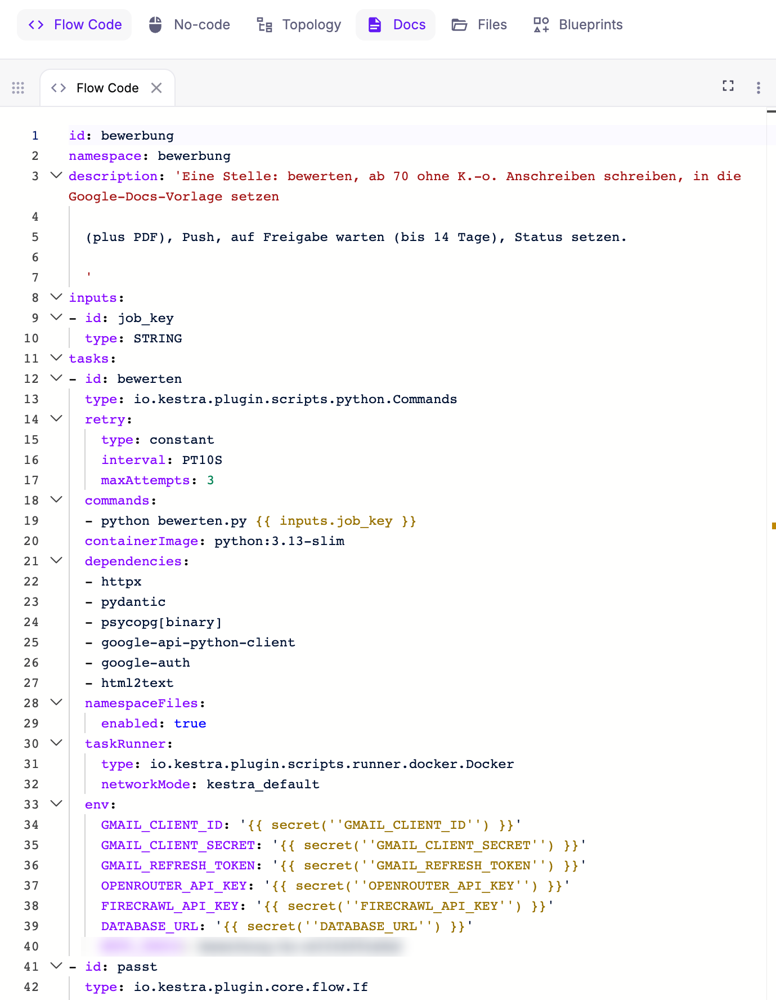
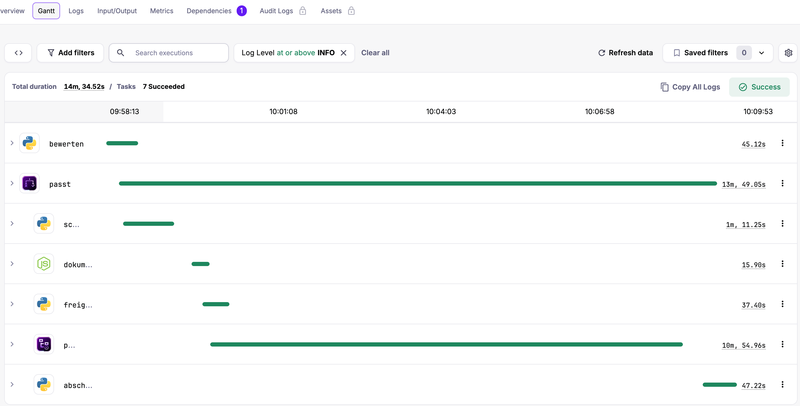

**Stand:** Oktober 2026 · **Autor:** Thomas Ebermann · **Lesedauer:** ca. 8 Minuten

<!-- serie:start -->
> **Serie „Agenten 2026“** · Teil 1: Bewerbungs-Agenten mit festem Ablauf, fünfmal derselbe Agent
>
> - Klicken: [Wie weit kommt man mit Klicken? (n8n)](/blog/2026-09-29-bewerbungs-agent-n8n/) · [Klicken, aber womit? (n8n gegen Activepieces)](/blog/2026-10-06-n8n-vs-activepieces/)
> - Code mit Plattform: [Was bringt echter Code? (Windmill)](/blog/2026-10-13-bewerbungs-agent-windmill/) · **Braucht es einen Orchestrierer? (Kestra)** ← du bist hier
> - Code ohne Plattform: [Braucht es überhaupt eine Plattform? (DBOS)](/blog/2026-10-27-bewerbungs-agent-dbos/)
> - Teil 2: [Agenten, die selbst planen](/blog/2026-10-28-bewerbungs-agent-geplante-aufgabe/)
<!-- serie:end -->

Im [letzten Beitrag](/blog/2026-10-13-bewerbungs-agent-windmill/) habe ich meinen Bewerbungs-Agenten von Klicks auf Code umgestellt: Windmill, normale Python-Skripte, und die Plattform kümmert sich um Zeitplan, Wiederholungen und Freigabe. Heute setze ich noch eine Ebene drauf. Mit **Kestra** beschreibe ich nicht mehr nur die einzelnen Schritte als Code, sondern den ganzen Ablauf deklarativ in YAML – und jeder Schritt läuft in seinem eigenen Container.

Klingt nach Overkill für einen Agenten, der ein paar Newsletter liest? Ein bisschen schon :) Aber genau an so einem überschaubaren Beispiel sieht man gut, was ein Orchestrierer wie Kestra anders macht, und was das kostet.

## Was ist anders als bei Windmill?

Lass mich die Idee an einem Bild erklären. Windmill ist wie eine Werkstatt, in der wir alle in einer gemeinsamen Umgebung arbeiten: Die Worker teilen sich Python und alle Pakete, und der Flow ruft die Skripte einfach nacheinander auf. Kestra arbeitet dagegen komplett mit Containern. Für jeden Arbeitsschritt wird ein eigener Container hingestellt, mit genau dem Werkzeug, das dieser Schritt braucht, und nach getaner Arbeit wieder abgeräumt.

Wer schon mit [Vertex AI Pipelines](https://cloud.google.com/vertex-ai/docs/pipelines/introduction) von Google gearbeitet hat, kennt dieses Prinzip, und genau daher kenne ich es auch aus meiner Arbeit: Dort läuft jede Komponente einer Pipeline ebenfalls in ihrem eigenen Container, den Google im Hintergrund auf Kubernetes-Infrastruktur startet und danach wieder wegräumt. Kestra bringt diese Denkweise auf den eigenen Rechner, nur dass hier Docker die Container startet und nicht ein Cluster in der Cloud.

Daraus folgen drei Unterschiede:

- **Der Ablauf ist eine YAML-Datei.** Welche Schritte es gibt, in welcher Reihenfolge, mit welchen Wiederholungen, Bedingungen und Wartezeiten – das steht deklarativ in einer Datei. Die Python-Skripte enthalten nur noch die eigentliche Arbeit.
- **Jeder Schritt ist isoliert.** Python-Schritte laufen in `python:3.13-slim`, der Brief-Schritt in `node:22-slim`. Kein Schritt kann einem anderen die Pakete kaputtmachen.
- **Kestra ist für mehr gebaut als für meinen Agenten.** Hunderte Plugins, Ereignis-Auslöser, Dashboards, Revisionen jeder Flow-Version. Ein Orchestrierer für Datenpipelines, der meinen Agenten eben auch kann.

## Der Ablauf als YAML

Die Struktur ist dieselbe wie bei allen Varianten der Serie: Ein Flow `scan` liest die Newsletter und startet für jede neue Stelle einen Subflow `bewerbung`. Der bewertet die Stelle und entscheidet über ein `If`, ob es weitergeht. Ab 70 Punkten schreibt Opus das Anschreiben, ein Node-Schritt setzt es in meine Google-Docs-Vorlage, ich bekomme eine Push-Nachricht, und dann wartet eine `Pause` bis zu 14 Tage auf meine Entscheidung.

So sieht der Anfang des Flows aus:



Schau dir die Zeilen 20 bis 40 an: Für jeden Python-Schritt steht da, welches Container-Image er nutzt, welche Pakete er braucht, dass er die Dateien aus dem Namespace bekommt und welche Secrets als Umgebungsvariablen hineinkommen. Auch das kennt man aus Vertex-AI-Umgebungen, wo jede Komponente ihr Basis-Image und ihre Pakete mitbringt (bei Kubeflow Pipelines heisst das [`base_image` und `packages_to_install`](https://www.kubeflow.org/docs/components/pipelines/user-guides/components/lightweight-python-components/)). Das ist ehrlich und nachvollziehbar, aber auch viel Text für „führe `bewerten.py` aus“. Ich habe diese Einstellungen deshalb einmal zentral definiert und lasse sie beim Einspielen in jeden Schritt einsetzen.

Die Freigabe ist in Kestra besonders schön gelöst. Nach dem Push-Schritt kommt eine `Pause`: Die Ausführung bleibt an dieser Stelle stehen und wartet, bis jemand sie fortsetzt und dabei eine Frage beantwortet. In YAML sieht das so aus:

```yaml
- id: pause
  type: io.kestra.plugin.core.flow.Pause
  pauseDuration: P14D
  behavior: CANCEL          # nach 14 Tagen ohne Antwort: abbrechen
  onResume:
    - id: entscheidung
      type: SELECT
      values: [freigeben, ablehnen]
```

Beantwortet wird die Frage allerdings nicht in der Push-Nachricht selbst, sondern in Kestra. Die Nachricht auf meinem Handy enthält drei Links: das Anschreiben als Google-Doc, das PDF und einen Link „Freigeben“, der direkt die pausierte Ausführung in Kestra öffnet. Dort klicke ich auf „Resume“, Kestra fragt mich nach der Entscheidung, und ich wähle genau eine der beiden Optionen. Der nächste Schritt liest die Antwort dann mit `{{ outputs.pause.onResume.entscheidung }}` und setzt den Status auf „freigegeben“ oder „abgelehnt“. Weil Kestra bei mir lokal läuft, funktioniert dieser letzte Link allerdings nur am Mac und nicht unterwegs auf dem Handy.

## Was der Container-Ansatz kostet

Jetzt wird es spannend. Hier ist ein kompletter Lauf für eine Stelle, die 84 Punkte bekam, im Gantt-Diagramm von Kestra:



Die lange Bahn ist die Pause, also meine Bedenkzeit. Interessant sind die anderen Zahlen, und zum Vergleich daneben dieselbe Stelle in Windmill:

| Schritt | Kestra | Windmill |
| --- | --- | --- |
| Bewerten (Firecrawl + DeepSeek) | 45,1 s | 9,9 s |
| Anschreiben (Opus) | 71,3 s | 21,9 s |
| Google-Doc und PDF | 15,9 s | 9,0 s |
| Push | 37,4 s | 0,6 s |
| Abschluss (eine SQL-Zeile) | 47,2 s | 0,2 s |

Was ist da passiert, fragst du dich vielleicht? Der Abschluss macht nichts anderes, als eine Zeile in der Datenbank zu ändern. In Windmill dauert das 0,2 Sekunden, in Kestra 47. Der Grund: Kestra startet für jeden Schritt einen neuen Container, installiert darin die Python-Pakete und räumt danach wieder auf. Bei meinem Agenten sind das pro Schritt 30 bis 40 Sekunden Overhead.

Ist das schlimm? Für meinen Agenten, der einmal am Tag läuft und danach sowieso stunden- oder tagelang auf meine Freigabe wartet, ehrlich gesagt nicht: Ob ein Entwurf nach einer oder nach vier Minuten fertig ist, merke ich gar nicht, weil ich ihn ohnehin erst lese, wenn ich Zeit dafür habe. Ganz anders sieht es bei einer Pipeline mit tausend kurzen Schritten aus, denn dort würden sich 30 bis 40 Sekunden pro Schritt zu Stunden aufsummieren. In so einem Fall würdest du in Kestra eher wenige, grössere Schritte bauen, die mehr Arbeit am Stück erledigen, oder einen anderen Task-Runner wählen, der ohne frischen Container auskommt. Die Isolation hat ihren Preis, und an diesem Beispiel sieht man ihn sehr deutlich.

## Wo es weh tat

Kestra war von allen bisherigen Werkzeugen das, bei dem ich am meisten gestolpert bin. Ein Teil davon geht auf das Konto der ganz frischen Version 2.0:

- **Wo sind die Ergebnisse der Schritte?** Das hat mich am meisten Zeit gekostet. Jeder Schritt gibt Ergebnisse weiter, etwa den Score oder die Links zum Google-Doc, und der nächste Schritt konnte sie auch problemlos verwenden. In der API-Antwort einer Ausführung tauchten sie aber nirgends auf, und ich dachte zuerst, meine Skripte würden gar nichts zurückgeben. Erst später habe ich verstanden, dass Kestra 2.0 die Ergebnisse bewusst aus dieser Antwort herausgenommen hat, damit die Listen schneller laden, und sie jetzt über einen eigenen Endpunkt ausliefert (`/outputs/tasks/{Ausführung}`, beschrieben im [Migrationsleitfaden](https://kestra.io/docs/migration-guide/v2.0.0/execution-api-response)). Dort ist alles vorhanden, vom Score 84 bis zur Entscheidung „freigeben“ aus der Pause, und in der Oberfläche sind die Ergebnisse laut Leitfaden ohnehin weiterhin zu sehen. Das Debugging ist also nicht schwieriger geworden, man muss nur wissen, wo man suchen muss. Meine Skripte schreiben ihre Ergebnisse trotzdem zusätzlich lesbar ins Log, weil ich sie dort am schnellsten finde.
- **Das Standard-Image ist 9 GB gross.** Es bringt alle rund tausend Plugins mit, und auf meinem Mac war der Speicher danach wieder fast voll. Die Lösung war das schlanke Image ohne Plugins, in das ich nur die zwei installiere, die ich brauche (Python und Node). Ergebnis: 769 MB.
- **Version 2.0 hat einiges umgebaut.** `ForEach` heisst jetzt `Loop`, der Eingabetyp `BOOLEAN` heisst `BOOL`, und gemeinsame Einstellungen pro Flow (`pluginDefaults`) gibt es nicht mehr. Wer Beispiele aus dem Netz kopiert, landet deshalb schnell bei Fehlermeldungen.
- **Deine Dateien sieht Kestra nicht direkt.** Weil jeder Schritt in einem frischen Container läuft, kommen Lebenslauf, Regeln und Profil als „Namespace-Dateien“ in Kestra, und ein kleines Skript lädt sie bei jeder Änderung hoch.
- **Secrets kommen in der Open-Source-Version als Umgebungsvariablen**, Base64-kodiert mit dem Präfix `SECRET_`. Das funktioniert, bietet aber laut [Kestra-Doku](https://kestra.io/docs/concepts/secret) weder Verschlüsselung im Ruhezustand noch ein Protokoll, wer wann darauf zugegriffen hat, noch eine Zugriffskontrolle. In der Enterprise-Version gibt es dafür einen richtigen Secrets-Manager, entweder Kestras eigenen oder angebunden an AWS Secrets Manager, Azure Key Vault oder HashiCorp Vault, und die Secrets lassen sich pro Namespace verwalten.

Was mir dagegen richtig gut gefallen hat: das Gantt-Diagramm, die Logs pro Schritt, die Versionsgeschichte jedes Flows und die Dokumentation direkt neben dem Code-Editor. Man merkt, dass Kestra für Teams gebaut ist, die viele Abläufe parallel betreiben.

## Windmill oder Kestra?

| | Windmill | Kestra |
| --- | --- | --- |
| Der Ablauf ist | ein Flow, der Skripte verbindet | eine YAML-Datei, die alles beschreibt |
| Ein Schritt läuft | im gemeinsamen Worker | in einem eigenen Container |
| Overhead pro Schritt | unter einer Sekunde | 30 bis 40 Sekunden |
| Freigabe | Freigabeseite | Pause mit Auswahl beim Fortsetzen |
| Tracker | eingebaute Datentabellen | eigene Datenbank (bei mir Postgres) |
| Image lokal | ~6 GB | 9 GB, schlank gebaut 769 MB |
| Lizenz | AGPLv3 (Community Edition) | Apache 2.0 |
| Stärke | Code schreiben und schnell ausprobieren | viele, verschiedene Abläufe sauber betreiben |

Für meinen Bewerbungs-Agenten würde ich klar Windmill nehmen. Er ist schneller, schlanker, und ich komme schneller von der Idee zum laufenden Schritt. Kestra spielt seine Stärken dort aus, wo ein Team Dutzende Abläufe in verschiedenen Sprachen betreibt, die sich nicht gegenseitig stören dürfen, und wo jeder Ablauf als Datei in einem Review landen soll. Für einen Ein-Personen-Agenten ist das mehr Werkzeug als nötig, aber ich wollte genau sehen, wie sich diese eine Ebene mehr anfühlt.

## Open Source oder Enterprise?

Ich habe alles mit der kostenlosen Open-Source-Version gebaut, und für einen Ein-Personen-Agenten fehlt mir dort nichts. Trotzdem lohnt sich ein kurzer Blick darauf, was die bezahlte Enterprise-Version zusätzlich bringt, denn genau dort zeigt sich, für wen Kestra eigentlich gebaut ist ([Vergleich von Kestra](https://kestra.io/docs/oss-vs-paid)):

| | Open Source | Enterprise |
| --- | --- | --- |
| Anmeldung | ein gemeinsames Basic-Auth-Konto für alle | eigene Konten, SSO, Rollen und Rechte (RBAC) |
| Secrets | Umgebungsvariablen | Secrets-Manager (eigener, AWS, Azure, Vault), pro Namespace |
| Wo die Schritte laufen | lokal als Prozess oder im Docker-Container | zusätzlich auf Kubernetes, AWS Batch, Azure Batch oder Google Cloud Run, mit Worker-Gruppen |
| Mandanten | eine Umgebung | mehrere vollständig getrennte Umgebungen |
| Nachvollziehbarkeit | – | Audit-Log jeder Aktion, Richtlinien, erlaubte Plugins |
| Extras | – | Apps, eigene Vorlagen, Unit-Tests für Flows, Wartungsmodus |
| Support | Community | mit garantierten Antwortzeiten |

Spannend finde ich vor allem die Zeile „Wo die Schritte laufen“: Mit der Enterprise-Version landet man genau bei dem Bild von oben, bei dem jeder Schritt als Container auf einem Kubernetes-Cluster oder in der Cloud läuft, so wie man es von Vertex AI kennt. Die Open-Source-Version reicht völlig, um Kestra kennenzulernen und kleine Abläufe zu betreiben. Sobald aber mehrere Leute mit eigenen Rechten daran arbeiten oder Secrets sauber verwaltet werden müssen, führt eigentlich kein Weg an der bezahlten Version vorbei.

## Was kommt als Nächstes?

Damit habe ich den festen Ablauf jetzt in vier Werkzeugen gebaut: n8n, Activepieces, Windmill und Kestra. Bleibt der letzte Schritt im ersten Teil der Serie: reiner Python-Code ohne Plattform, mit DBOS, der nach einem Absturz genau dort weitermacht, wo er aufgehört hat. Und danach wechseln wir endlich die Seite: Im zweiten Teil plant der Agent selbst, was er als Nächstes tut.

<!-- serie:next -->
**Weiter in der Serie:** [Braucht es überhaupt eine Plattform? Der Bewerbungs-Agent mit DBOS](/blog/2026-10-27-bewerbungs-agent-dbos/)
<!-- serie:next-end -->

Ich freue mich auf eure Kommentare und Anregungen!
