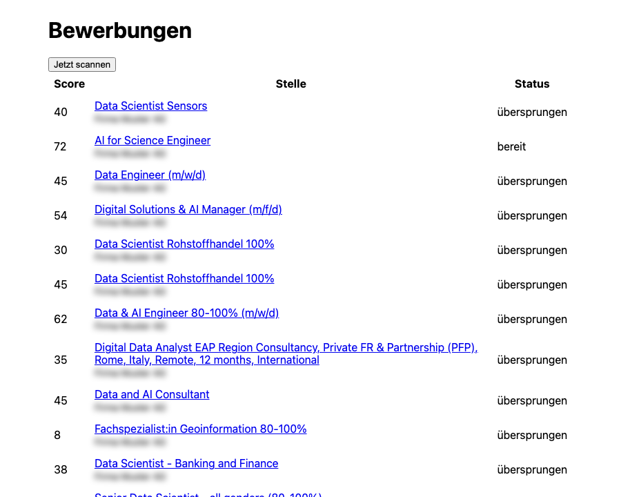
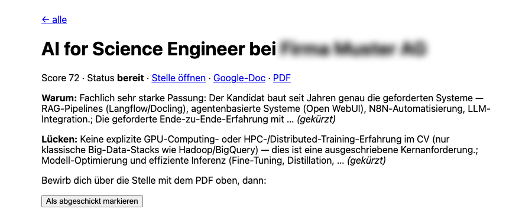

**Stand:** Oktober 2026 · **Autor:** Thomas Ebermann · **Lesedauer:** ca. 7 Minuten

<!-- serie:start -->
> **Serie „Agenten 2026“** · Teil 1: Bewerbungs-Agenten mit festem Ablauf, fünfmal derselbe Agent
>
> - Klicken: [Wie weit kommt man mit Klicken? (n8n)](/blog/2026-09-29-bewerbungs-agent-n8n/) · [Klicken, aber womit? (n8n gegen Activepieces)](/blog/2026-10-06-n8n-vs-activepieces/)
> - Code mit Plattform: [Was bringt echter Code? (Windmill)](/blog/2026-10-13-bewerbungs-agent-windmill/) · [Braucht es einen Orchestrierer? (Kestra)](/blog/2026-10-20-bewerbungs-agent-kestra/)
> - Code ohne Plattform: **Braucht es überhaupt eine Plattform? (DBOS)** ← du bist hier
> - Teil 2: Agenten, die selbst planen (folgt)
<!-- serie:end -->

In den letzten Beiträgen ging es Schritt für Schritt Richtung Code: [n8n](/blog/2026-09-29-bewerbungs-agent-n8n/) und Activepieces zum Klicken, [Windmill](/blog/2026-10-13-bewerbungs-agent-windmill/) mit Python-Skripten in einer Plattform, [Kestra](/blog/2026-10-20-bewerbungs-agent-kestra/) mit dem ganzen Ablauf als YAML und einem Container pro Schritt. Heute kommt der letzte Schritt im ersten Teil der Serie, und der ist eigentlich ein Schritt zurück: **keine Plattform mehr**. Kein Server, den ich installiere, keine Oberfläche, in die ich mich einlogge. Nur ein Python-Prozess und eine SQLite-Datei.

Klingt nach „dann schreib halt ein Skript mit einem Cronjob“? Fast :) Der Unterschied steckt in einer kleinen Bibliothek namens **DBOS**, und genau um die geht es heute.

## Was ist DBOS eigentlich?

DBOS macht aus normalen Python-Funktionen Abläufe, die einen Absturz überleben. Dafür speichert es das Ergebnis jeder Funktion in einer Datenbank, bevor es weitergeht, im Grunde so ähnlich wie das Save Game in einem Videospiel :) Startet der Prozess neu, macht DBOS beim letzten gespeicherten Schritt weiter, statt von vorne anzufangen.

Das Besondere: Dafür braucht es keinen eigenen Dienst. Windmill und Kestra sind Server mit Datenbank, Workern und Weboberfläche. DBOS ist ein `uv add dbos`, und die „Datenbank“ ist bei mir eine einzige Datei, `state/dbos.sqlite`.

## Wie sieht der Agent aus?

Der Ablauf ist derselbe wie in allen Varianten: Newsletter von jobs.ch und x28 lesen, jede Stelle mit Firecrawl laden und von DeepSeek gegen meinen Lebenslauf bewerten, ab 70 Punkten schreibt Opus das Anschreiben, das in meine Google-Docs-Vorlage samt Unterschrift kommt, und eine Push-Nachricht holt mich zur Freigabe.

Vieles musste ich gar nicht neu schreiben. Die Module für Gmail, Firecrawl, die Modellaufrufe und ntfy habe ich fast unverändert aus der [Kestra-Variante](/blog/2026-10-20-bewerbungs-agent-kestra/) kopiert, und für die Google-Docs-Vorlage läuft dieselbe JavaScript-Datei wie bei allen anderen Werkzeugen, hier einfach mit `node` aus Python aufgerufen. Insgesamt sind es rund 650 Zeilen.

Das Herzstück ist `flow.py`. Jede Funktion, die nach aussen spricht, also Gmail, Firecrawl, ein Modell, Google Docs oder ntfy, ist ein **Schritt** und bekommt den Dekorator `@DBOS.step()`. Dort lege ich auch fest, wie oft er es bei einem Fehler noch einmal versucht:

```python
@DBOS.step(retries_allowed=True, max_attempts=3, interval_seconds=10)
async def rate(job: dict, posting: str) -> dict:
    # DeepSeek bewertet die Stelle; das Ergebnis landet in SQLite
    return (await score_match(CV, SPEC, Job(**job), posting)).model_dump()
```

Die Schritte setze ich in einem **Workflow** zusammen, markiert mit `@DBOS.workflow()`. So sieht der Workflow für eine einzelne Stelle aus, leicht gekürzt:

```python
@DBOS.workflow()
async def application(job: dict) -> str:
    await DBOS.set_event_async("job", job)
    posting = await load_posting(job["url"])          # Schritt: Firecrawl
    match = await rate(job, posting["text"])          # Schritt: DeepSeek
    if match["score"] < MATCH_THRESHOLD or match["dealbreaker"]:
        await status("übersprungen")
        return "übersprungen"

    letter = await write(job, posting["text"], match)  # Schritt: Opus
    doc = await document(job, letter)                  # Schritt: Google Doc + PDF
    await push(...)                                    # Schritt: ntfy
    await status("prüfen")

    # Wartet bis zu 14 Tage auf meine Entscheidung. Währenddessen läuft nichts.
    msg = await DBOS.recv_async("review", timeout_seconds=14 * DAY)
    ...
```

Das ist ganz normales Python mit `if` und `return`, und genau das gefällt mir daran: Ich lese den Ablauf von oben nach unten wie jedes andere Programm, während DBOS im Hintergrund nach jedem Schritt das Ergebnis wegschreibt und bei einem Fehler die Wiederholungen übernimmt, zum Beispiel wenn DeepSeek mal eine leere Antwort liefert.

## Wer steuert hier eigentlich was?

Das war auch meine erste Frage: Wenn es keinen Server gibt, wer startet morgens um 7 den Scan? Ein Cronjob? Nein, DBOS bringt einen eigenen Zeitplaner mit, der im selben Prozess läuft wie alles andere:

```python
DBOS.apply_schedules([{
    "schedule_name": "daily-scan",
    "workflow_fn": daily_scan,
    "schedule": "0 7 * * *",
    "cron_timezone": "Europe/Zurich",
    "automatic_backfill": True,
}])
```

Der Zeitplan landet in der SQLite-Datei, und um 7 Uhr startet DBOS den Workflow `daily_scan`. Der startet pro Newsletter einen Workflow `process_mail`, und der wiederum pro Stelle einen Workflow `application`, also Abläufe, die weitere Abläufe starten, und alle mit gespeichertem Zustand.

Was passiert aber, wenn der Prozess gar nicht läuft? Dann passiert auch nichts, denn DBOS ist kein eigener Dienst, der irgendwo im Hintergrund wacht, sondern lebt in meinem Programm. Der Prozess muss deshalb wie jede andere Anwendung dauerhaft laufen: auf dem Server als Docker-Container mit `restart: unless-stopped`, auf dem Mac zum Beispiel als launchd-Dienst. Stürzt er ab und wird neu gestartet, schaut DBOS beim Start in der SQLite-Datei nach, welche Workflows noch offen sind, und macht bei jedem beim letzten gespeicherten Schritt weiter. Und war der Prozess genau um 7 Uhr nicht da, sorgt `automatic_backfill` dafür, dass der verpasste Scan direkt nach dem Neustart nachgeholt wird ([Doku zu geplanten Workflows](https://docs.dbos.dev/python/tutorials/scheduled-workflows)).

Und jetzt kommt mein Lieblingstrick. In allen anderen Varianten brauchte es eine Tabelle, die sich merkt, welche Mails und Stellen schon bearbeitet sind. Hier nicht: Jeder Workflow bekommt eine feste ID, `mail-<Gmail-ID>` pro Newsletter und `app-<Firma+Titel>` pro Stelle, und startet man einen Workflow mit einer ID, die es schon gibt, liefert DBOS einfach den vorhandenen zurück. Die Doppelprüfung ist damit gratis, und die Tabelle kannst du dir sparen.

Hat das funktioniert? Mein erster echter Scan fand in 5 Newslettern 11 neue Stellen, darunter eine, die ich vorher schon von Hand getestet hatte und die trotzdem nicht doppelt angelegt wurde. Als ich direkt danach ein zweites Mal gescannt habe, entstand ausser dem Scan selbst kein einziger neuer Workflow, und auf dem Handy kam auch keine zweite Push-Nachricht an. Einen Tracker im klassischen Sinn gibt es damit gar nicht mehr, denn der Status jeder Bewerbung *ist* ihr Workflow.

## Die Oberfläche baust du selbst

Was DBOS nicht mitbringt, ist eine Oberfläche. Windmill hat seine eingebaute Freigabeseite und Kestra seine Pause mit Auswahl beim Fortsetzen, hier dagegen gibt es erst einmal gar nichts. Es gäbe zwar mit „DBOS Conductor“ eine Cloud-Konsole, in der man Workflows anschauen und verwalten kann, die habe ich aber bewusst weggelassen, weil ich ja gerade ohne Plattform auskommen wollte.

Also habe ich die Prüfseite selbst geschrieben, beziehungsweise schreiben lassen: rund 170 Zeilen FastAPI mit schlichtem HTML, ganz ohne Frontend-Framework, und sie läuft im selben Prozess wie die Workflows. Die Startseite listet alle Stellen mit ihrem Score und ihrem aktuellen Status, und über einen Knopf kann ich den Scan auch von Hand anstossen:



Auf der Seite einer einzelnen Stelle sehe ich, warum sie passt und was mir fehlt, und habe die Links zum Google-Doc und zum PDF direkt zur Hand. Steht eine Stelle auf `prüfen`, kann ich das Anschreiben gleich im Textfeld korrigieren und freigeben, und aus dem korrigierten Text entsteht dann ein neues Doc. Der Klick auf „Freigeben“ schickt dem wartenden Workflow eine Nachricht mit `DBOS.send_async`, und der macht genau dort weiter, wo er vielleicht schon seit Stunden oder Tagen steht.



Ist das ein Nachteil? Ein bisschen Arbeit ist es natürlich, aber ehrlich gesagt hat es mir auch richtig Spass gemacht, weil die Seite genau das zeigt, was ich brauche, auf Deutsch und auf dem Handy gut lesbar, ohne dass ich mich mit einem Formular-Baukasten herumschlagen musste. Und wenn ohnehin ein Coding-Agent den Code schreibt, sind 170 Zeilen heute keine echte Hürde mehr.

## Der wichtigste Test: Stecker ziehen

Die ganze Idee von DBOS steht und fällt mit dem Absturz. Also habe ich genau das getestet, wie es die Anleitung vorschlägt: Eine Stelle stand auf `prüfen` und wartete auf mich. Dann:

```bash
kill -9 <uvicorn-prozess>     # kein sauberes Herunterfahren, einfach weg
uv run uvicorn agent.app:app --port 3000
```

Im Log beim Neustart:

```
Recovering 1 workflows from application version 1
```

Keine zweite Push-Nachricht, kein neues Anschreiben, kein neues Doc. Ich habe die Stelle freigegeben, und sie sprang auf `bereit`, als wäre nichts gewesen. Das ist für mich der Moment, in dem man versteht, was DBOS anders macht als ein Skript mit Cronjob.

## Wo es weh tat

Weniger als bei Kestra, aber zwei Dinge haben mich doch beschäftigt.

**Ein fehlgeschlagener Schritt bleibt fehlgeschlagen.** Beim allerersten Test kam keine Push-Nachricht an. ntfy.sh antwortete mit einem Serverfehler, weil DeepSeek seine Begründungen gern als kleine Aufsätze schreibt und die Nachricht damit über der Grenze von 4 KB lag. Der Fix war schnell gemacht, die Push-Nachricht ist jetzt kurz und die Details stehen auf der Prüfseite. Spannender war, was in der Zwischenzeit mit dem Workflow passiert ist: DBOS hatte den Push-Schritt brav fünfmal wiederholt und den Workflow danach auf `ERROR` gesetzt. Anschreiben und Google-Doc waren zu diesem Zeitpunkt schon fertig und gespeichert, nur der letzte Schritt fehlte. Mein erster Gedanke war, den Workflow nach dem Fix einfach mit `resume_workflow` fortzusetzen, aber das brachte nichts, weil DBOS auch den Fehler als Ergebnis des Schritts gespeichert hatte und ihn beim Fortsetzen einfach noch einmal abspielte. Die Lösung ist eine Art Zeitreise: `rewind_workflow(id, start_step=13)` setzt den Workflow genau auf den Push-Schritt zurück und lässt ihn von dort neu laufen ([Doku zum Zurückspulen von Workflows](https://docs.dbos.dev/python/tutorials/workflow-management#rewinding-workflows)). Der Workflow behält seine ID, Anschreiben und Doc bleiben, wie sie sind, und nur der Push läuft noch einmal. Das hat mich zuerst geärgert und dann ziemlich begeistert :)

**Code ändern, während Workflows warten.** DBOS setzt nach einem Neustart nur Workflows fort, deren Version zur laufenden Anwendung passt. Ohne feste Versionsnummer berechnet DBOS diese Version aus dem Code, und dann würde jede kleine Änderung dazu führen, dass Bewerbungen, die gerade auf meine Freigabe warten, einfach stehen bleiben. Deshalb steht in der Konfiguration eine feste `APP_VERSION` ([Doku zu Upgrades](https://docs.dbos.dev/python/tutorials/upgrading-workflows)). Die Regel, die ich mir dazu gemerkt habe: Prompts und Prüfseite darf ich jederzeit ändern, die Reihenfolge der Schritte nur dann, wenn keine Bewerbung mehr offen ist.

## Und wie schnell ist das?

Dieselbe Stelle wie in den letzten Beiträgen, die Zeiten kommen direkt aus der SQLite-Datei, in der DBOS jeden Schritt mit Start und Ende speichert:

| Schritt | DBOS | Windmill | Kestra |
| --- | --- | --- | --- |
| Bewerten (Firecrawl + DeepSeek) | 13,9 s | 9,9 s | 45,1 s |
| Anschreiben (Opus) | 23,8 s | 21,9 s | 71,3 s |
| Google-Doc und PDF | 8,0 s | 9,0 s | 15,9 s |
| Push | 0,4 s | 0,6 s | 37,4 s |

Kein Overhead pro Schritt, weil es keinen gibt: Ein Schritt ist ein Funktionsaufruf plus eine Zeile in SQLite. Die Unterschiede zu Windmill sind die Modelle selbst, die mal schneller und mal langsamer antworten.

## Und auf einem Server?

Für den Betrieb auf einem Server reicht ein einziger Container. Das Dockerfile installiert die Abhängigkeiten mit uv und dazu node für die Google-Docs-Vorlage, und das fertige Image ist mit 649 MB ungefähr ein Zehntel so gross wie das von Windmill. Der ganze Zustand liegt in der SQLite-Datei auf einem Volume, und ein Backup ist damit nichts anderes als eine Kopie dieser einen Datei. Wichtig ist nur, dass die Prüfseite nicht offen im Internet hängt: Der Port bindet deshalb an die Adresse im privaten Tailscale-Netz, über das Handy und Mac die Seite erreichen, während sie für den Rest der Welt unsichtbar bleibt.

## Fünf Werkzeuge, ein Agent

| | n8n / Activepieces | Windmill | Kestra | DBOS |
| --- | --- | --- | --- | --- |
| Was ist es? | Plattform zum Klicken | Plattform für Skripte | Orchestrierer für YAML-Abläufe | Bibliothek |
| Die Logik steckt in | Knoten | Python-Dateien | YAML plus Skripte | ganz normalem Python |
| Freigabe | Push-Links / Approval | eingebaute Freigabeseite | Pause mit Auswahl | selbst gebaute Seite |
| Tracker | Google Sheet / Tabelle | Datentabelle | Postgres | die Workflows selbst |
| Lokal betreiben | 1 bzw. 4 Container | 5 Container, ~6 GB | 2 Container, 769 MB | ein Prozess |
| Gut für | ohne Code starten | Code mit Komfort | viele Abläufe im Team | eigener Code, volle Kontrolle |

Welche Variante würde ich behalten? Für mich persönlich ist es knapp zwischen Windmill und DBOS. Windmill gibt mir Logs, Oberfläche und Freigabe geschenkt. DBOS gibt mir dafür das Gefühl, dass mir der ganze Agent gehört: ein Repo, ein Prozess, eine Datei mit dem Zustand, kein Server, den ich pflegen muss. Und weil ein Coding-Agent die paar hundert Zeilen ohnehin schreibt, ist „selbst bauen“ heute viel weniger abschreckend als noch vor einem Jahr. Ich würde mein Geld darauf wetten, dass dieser Ansatz, kleine Bibliothek statt grosser Plattform, mit Coding-Agenten noch deutlich beliebter wird.

## Was kommt als Nächstes?

Damit ist der erste Teil der Serie fertig: fünfmal derselbe feste Ablauf, vom Klicken bis zum reinen Code. Im zweiten Teil wechseln wir endlich die Seite. Dort gibt es keinen festen Ablauf mehr, sondern einen Agenten, der selbst plant, was er als Nächstes tut.

<!-- serie:next -->
**Weiter in der Serie:** Teil 2, Agenten, die selbst planen (folgt). Zum [Anfang der Serie](/blog/2026-09-29-bewerbungs-agent-n8n/).
<!-- serie:next-end -->

Ich freue mich auf eure Kommentare und Anregungen!
