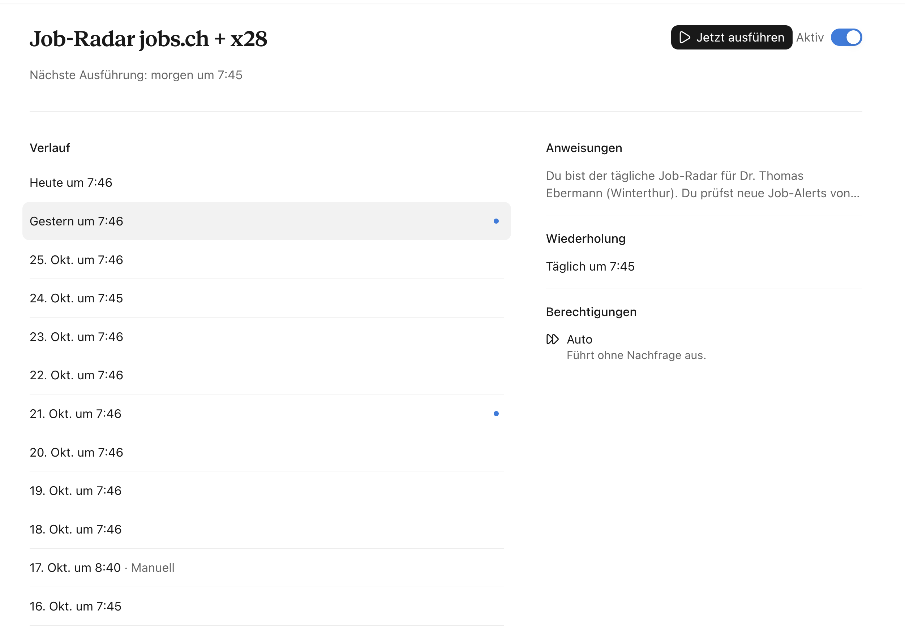
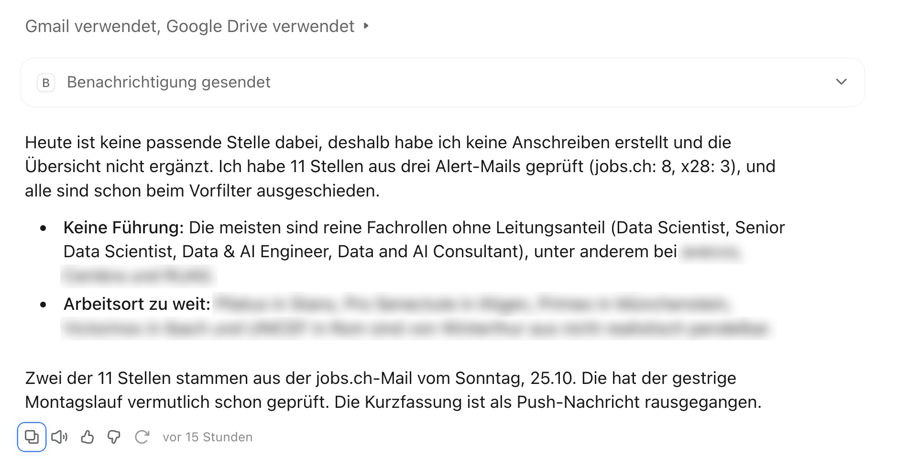

**Stand:** Oktober 2026 · **Autor:** Thomas Ebermann · **Lesedauer:** ca. 14 Minuten

<!-- serie:start -->
> **Serie „Agenten 2026“** · Teil 2: Agenten, die selbst planen
>
> - **Braucht es überhaupt noch einen Workflow? (geplante Aufgabe)** ← du bist hier
> - [Was kann ein Schwarm? (Claude Managed Agents)](/blog/2026-10-28-bewerbungs-agent-schwarm/)
> - [Wie machen es Google und OpenAI?](/blog/2026-10-29-bewerbungs-agent-vergleich/)
> - [Den Schwarm selbst programmieren? (CrewAI)](/blog/2026-10-29-bewerbungs-agent-crewai/)
> - Ein fertiger Agent, aber offen? (Pi, Hermes) · folgt
>
> Teil 1, Bewerbungs-Agenten mit festem Ablauf: [von n8n](/blog/2026-09-29-bewerbungs-agent-n8n/) bis [DBOS](/blog/2026-10-27-bewerbungs-agent-dbos/)
<!-- serie:end -->

Im ersten Teil dieser Serie habe ich meinen Bewerbungs-Agenten fünfmal gebaut, jedes Mal als festen Ablauf: zuerst zum Klicken mit [n8n](/blog/2026-09-29-bewerbungs-agent-n8n/) und Activepieces, dann als Code in einer Plattform mit Windmill und Kestra und zum Schluss ganz ohne Plattform mit [DBOS](/blog/2026-10-27-bewerbungs-agent-dbos/). Bei allen fünf Varianten stand vorher fest, welcher Schritt nach welchem kommt: Newsletter lesen, Stellen herausziehen, bewerten, ab 70 Punkten ein Anschreiben schreiben, mich benachrichtigen und auf meine Freigabe warten. Das Modell durfte innerhalb eines Schrittes Text verarbeiten, aber nie entscheiden, was als Nächstes passiert.

Im zweiten Teil drehe ich das um. Ich beschreibe nur noch das Ziel, und der Agent entscheidet selbst, wie er dorthin kommt. Und ich fange mit der Variante an, die so zugänglich ist, dass sie fast schon langweilig wirkt: einer geplanten Aufgabe in der ganz normalen Claude-App.

## Was ist eine geplante Aufgabe?

Eine geplante Aufgabe ist ein Prompt, den die Claude-Desktop-App nach einem Zeitplan ausführt, bei mir jeden Morgen um 7:45. Dazu gebe ich ihr die Konnektoren, die sie braucht, in meinem Fall Gmail zum Lesen der Newsletter und Google Drive für Lebenslauf, Anschreiben und Übersicht. Bei den Berechtigungen steht „Auto“, die Aufgabe führt also alles aus, ohne bei jedem Werkzeugaufruf nachzufragen. Sonst würde sie um 7:45 Uhr ziemlich einsam auf meine Bestätigung warten.



Inzwischen laufen geplante Aufgaben in der Cloud, nicht mehr auf meinem Mac. Sie starten also auch dann pünktlich, wenn der Laptop zugeklappt im Rucksack liegt ([Claude-Hilfecenter](https://support.claude.com/en/articles/13854387)). Das war in Teil 1 noch das grosse Argument gegen eine lokale Installation: Dort musste ich für einen zuverlässigen Betrieb über einen Server bei Hetzner und Co. nachdenken. Hier gibt es keinen Server, kein Docker, keinen Token für Gmail und kein OAuth-Geklicke in der Google-Console. Die Konnektoren melde ich einmal in der App an, und gut ist. Bezahlt wird über mein Claude-Abo, eine Rechnung für Tokens gibt es nicht.

## Der Prompt ersetzt den Ablauf

Was in Teil 1 ein Workflow aus Dutzenden Knoten oder ein paar hundert Zeilen Python war, ist hier ein Prompt mit sechs Schritten: Kontext laden, Newsletter-Mails finden, offensichtlich Unpassendes vorfiltern, die übrigen Anzeigen im Detail prüfen, für die besten Stellen ein Anschreiben schreiben und zum Schluss die Übersicht ergänzen. Ein Ausschnitt aus dem Schritt mit den Kriterien:

```text
ALLE vier Kriterien müssen passen:
1. Ort: Schweiz, Arbeitsort realistisch von Winterthur pendelbar (ca. ≤ 60 Min ÖV)
   oder überwiegend remote.
2. Leadership: echte Führungs- oder Leitungsrolle (Head of, Lead, Leiter/in, Teamlead,
   Director, Chapter Lead, Principal mit Führung).
3. Daten oder AI: Data Science, ML, AI/GenAI, Data Engineering/Platform, Analytics, BI …
4. Lohn ≥ CHF 130'000/Jahr (bei Teilzeit auf 100 % hochgerechnet). Wenn keine Angabe:
   nach Stufe, Branche und Region einschätzen und als „geschätzt ca. X“ kennzeichnen.

Vergib einen Match-Score 1–10 gegen Lebenslauf und Bewerbungskontext.
Nur Stellen mit Score ≥ 7 sind Empfehlungen.
```

Spannend wird es, wenn man nebeneinanderlegt, was in Teil 1 Code war und was hier ein einziger Satz ist:

| Aufgabe | Teil 1 (fester Ablauf) | Geplante Aufgabe |
| --- | --- | --- |
| Newsletter am Montag | Immer drei Tage zurück, fest eingestellt | „Am Montag `newer_than:4d`, damit das Wochenende abgedeckt ist.“ |
| Dieselbe Stelle bei mehreren Personalvermittlern | Personalvermittler als K.-o.-Kriterium | „Duplikate zusammenführen, bevorzuge den direkten Arbeitgeber.“ |
| Schon einmal bei der Firma beworben | Gar nicht berücksichtigt | „Kein Ausschlussgrund bei anderer Rolle und mehr als 3 Monaten Abstand, aber vermerken.“ |
| Lohn nicht angegeben | Kein Kriterium | „Nach Stufe, Branche und Region einschätzen und kennzeichnen.“ |
| Anschreiben in die Vorlage setzen | Gut hundert Zeilen JavaScript, die Absätze im Google-Doc suchen und ersetzen | „Kopiere das Template, ersetze die Platzhalter, setze den Link auf thomas.ebermann.ch.“ |
| Qualitätskontrolle | Prüfen, ob der Brief mit „Ebermann“ endet | „Lies den Text kritisch gegen die Vermeiden-Liste und streiche alles, was dort steht.“ |

Genau diese Sonderfälle sind es, die einen festen Ablauf mit der Zeit aufblähen, weil jeder davon eine Bedingung, einen Zweig oder eine Hilfstabelle braucht. Der Agent erledigt sie aus einem Satz, und wenn mir morgen ein neuer Sonderfall einfällt, schreibe ich einen weiteren Satz dazu.

## Das eigentliche Geheimnis: der Bewerbungskontext

Der Prompt sagt dem Agenten, was er tun soll. Wie er schreiben soll, steht in einem zweiten Dokument, dem **Bewerbungskontext**, den der Agent vor jedem Lauf aus meinem Google Drive liest. Ich habe ihn einmal aus meinen bisherigen Anschreiben destillieren lassen, und ich kann ihn jederzeit selbst ergänzen oder korrigieren; meine Änderungen haben Vorrang vor dem Prompt. Er hat fünf Teile: meine aktuelle Situation samt Wechselmotivation, die Belege, die ich in Anschreiben immer wieder verwende (mit den genauen Zahlen aus dem Lebenslauf), Argumentationsmuster je nach Rollentyp, eine Stil-Liste mit allem, was ich nicht mehr lesen will, und eine Liste der Firmen, bei denen ich mich schon beworben habe.

Die Vermeiden-Liste ist mein persönlicher Favorit. Da stehen Formulierungen wie „motiviert mich ausserordentlich“, „nahtlos“, „umfassende Expertise“, „spannende Herausforderung“, Dreierlisten aus Adjektiven und Sätze nach dem Muster „nicht nur X, sondern auch Y“. Kurz gesagt: alles, woran man ein Anschreiben aus einem Sprachmodell auf drei Meter Entfernung erkennt. Der Agent liest seinen Entwurf vor dem Einsetzen gegen diese Liste und streicht, was er findet.

Das ist der grösste Unterschied zu Teil 1, und ehrlich gesagt hat er mich selbst überrascht. In Teil 1 steckte das Wissen darüber, wie ein gutes Anschreiben für mich aussieht, in einer Vorlage mit ein paar Regeln. Hier steckt es in einem lebenden Dokument, das ich jederzeit ergänzen kann, ohne irgendetwas neu einzuspielen, und das der Agent beim nächsten Lauf einfach berücksichtigt.

## Welche Dateien der Agent liest

Damit klar ist, womit der Agent eigentlich arbeitet, hier alles, was er bei jedem Lauf anfasst:

| Was | Wo | Wozu |
| --- | --- | --- |
| Der Prompt | In der geplanten Aufgabe selbst | Der Ablauf in sechs Schritten und die Kriterien |
| Lebenslauf | Google Doc | Fakten, Stationen und Zahlen für Bewertung und Anschreiben |
| Bewerbungskontext | Google Doc | Situation, Wechselmotivation, Belege, Argumentationsmuster, Stil- und Vermeiden-Liste, frühere Bewerbungen; hat Vorrang vor dem Prompt |
| Stil-Referenz | Google Doc | Ein Anschreiben, das mir besonders gut gefallen hat, als Vorbild für Ton und Aufbau |
| Anschreiben-Vorlage | Google Doc | Briefkopf, Unterschrift und drei Platzhalter für Adresse, Position und Text |
| Anschreiben-Ordner | Google Drive | Alle bisherigen Anschreiben, um frühere Bewerbungen pro Firma zu erkennen |
| Übersicht | Google Doc | Bereits empfohlene Stellen erkennen und neue anhängen |
| Job-Alerts | Gmail | Die Newsletter von jobs.ch und x28 der letzten zwei (montags vier) Tage |
| Stellenanzeigen | Web | Details zu Aufgaben, Führung, Ort, Lohn und Kontaktperson |
| Meine Webseite | thomas.ebermann.ch | Nur als Link im Anschreiben |

Beim Zusammenstellen dieser Liste ist mir übrigens aufgefallen, dass mein Lebenslauf in Google Docs noch vom August 2025 stammt und die NZZ darin gar nicht vorkommt. Dass die Anschreiben trotzdem stimmen, liegt nur daran, dass der Bewerbungskontext die aktuelle Stelle ausdrücklich nachträgt. Ein schönes Beispiel dafür, wie gutmütig so ein Agent mit widersprüchlichem Kontext umgeht, und gleichzeitig eine Erinnerung, dass man den Kontext pflegen muss :)

## Was dabei herauskommt

Seit dem 15. Oktober hat der Agent fünf Stellen empfohlen. Pro Empfehlung entstehen zwei Dinge:

- **Ein fertiges Anschreiben als Google Doc**, in meiner Vorlage mit Briefkopf und Unterschrift, adressiert an die Firma und wenn möglich an die Kontaktperson, in der Sprache der Anzeige und mit einem Link auf meine Webseite. Ich lese es, korrigiere, was mir nicht passt, lade es als PDF herunter und bewerbe mich.
- **Ein Eintrag in der Übersicht**, einem Google Doc mit einem Block pro Stelle: Score, geschätzter Lohn, Pensum, Führungsspanne, warum die Stelle passt, Risiken und Lücken, Links zur Anzeige und zum Anschreiben und ein Status, den ich selbst von OFFEN auf BEWORBEN setze.

An den meisten Tagen passt allerdings gar nichts, und auch dann schreibt mir der Agent eine kurze Zusammenfassung, die als Push-Nachricht auf meinem Handy landet. So sah das heute Morgen aus:



Mir gefällt, wie diese Zusammenfassung klingt: nicht wie ein Protokoll, sondern wie eine Kollegin, die mir am Morgen kurz erzählt, was sie angeschaut hat und warum nichts dabei war.

## Dieselbe Stelle, ein anderes Urteil

Unter den elf Stellen von heute war auch eine alte Bekannte, die Senior-Data-Scientist-Stelle bei einer Schweizer Bank. Das war unsere Teststelle in Teil 1, und alle fünf Werkzeuge haben sie mit 80 bis 85 Punkten als passend eingestuft und ein Anschreiben geschrieben. Der Agent hat sie heute schon im Vorfilter verworfen, weil es eine reine Fachrolle ohne Führung ist.

Hat sich also eines der beiden Systeme geirrt? Nein, und genau das finde ich die wichtigste Erkenntnis aus diesem Vergleich. Der Unterschied liegt nicht am Modell, sondern an den Regeln. Für Teil 1 hatte ich eine vereinfachte Spezifikation geschrieben, in der Senior-Rollen genügten und der Lohn kein Kriterium war. Die geplante Aufgabe arbeitet mit meinen echten Kriterien, und die verlangen Führung und mindestens 130'000 Franken. Ein Agent ist eben nur so gut wie die Beschreibung dessen, was man eigentlich will, und diese Beschreibung lässt sich in einem Prompt viel feiner fassen als in einem Workflow.

## Wo es hakt

Ganz ohne Haken geht es natürlich nicht.

**Ich muss dem Agenten glauben.** In Teil 1 konnte ich bei jedem Lauf nachsehen, welcher Knoten mit welchem Ergebnis gelaufen ist, und die Doppelprüfung war ein Schlüssel in einer Tabelle, der garantiert nicht zweimal vorkommt. Hier prüft der Agent die Übersicht und den Ordner und entscheidet selbst, ob er eine Stelle schon kennt. Das klappt erstaunlich gut, aber garantiert ist es nicht. Ein Beispiel steht im Screenshot oben: Zwei Stellen stammten aus einer Mail vom Sonntag, die der Montagslauf „vermutlich schon geprüft“ hat. Vermutlich, weil verworfene Stellen nirgends notiert werden und der Agent deshalb am nächsten Tag nicht wissen kann, dass er sie schon gesehen hat. Für mich ist das kein Problem, es kostet nur ein paar Sekunden. Es zeigt aber gut, wo die Grenze zwischen „der Agent entscheidet“ und „ein System garantiert“ verläuft.

**Es gibt keine Freigabe, auf die ein Ablauf warten würde.** In Teil 1 hat jeder Workflow tagelang auf meinen Klick gewartet und danach den Status gesetzt. Hier endet der Lauf nach der Zusammenfassung, und der Status in der Übersicht ist ein Wort, das ich selbst von OFFEN auf BEWORBEN ändere. Das ist schlichter, für einen Ein-Personen-Agenten aber völlig ausreichend.

**Es gibt keine Versionsgeschichte.** Ändere ich den Prompt oder den Bewerbungskontext und die Anschreiben werden danach schlechter, sehe ich nicht, was sich geändert hat, und ich kann auch nicht einfach zur Fassung von letzter Woche zurück.

**Nur ein Gmail-Konto.** Der Google-Konnektor von Claude verbindet genau ein Google-Konto, und das gilt für Gmail, Drive und Kalender gemeinsam. Wer Alerts in mehreren Postfächern bekommt, muss sie deshalb an das verbundene Konto weiterleiten oder auf einen Drittanbieter-Konnektor ausweichen.

**Ein Agent für alles.** Ein einziger Lauf liest die Mails, bewertet, schreibt und kontrolliert sich selbst, alles im selben Kontext. Niemand prüft seine Arbeit gegen, bevor ich sie sehe, und wenn an einem Tag viele Stellen kommen, wird dieser eine Kontext ziemlich voll.

## Und für Entwickler: dieselbe Aufgabe in Claude Code

Geplante Aufgaben gibt es nicht nur für den Chat, sondern auch für Claude Code ([Doku](https://code.claude.com/docs/en/routines)). Inzwischen sind das nicht einmal mehr zwei Produkte: Beide leben auf derselben Seite unter „Geplante Aufgaben“, und eine Aufgabe wird zur Claude-Code-Aufgabe, sobald man ihr ein GitHub-Repository zuordnet. Die Idee bleibt dieselbe, ein Prompt läuft nach Zeitplan in Anthropics Cloud, aber statt in einem Eingabefeld liegt alles als Dateien im Repo. Weil mich interessiert hat, was das in der Praxis ändert, habe ich meinen Radar einmal nachgebaut, mit derselben Vorlage, denselben Konnektoren und einem eigenen Ordner in Google Drive, damit sich die beiden nicht in die Quere kommen.

Das Repo sieht so aus:

| Datei | Was drinsteht |
| --- | --- |
| `CLAUDE.md` | Zweck, harte Regeln („bewirb dich nie, sende keine E-Mails, lösche nichts“) und die festen IDs in Google Drive |
| `.claude/skills/job-radar/SKILL.md` | Der tägliche Ablauf in sieben Schritten, im Kern derselbe Prompt wie in der App |
| `.claude/skills/anschreiben/SKILL.md` | Wie ein Anschreiben aus der Vorlage entsteht |
| `context/lebenslauf.md`, `context/bewerbungskontext.md`, `context/stil-referenz.md` | Die Kontext-Dokumente als Markdown, versioniert |
| `context/kriterien.md` | Vorfilter, die vier Muss-Kriterien, Score und die Regel zu früheren Bewerbungen |
| `state/stellen.json` | Das Gedächtnis: jede je geprüfte Stelle mit Status und Grund, auch die verworfenen |
| `laeufe/<Datum>.md` | Ein Bericht pro Lauf |
| `scripts/check.py` | Eine feste Prüfung am Ende jedes Laufs |

Drei Dinge werden dadurch besser.

**Jede Änderung ist ein Diff.** Passe ich den Bewerbungskontext oder die Kriterien an, sehe ich in Git genau, was sich geändert hat, und wenn die Anschreiben danach schlechter werden, gehe ich einfach zur vorherigen Fassung zurück. Auch jeder Lauf ist ein Commit: Der Agent arbeitet auf einem eigenen Branch und committet sein Gedächtnis und seinen Bericht, sodass ich die ganze Historie im Repo nachlesen kann.

**Der Agent vergisst nichts mehr.** In der Desktop-Variante merkt sich der Agent nur die empfohlenen Stellen, weil nur sie in der Übersicht landen. Hier schreibt er jede geprüfte Stelle ins Gedächtnis, auch die verworfenen, samt Grund. Beim ersten Testlauf an einem Dienstagabend hat er nach knapp zwei Minuten 15 Stellen geprüft, keine passte, und alle 15 standen danach mit Begründung in `state/stellen.json`. Ein zweiter Lauf direkt danach war nach 38 Sekunden fertig und meldete: „Die 3 Mails der letzten 2 Tage hatte schon der erste Lauf heute verarbeitet.“ Kein „vermutlich“ mehr.

**Ein fester Rahmen, wo es zählt.** Das kleine Skript `scripts/check.py` prüft am Ende jedes Laufs ganz ohne KI, ob das Gedächtnis gültig ist, ob jede empfohlene Stelle einen Score von mindestens 7 und einen Link zum Anschreiben hat und ob der Bericht existiert. Schlägt es fehl, muss der Agent nachbessern oder die Abweichung melden. Das ist genau die Mischung, die ich im Fazit unten meine: Der Agent entscheidet, das Skript garantiert.

Als ich den Agenten testweise ein Anschreiben für eine Beratungsstelle schreiben liess, für die der Desktop-Radar ein paar Tage vorher schon eines angelegt hatte, hat er das von sich aus bemerkt und darauf hingewiesen, dass er die Stelle im echten Lauf wegen der Drei-Monats-Regel aussortiert hätte. Dazu kam eine zweite Beobachtung: Die Anzeige war auf Deutsch, verlangte aber ein englisches Anschreiben, also hat er den Brief englisch geschrieben und dabei auch die festen deutschen Texte der Vorlage übersetzt, aus „Mit freundlichen Grüssen“ wurde „Kind regards“. Das stand so in keiner Regel, und am Ende schlug er selbst vor, für solche Fälle eine englische Vorlage oder eine zusätzliche Regel im Skill anzulegen.

In der Cloud gab es dann noch zwei Stolpersteine, die ich lokal nicht gesehen hatte. Der erste war das Netz: Eine Claude-Code-Aufgabe läuft in einer Sandbox, die standardmässig nur eine Positivliste von Paketquellen und Entwickler-Seiten erreicht. jobs.ch steht da natürlich nicht drauf. Gmail und Google Drive funktionierten trotzdem, weil die Konnektoren über Anthropics Server laufen, aber jede Stellenanzeige schlug mit „Host nicht auflösbar“ fehl. Schön fand ich, wie der Agent damit umgegangen ist: Er hat die Stellen nur anhand von Titel und Ort beurteilt, das ausdrücklich als Abweichung gemeldet und die zwei Stellen, bei denen er ohne Anzeige unsicher war, zur manuellen Prüfung markiert, statt einfach Erfolg zu melden. Nachdem ich jobs.ch und jobagent.ch in den Netzwerk-Einstellungen der Umgebung freigegeben hatte, lief alles durch. Der zweite Stolperstein war die Zeit: Die Cloud läuft in UTC, und ein Lauf kurz nach Mitternacht hat seinen Bericht deshalb mit dem Datum vom Vortag abgelegt. Seitdem steht im Skill, dass Datum und Wochentag immer in Schweizer Zeit gelten.

Ganz nebenbei hat der Agent in der Cloud auch einen Fehler in meinen eigenen Anweisungen gefunden. Dort steht, die Mails kämen weitergeleitet von meiner GMX-Adresse. Er hat festgestellt, dass sie inzwischen direkt von jobs.ch und x28 kommen, und das im Bericht vermerkt. Und als im Ordner noch das Test-Anschreiben von vorher lag, ohne Eintrag im Gedächtnis, hat er es bemerkt, gemeldet und nicht angefasst.

Der Preis für all das: Man braucht ein GitHub-Konto, muss Claude Code kennen, der Claude-App auf GitHub Zugriff auf das Repo geben und die Aufgabe mit Repo, Konnektoren und einer Umgebung mit passendem Netzzugang einrichten. Für Entwicklerinnen und Entwickler ist das die sauberere Variante. Für alle anderen bleibt die Desktop-App der einfachere Einstieg, und sie schickt die Zusammenfassung ganz bequem als Push-Nachricht aufs Handy.

## Fester Ablauf oder geplante Aufgabe?

| | Teil 1: fester Ablauf | Geplante Aufgabe |
| --- | --- | --- |
| Was ich baue | Workflow oder Code | Einen Prompt und einen Bewerbungskontext |
| Wo es läuft | Auf meinem Mac in Docker, im Betrieb auf einem Server | In Anthropics Cloud |
| Zugänge | Eigener Google-OAuth-Client, Tokens, API-Schlüssel | Konnektoren in der App |
| Sonderfälle | Je ein Zweig, eine Bedingung oder eine Tabelle | Je ein Satz |
| Nachvollziehbarkeit | Jeder Schritt mit Ein- und Ausgabe | Ich lese, was der Agent berichtet |
| Doppelprüfung | Garantiert über einen Schlüssel | Der Agent entscheidet |
| Freigabe | Workflow wartet auf meinen Klick | Status in der Übersicht, von Hand |
| Kosten | Wenige Rappen pro Stelle für Tokens, im Betrieb dazu der Server | Im Claude-Abo enthalten |

Braucht es also überhaupt noch einen Workflow? Für meinen persönlichen Job-Radar ehrlich gesagt nicht. Die geplante Aufgabe ist schneller eingerichtet, kennt mehr Sonderfälle und schreibt dank des Bewerbungskontexts Anschreiben, die näher an meiner eigenen Stimme sind, und das ohne eine Zeile Code. Sobald aber Garantien zählen, etwa weil mehrere Leute damit arbeiten oder ein Fehler teuer wäre, würde ich den festen Ablauf nicht so schnell aufgeben. Ich persönlich glaube, dass beide Welten zusammenwachsen werden: ein fester Rahmen für das, was garantiert sein muss, und ein Agent für alles dazwischen.

## Was kommt als Nächstes?

Die grösste Schwäche der geplanten Aufgabe ist, dass ein einziger Agent alles allein macht. Im nächsten Beitrag verteile ich die Arbeit deshalb auf mehrere: Mit Claude Managed Agents plant ein Lead-Agent jeden Morgen selbst, welche Spezialisten er für welche Stelle braucht, und lässt sie parallel arbeiten, einen für den Abgleich, einen für die Recherche zur Firma, einen fürs Schreiben und einen Skeptiker, der das Anschreiben auf unbelegte Behauptungen prüft, bevor ich es überhaupt zu sehen bekomme.

<!-- serie:next -->
**Weiter in der Serie:** [Was kann ein Schwarm? Der Bewerbungs-Agent mit Claude Managed Agents](/blog/2026-10-28-bewerbungs-agent-schwarm/)
<!-- serie:next-end -->

Ich freue mich auf eure Kommentare und Anregungen!
