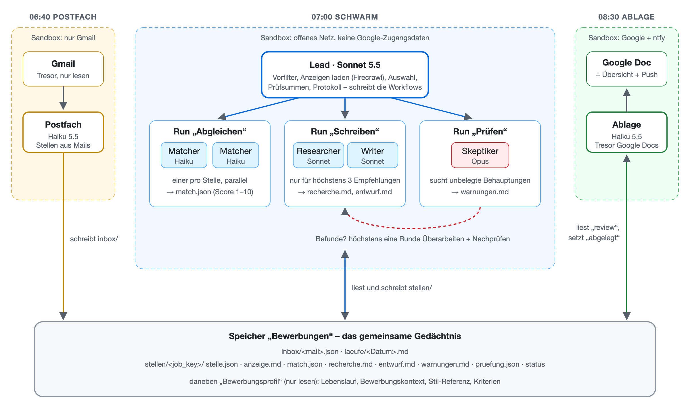

**Stand:** Oktober 2026 · **Autor:** Thomas Ebermann · **Lesedauer:** ca. 14 Minuten

<!-- serie:start -->
> **Serie „Agenten 2026“** · Teil 2: Agenten, die selbst planen
>
> - [Braucht es überhaupt noch einen Workflow? (geplante Aufgabe)](/blog/2026-10-28-bewerbungs-agent-geplante-aufgabe/)
> - **Was kann ein Schwarm? (Claude Managed Agents)** ← du bist hier
> - [Wie machen es Google und OpenAI?](/blog/2026-10-29-bewerbungs-agent-vergleich/)
> - [Den Schwarm selbst programmieren? (CrewAI)](/blog/2026-10-29-bewerbungs-agent-crewai/)
> - [Der Schwarm zieht nach Hause? (Pi, Hermes)](/blog/2026-10-29-bewerbungs-agent-pi-hermes/)
> - [Ich bau mir meinen Schwarm komplett selbst (Microsoft Agent Framework)](/blog/2026-10-30-bewerbungs-agent-microsoft/)
>
> Teil 1, Bewerbungs-Agenten mit festem Ablauf: [von n8n](/blog/2026-09-29-bewerbungs-agent-n8n/) bis [DBOS](/blog/2026-10-27-bewerbungs-agent-dbos/)
<!-- serie:end -->

Im [letzten Beitrag](/blog/2026-10-28-bewerbungs-agent-geplante-aufgabe/) hat eine einzige geplante Aufgabe in der Claude-App meinen ganzen Bewerbungs-Agenten ersetzt: Ein Prompt liest jeden Morgen die Job-Alerts, bewertet die Stellen und schreibt für die besten ein Anschreiben in meine Google-Docs-Vorlage. Das funktioniert erstaunlich gut, hat aber eine Schwäche, die ich dort schon angedeutet habe. Ein einziger Agent macht alles allein, im selben Kontext und ohne dass irgendjemand seine Arbeit gegenprüft, bevor ich sie zu sehen bekomme.

Heute verteile ich die Arbeit deshalb auf ein ganzes Team. Mit **Claude Managed Agents** gibt es einen Lead, der jeden Morgen selbst plant, welche Spezialisten er für welche Stelle braucht: einen Matcher, der die Stelle bewertet, einen Researcher, der Fakten zur Firma sucht, einen Writer, der das Anschreiben schreibt, und einen Skeptiker, der den Entwurf auf unbelegte Behauptungen prüft, bevor er überhaupt bei mir ankommt. Klingt nach dem, was man sich unter einem Agenten-Schwarm vorstellt? Genau das wollte ich herausfinden, und zwar mit echten Zahlen zu Kosten, Tokens und Laufzeit.

## Was sind Claude Managed Agents?

Die geplante Aufgabe aus dem letzten Beitrag ist ein Produkt: Claude arbeitet für mich, im Rahmen meines Abos. Managed Agents sind dagegen eine Plattform, mit der man selbst einen Agenten-Dienst baut. Anthropic betreibt dafür die Agenten-Schleife, die Sandboxen, in denen die Agenten Befehle ausführen, die Speicher, in denen sie sich zwischen den Läufen Dinge merken, die Tresore für Zugangsdaten und die Zeitpläne. Man bezahlt über die API, also pro Token und pro Stunde Laufzeit, und nicht über das Abo ([Überblick](https://platform.claude.com/docs/en/managed-agents/overview)).

Was mir besonders gefällt: Ich musste nichts davon in einer Oberfläche zusammenklicken. Jeder Agent ist eine Markdown-Datei, bei der oben die Konfiguration steht (Modell, Werkzeuge, Skills) und darunter der Systemprompt. Umgebungen, Speicher, Tresore und Zeitpläne sind kleine YAML- oder Markdown-Dateien daneben. Ein einziger Befehl, `ant apply .`, legt aus diesem Ordner alle 21 Ressourcen an und hält sie danach aktuell, ganz ähnlich wie Terraform für Server ([Doku zu ant apply](https://platform.claude.com/docs/en/cli-sdks-libraries/cli/apply)). Der ganze Schwarm ist also ein Ordner mit Textdateien, den ich versionieren kann wie jedes andere Projekt.

## Der Aufbau

Der Schwarm besteht aus drei Teilen, die zu verschiedenen Zeiten laufen und sich nur über einen gemeinsamen Speicher abstimmen:

Um 6:40 liest der **Postfach-Agent** die Job-Alerts von jobs.ch und x28 und legt die Stellen als Dateien im Speicher ab. Um 7:00 startet der **Lead** mit seinem Team und bearbeitet diese Stellen. Und um 8:30 nimmt die **Ablage** die fertig geprüften Anschreiben, setzt sie in meine Google-Docs-Vorlage, ergänzt die Übersicht und schickt mir eine Push-Nachricht aufs Handy.

Warum so umständlich, statt einfach einen Agenten mit allen Zugängen loszuschicken? Die Antwort ist Sicherheit, und sie hat mich beim Bauen mehr beschäftigt als alles andere. Der Schwarm liest fremde Stellenanzeigen auf beliebigen Webseiten, und jede dieser Seiten könnte versteckte Anweisungen enthalten. Deshalb hat jeder der drei Teile seine eigene, abgeschottete Sandbox:

| Teil | Erreicht | Zugangsdaten |
| --- | --- | --- |
| Postfach | nur die Gmail-API | Gmail, nur lesen |
| Schwarm | jede Webseite | keine Google-Zugangsdaten, nur einen Schlüssel für Firecrawl, um Anzeigen zu laden |
| Ablage | nur Google Docs, Drive und ntfy | Google Docs |

Die Zugangsdaten selbst sehen die Agenten nie. Sie liegen in einem Tresor, und in der Sandbox steht nur ein Platzhalter, den Anthropic erst beim Verlassen der Sandbox durch den echten Wert ersetzt, und zwar nur für die Adresse, die ich dafür freigegeben habe ([Tresore](https://platform.claude.com/docs/en/managed-agents/vaults)). Eine präparierte Stellenanzeige kann den Schwarm also im schlimmsten Fall zu einem schlechten Anschreiben verleiten, aber nicht an mein Gmail oder mein Google Drive heranführen.

Das gemeinsame Gedächtnis ist ein Speicher namens „Bewerbungen“, der in jeder Sitzung als Ordner erscheint ([Speicher](https://platform.claude.com/docs/en/managed-agents/memory)). Jede Bewerbung ist darin ein eigener Ordner, und an den Dateien sieht man, wer was gemacht hat: `stelle.json` und `anzeige.md` legt der Lead an, `match.json` der Matcher, `recherche.md` der Researcher, `entwurf.md` der Writer, `warnungen.md` der Skeptiker. Daneben liegt ein zweiter Speicher, nur lesbar, mit meinem Lebenslauf, dem Bewerbungskontext, der Stil-Referenz und den Kriterien, also genau denselben Dateien, die auch die geplante Aufgabe aus dem letzten Beitrag liest.

## Der Lead schreibt sein Programm selbst

Jetzt wird es spannend. Der Lead bekommt keine Liste von Schritten, die er abarbeiten soll, sondern Regeln: höchstens 15 neue Stellen pro Lauf, höchstens drei Anschreiben, eine Empfehlung erst ab Score 7 und mit allen vier Kriterien erfüllt, und kein Urteil des Skeptikers gilt für eine Fassung, die er nicht gesehen hat. Daraus schreibt er jeden Morgen selbst kleine Programme, sogenannte **dynamische Workflows**, die seine Spezialisten parallel starten und ihre Ergebnisse einsammeln ([Doku](https://platform.claude.com/docs/en/managed-agents/multiagent-orchestration)).

Bei meinem Testlauf mit einer passenden Stelle hat er fünf solcher Läufe nacheinander gestartet und jeweils selbst benannt: „Abgleichen“, „Schreiben“, „Prüfen“, „Überarbeiten“ und „Nachprüfen“. Dazwischen hat er selbst gearbeitet, also ausgewählt, Prüfsummen berechnet und kontrolliert, ob die Dateien seiner Spezialisten das verlangte Format haben.

Am meisten überrascht haben mich die kleinen Entscheidungen, die in keinem Prompt standen. Als an einem Tag 17 Stellen in der Inbox lagen, aber nur 15 erlaubt waren, hat der Lead zwei Stellen zurückgestellt, und zwar ausdrücklich zwei Analysten-Stellen statt einer Head-of-AI-Stelle, „damit diese heute noch läuft“. Als ein Matcher für eine Stelle keine Bewertung geliefert hat, hat er einen zweiten Lauf „Abgleichen (Wiederholung)“ nur für diese Stelle gestartet. Und als beim Laden einer Anzeige statt des Inserats eine Suchseite zurückkam, hat er es selbst noch einmal mit dem Link ohne Tracking-Parameter versucht. Genau das ist der Unterschied zu einem festen Ablauf aus dem ersten Teil der Serie: Dort hätte ich jeden dieser Fälle vorher kennen und programmieren müssen.

## Der Skeptiker

Der Teil, auf den ich am meisten gespannt war, ist der Skeptiker. Er läuft als einziger auf Opus, dem stärksten Modell, weil Gegenprüfen nach meiner Erfahrung mehr Sorgfalt braucht als Schreiben. Er liest den Entwurf, meinen Lebenslauf, den Bewerbungskontext und die Recherche und sucht jede Behauptung über mich, die keine dieser Quellen belegt, jede Aussage über die Firma ohne Quelle und jede Formulierung von meiner Vermeiden-Liste.

Beim Testlauf fand er im ersten Entwurf fünf Befunde, darunter eine Formulierung zu meiner früheren Produktsuite bei OMG, die etwas grosszügiger klang, als es im Lebenslauf steht. Der Writer hat überarbeitet, der Skeptiker hat nachgeprüft, und in der zweiten Runde blieb nichts mehr übrig. Damit ein Urteil des Skeptikers nicht für eine Fassung gilt, die danach noch jemand geändert hat, hält der Lead vor jeder Prüfung eine Prüfsumme des Entwurfs fest und vergleicht sie danach noch einmal. Stimmt sie nicht, landet die Bewerbung als Fehler bei mir und nicht als fertiges Anschreiben.

Das Ergebnis war ein Anschreiben mit 344 Wörtern, mit konkreten Zahlen aus meinem Lebenslauf, einem Bezug zu einem aktuellen Projekt der Firma aus der Recherche und dem Link auf meine Webseite, ordentlich in meiner Vorlage abgelegt und in der Übersicht eingetragen.

## Was es kostet und wie lange es dauert

Kommen wir zu den Zahlen, denn die haben mich am meisten interessiert. Alle Werte stammen direkt aus der Abrechnung der einzelnen Sitzungen:

| Lauf | Dauer | Tokens rein | davon aus dem Cache | Tokens raus | Kosten |
| --- | --- | --- | --- | --- | --- |
| Postfach: 4 Mails, 17 Stellen | 50 s | 171'880 | 81 % | 10'112 | 0,01 $ |
| Schwarm ohne Treffer: 15 Stellen, 3 im Detail bewertet | 2 min 23 s | 745'733 | 81 % | 24'726 | 0,32 $ |
| Schwarm mit einem Anschreiben, 5 Workflow-Runs | 6 min 23 s | 2'547'482 | 84 % | 41'680 | 1,77 $ |
| Ablage: 1 Anschreiben, Übersicht, Push | 37 s | 146'841 | 82 % | 3'878 | 0,01 $ |

Für ein einziges Anschreiben hat der Schwarm also gut zweieinhalb Millionen Tokens gelesen. Das klingt nach sehr viel, und es ist auch sehr viel. Dass es trotzdem nur 1,77 Dollar kostet, liegt am Cache: 84 Prozent dieser Tokens hat die Plattform aus dem Zwischenspeicher geladen, was nur einen Bruchteil des normalen Preises kostet. Ohne diesen Cache wäre derselbe Lauf um ein Vielfaches teurer.

Wohin die Tokens fliessen, zeigt der Lauf mit dem Anschreiben, aufgeschlüsselt nach Agenten:

| Agent | Modell | Aktiv | Tokens rein | Tokens raus | Kosten |
| --- | --- | --- | --- | --- | --- |
| Lead | Sonnet 5.5 | 140 s | 1'628'102 | 13'272 | 0,49 $ |
| Matcher | Haiku 5.5 | 21 s | 139'200 | 3'478 | 0,02 $ |
| Researcher (4 Websuchen) | Sonnet 5.5 | 68 s | 492'725 | 7'899 | 0,52 $ |
| Writer | Sonnet 5.5 | 32 s | 74'126 | 4'534 | 0,13 $ |
| Skeptiker | Opus 5.5 | 59 s | 65'774 | 6'434 | 0,30 $ |
| Writer, Überarbeitung | Sonnet 5.5 | 27 s | 82'075 | 3'192 | 0,09 $ |
| Skeptiker, Nachprüfung | Opus 5.5 | 30 s | 65'480 | 2'871 | 0,20 $ |

Zwei Dinge fallen auf. Der grösste Posten ist nicht der Skeptiker auf Opus, wie ich vorher vermutet hätte, sondern der Lead selbst, der mit gut 1,6 Millionen Tokens fast zwei Drittel aller Tokens des Laufs liest. Er liest bei jedem Schritt seine eigene Geschichte, alle Dateien und alle Rückmeldungen wieder, und das summiert sich. Und der teuerste einzelne Agent ist mit 0,52 Dollar der Researcher, der mit seinen Websuchen eine halbe Million Tokens liest, obwohl er am Ende nur ein paar Fakten zur Firma liefert.

Was heisst das pro Monat? An einem Tag ohne passende Stelle kosten alle drei Teile zusammen etwa 0,35 Dollar. Mein Radar aus dem letzten Beitrag hat in knapp zwei Wochen fünf Stellen empfohlen, also rechne ich mit etwa zehn Anschreiben im Monat, die jeweils rund 1,50 Dollar zusätzlich kosten. Zusammen sind das um die 25 Dollar im Monat. Die Laufzeitgebühr von 0,08 Dollar pro Sitzungsstunde spielt bei rund zehn Minuten am Tag praktisch keine Rolle.

Und die Zeit? Da hast du recht, wenn dir der Schwarm langsam vorkommt. Ein Lauf mit einem einzigen Anschreiben dauert über sechs Minuten, während DBOS im ersten Teil für Bewertung, Anschreiben und Google-Doc einer Stelle zusammen keine Minute gebraucht hat und die Claude-Code-Variante aus dem letzten Beitrag 15 Stellen in knapp zwei Minuten durchgesehen hat. Der Grund liegt im Aufbau: Die fünf Workflow-Runs laufen nacheinander, weil jeder auf das Ergebnis des vorherigen wartet, dazwischen arbeitet der Lead selbst gut zwei Minuten, und jede Prüfrunde des Skeptikers kostet noch einmal eine halbe bis eine Minute. Parallel läuft nur, was innerhalb eines Runs voneinander unabhängig ist, also etwa mehrere Matcher für mehrere Stellen. Für einen Agenten, der um sieben Uhr morgens startet und bis zum Frühstück fertig sein soll, ist das egal. Für alles, wo jemand auf eine Antwort wartet, wäre es zu langsam.

| | Teil 1 (DBOS) | Geplante Aufgabe (Claude Code) | Schwarm |
| --- | --- | --- | --- |
| Dauer, 15 Stellen ohne Anschreiben | – | 1 min 52 s | 2 min 23 s |
| Dauer, eine Stelle mit Anschreiben | unter 1 min | 1 min 37 s (nur Anschreiben) | 6 min 23 s |
| Kosten pro Anschreiben | wenige Rappen | im Abo | rund 1,50 $ |
| Gegenprüfung | keine | der Agent liest sich selbst gegen | eigener Skeptiker, bis zu zwei Runden |
| Recherche zur Firma | keine | nebenbei | eigener Researcher mit Websuche |

## Wo es weh tat

Ganz reibungslos lief es natürlich nicht, und ein paar Stolpersteine waren durchaus lehrreich.

**Der Lead hat abgebrochen, statt zu raten.** Beim allerersten Lauf hatte ich beim Hochladen meines Profils einen Fehler gemacht, sodass im Speicher statt meines Lebenslaufs nur ein Dateiverweis mit 20 Zeichen stand. Der Lead hat das sofort bemerkt, nach einer Kopie gesucht, keine gefunden und den Lauf abgebrochen, mit einer klaren Notiz im Protokoll, dass er ohne Kriterien nichts bewerten könne und keine erfinden werde. So einen Fehler hätte ich mir in jedem System gewünscht.

**Die Agenten durften die Anzeigen nicht öffnen.** Im zweiten Lauf haben alle Matcher ihre Stellen nur anhand des Titels bewertet, weil das Werkzeug zum Laden von Webseiten jede Anfrage abgelehnt hat. Der Grund ist eine Schutzregel: Es lädt nur Adressen, die im Gespräch schon vorgekommen sind, etwa in einer Nachricht oder einem Suchergebnis, aber nicht solche, die ein Agent selbst aus einer Datei gelesen hat. Das ist ein sinnvoller Schutz gegen Prompt-Injection, bricht aber genau unseren Anwendungsfall. Die Lösung war ein kleiner Skill, mit dem der Lead die Anzeigen selbst über Firecrawl lädt und als Datei ablegt, was nebenbei auch das Captcha von jobagent.ch umgeht, wegen dem ich schon im ersten Teil der Serie auf Firecrawl ausweichen musste.

**Ein Zugangstoken ist nicht so geheim, wie ich dachte.** Laut Doku sieht ein Agent zwar nie den Refresh-Token aus dem Tresor, wohl aber das Access-Token, das ein Skript damit bei Google abholt. Genau deshalb hat bei mir nur die abgeschottete Ablage überhaupt Google-Zugang, und nicht der Schwarm mit offenem Netz.

**Der Skeptiker kannte meine Vorlage nicht.** In der ersten Runde hat er eine fehlende Grussformel bemängelt, der Writer hat sie brav ergänzt, und im fertigen Google-Doc stand sie dann doppelt, weil meine Vorlage sie längst enthält. Seitdem weiss der Skeptiker, was in der Vorlage steht, der Lead prüft es, und das Ablage-Skript entfernt eine doppelte Grussformel zur Sicherheit selbst. Ein schönes Beispiel dafür, dass auch ein Gegenprüfer nur so gut ist wie der Kontext, den er bekommt.

## Lohnt sich ein Schwarm?

Für meinen persönlichen Job-Radar ehrlich gesagt nur bedingt. Die geplante Aufgabe aus dem letzten Beitrag ist im Abo enthalten, deutlich schneller und legt ihre Anschreiben in derselben Vorlage ab. Der Schwarm kostet rund 25 Dollar im Monat, braucht ein Vielfaches an Tokens und eine ganze Handvoll Konfigurationsdateien.

Lustigerweise sieht Anthropic das inzwischen ganz ähnlich. In einem [Artikel vom 22. Oktober](https://claude.com/resources/articles/building-agents-when-to-fold-subagents-into-your-main-agent-loop) rät Anthropic davon ab, vorschnell auf Subagenten und Schwärme zu setzen: Viele Systeme seien überbaut, und ein einzelner Agent, der Kontext und Werkzeuge nach und nach bekommt, arbeite oft besser, mit weniger verlustreichen Übergaben zwischen Agenten. Ein Kunde wurde nach dem Umbau von mehreren Agenten auf einen einzigen rund doppelt so schnell. Subagenten lohnen sich laut dem Artikel erst dann, wenn ein einzelner Agent messbar unter zu viel Kontext leidet, wenn Arbeit wirklich parallel laufen soll oder wenn sich Werkzeuge und Anweisungen in die Quere kommen. Und die Empfehlung, die ich mir am liebsten an die Wand hängen würde: erst eine Messung von Anfang bis Ende bauen, dann Subagenten einen nach dem anderen zusammenlegen und jedes Mal vergleichen. Für meinen Job-Radar heisst das: Die geplante Aufgabe mit einem einzigen Agenten war vermutlich die richtige Wahl, und der Schwarm ist vor allem dann sinnvoll, wenn ich die unabhängige Gegenprüfung durch einen zweiten Agenten wirklich brauche.

Was er dafür bietet, ist Gegenprüfung, Sicherheit und Nachvollziehbarkeit. Jedes Anschreiben ist von einem zweiten, stärkeren Modell geprüft worden, bevor ich es sehe, kein Agent mit Zugang zu fremden Webseiten kommt an mein Postfach, und jede Bewerbung liegt als Ordner mit allen Zwischenschritten im Speicher, sodass ich genau sehe, warum eine Stelle empfohlen oder verworfen wurde. Sobald so ein Agent nicht mehr nur für mich arbeitet, sondern zum Beispiel für ein Recruiting-Team oder für hundert Bewerbende gleichzeitig, wären das genau die Eigenschaften, auf die ich nicht verzichten möchte.

Den ganzen Schwarm habe ich übrigens in einem GitHub-Repo abgelegt, mit allen Agenten, Umgebungen, Skills und dem Einrichtungsskript, aber natürlich ohne meinen Lebenslauf.

## Was kommt als Nächstes?

Managed Agents sind Anthropics Antwort auf die Frage, wie man Agenten als Dienst betreibt. Google und OpenAI haben inzwischen ganz ähnliche Angebote, mit Gemini Managed Agents und der OpenAI Agents API. Im nächsten Beitrag baue ich denselben Bewerbungs-Agenten bei beiden nach und schaue, wie viel vom Schwarm dort überhaupt möglich ist, was es kostet und wo meine Daten dabei landen.

<!-- serie:next -->
**Weiter in der Serie:** [Derselbe Schwarm, drei Plattformen: Claude, Gemini und OpenAI im Vergleich](/blog/2026-10-29-bewerbungs-agent-vergleich/)
<!-- serie:next-end -->

Ich freue mich auf eure Kommentare und Anregungen!
