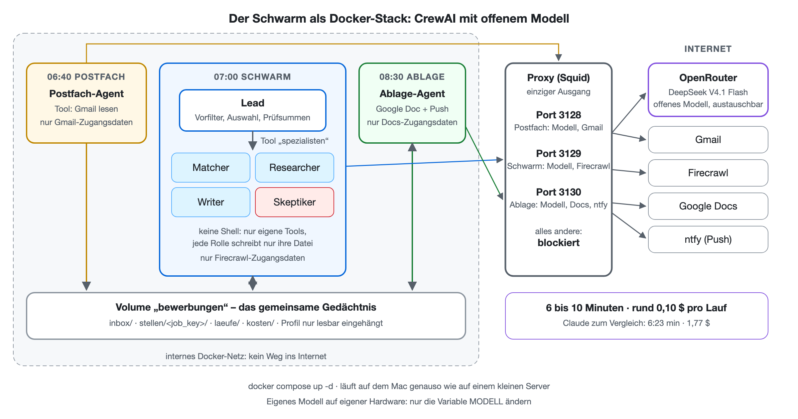

**Stand:** Oktober 2026 · **Autor:** Thomas Ebermann · **Lesedauer:** ca. 20 Minuten

<!-- serie:start -->
> **Serie „Agenten 2026“** · Teil 2: Agenten, die selbst planen
>
> - [Braucht es überhaupt noch einen Workflow? (geplante Aufgabe)](/blog/2026-10-28-bewerbungs-agent-geplante-aufgabe/)
> - [Was kann ein Schwarm? (Claude Managed Agents)](/blog/2026-10-28-bewerbungs-agent-schwarm/)
> - [Wie machen es Google und OpenAI?](/blog/2026-10-29-bewerbungs-agent-vergleich/)
> - **Den Schwarm selbst programmieren? (CrewAI)** ← du bist hier
> - Ein fertiger Agent, aber offen? (Pi, Hermes) · folgt
>
> Teil 1, Bewerbungs-Agenten mit festem Ablauf: [von n8n](/blog/2026-09-29-bewerbungs-agent-n8n/) bis [DBOS](/blog/2026-10-27-bewerbungs-agent-dbos/)
<!-- serie:end -->

In den letzten zwei Beiträgen hat mein Bewerbungs-Schwarm immer auf der Plattform eines grossen Anbieters gelebt: zuerst auf [Claude Managed Agents](/blog/2026-10-28-bewerbungs-agent-schwarm/), danach im [Vergleich mit Gemini und OpenAI](/blog/2026-10-29-bewerbungs-agent-vergleich/). Jedes Mal hat mir jemand die Sandbox, den Tresor für die Zugangsdaten, das Gedächtnis und den Zeitplan fix und fertig hingestellt. Bequem, aber man ist dabei immer auch Gast im Haus eines anderen.

Heute drehe ich den Spiess um. Derselbe Schwarm, dieselben fünf Rollen, dieselben Regeln, aber diesmal mit **CrewAI**, also Open Source, mit **offenen Modellen** und in einem **Docker-Stack**, der erstmal auf meinem Mac läuft, sich aber genauso gut auf einen Server schieben lässt. Die spannende Frage: Wie viel von dem, was die Plattformen mir abgenommen haben, vermisse ich wirklich? Und was kostet es, wenn man alles selbst macht?

## Was ist CrewAI?

CrewAI ist ein Python-Framework für genau das, was wir hier bauen: ein Team aus Agenten mit klaren Rollen. Jeder Agent hat eine Rolle, ein Ziel, eine Hintergrundgeschichte (bei uns: der Systemprompt aus dem Claude-Schwarm) und eine Liste von Werkzeugen. Das Team heisst bei CrewAI, wenig überraschend, eine Crew. Matcher, Researcher, Writer und Skeptiker sind also sozusagen schon eingebaut.

Was CrewAI dagegen nicht mitbringt, ist alles, was bei den Plattformen um die Agenten herum passiert: keine Sandbox, kein Tresor, kein Gedächtnis zwischen den Läufen, kein Zeitplan. Das ist der Teil, den ich heute selbst bauen muss.

## Welches Modell?

Mein Plan war eigentlich, ein offenes Modell lokal laufen zu lassen, etwa Qwen 3.8 mit 27 Milliarden Parametern. Der Haken: In der üblichen 4-Bit-Fassung ist das Modell 18 GB gross und braucht für einen flüssigen Betrieb einen Mac mit mindestens 32 GB Speicher. Mein MacBook hat 16 GB :) Dazu kommt, dass Docker auf dem Mac keine Grafikkarte durchreicht, ein Modell im Container also nur auf der CPU laufen würde.

Ich habe es deshalb pragmatisch gelöst: Die Modelle sind offen, laufen aber gehostet bei OpenRouter, das für sehr viele offene Modelle eine einheitliche API anbietet. Wichtig dabei: Es ist dasselbe Modell, das ich auch selbst betreiben könnte, und im Stack steckt es in einer einzigen Umgebungsvariable. Wer einen Server mit einer grossen Grafikkarte hat, tauscht die Adresse aus, und der Schwarm läuft komplett auf eigener Hardware.

Gestartet bin ich mit Qwen, weil es für offene Modelle in dieser Grösse gerade der Standard ist. Am Ende habe ich drei offene Modelle ausprobiert:

| Modell | Input pro Mio. Tokens | Output pro Mio. Tokens |
| --- | --- | --- |
| Qwen 3.8 27B | 0,039 $ | 1,25 $ |
| Qwen 3.8 Flash | 0,15 $ | 0,47 $ |
| DeepSeek V4.1 Flash | 0,045 $ | 0,50 $ |

Zum Vergleich: Bei Claude kostet Sonnet ein Vielfaches davon. Da wird man schon mal neugierig.

## Agenten ohne Shell

Der erste grosse Unterschied zu den Plattformen fällt sofort auf: CrewAI-Agenten haben keine Shell. Bei Claude, Gemini und OpenAI konnte jeder Agent in seiner Sandbox beliebige Befehle ausführen. Hier kann ein Agent genau das, was ich ihm als Werkzeug in Python gebe, und sonst nichts.

Am Anfang fand ich das einschränkend, inzwischen finde ich es ziemlich elegant. Ich habe es nämlich gleich für die Sicherheit genutzt. Jedes Werkzeug zum Lesen und Schreiben ist auf das gemeinsame Gedächtnis beschränkt, und jeder Agent bekommt ein Schreibwerkzeug, das nur seine eigenen Dateien erlaubt. Der Matcher darf nur `match.json` schreiben, der Writer nur `entwurf.md`, der Skeptiker nur `warnungen.md`. Versucht der Writer, die Prüfdatei des Leads zu überschreiben, bekommt er ein freundliches „VERBOTEN“ zurück. Im Claude-Schwarm stand das als Bitte im Prompt („Andere Dateien änderst du nicht“), hier ist es eine harte Regel im Code.

Die Zugangsdaten sieht kein Modell je, denn die Werkzeuge holen sie selbst aus den Umgebungsvariablen des Containers. Ein Agent ohne Shell kann auch nicht einfach `env` eintippen. Und den neugierigen Lead aus dem letzten Beitrag, der in meiner Shell-History gestöbert hat, kann es hier gar nicht geben.

## Der Lead, der alles delegiert hat

CrewAI hat eine eingebaute Delegation: Ein Agent darf Aufgaben an seine Kollegen weitergeben. Klingt perfekt für einen Lead, oder? Das dachte ich auch, bis ich im Log gesehen habe, was passiert ist. Der Lead hat schon den allerersten Schritt, nämlich die Dateien in der Inbox aufzulisten, an einen Kollegen delegiert, und zwar ausgerechnet an den Researcher. Der hatte dafür gar kein Werkzeug, hat brav geraten und mir dann erklärt, warum er die Liste leider nicht liefern kann :)

Die Lösung ist dieselbe wie bei Gemini: ein eigenes Werkzeug namens `spezialisten`. Der Lead ruft es mit einer Rolle und einer Liste von Stellenordnern auf, und das Werkzeug startet pro Stelle einen frischen Spezialisten mit genau den Werkzeugen seiner Rolle, bis zu acht gleichzeitig. Der Lead entscheidet also weiterhin selbst, wann er wen für welche Stellen braucht, kann aber keine falschen Kollegen mehr erwischen. Alles andere macht er selbst, genau wie im Claude-Schwarm.

## Der Docker-Stack

Jetzt kommt der Teil, den mir die Plattformen bisher abgenommen haben. Der Stack besteht aus drei Containern aus demselben Image, einen pro Teil des Schwarms, und einem vierten als Türsteher:

| Container | Erreicht | Zugangsdaten |
| --- | --- | --- |
| Postfach | Modell und Gmail-API | Gmail, nur lesen |
| Schwarm | Modell und Firecrawl | nur Firecrawl |
| Ablage | Modell, Google Docs und ntfy | Google Docs |

Wie setze ich das um, ohne Firewall-Regeln zu basteln? Die drei Container hängen in einem internen Docker-Netz ohne jeden Weg ins Internet. Der einzige Weg nach draussen führt über einen kleinen Squid-Proxy, und der hat pro Container einen eigenen Port mit einer eigenen Liste erlaubter Adressen. Fragt der Schwarm nach Gmail, sagt der Proxy nein. Versucht er es ohne Proxy, gibt es schlicht kein Netz. Getestet habe ich es natürlich: Jeder Container erreicht genau seine Ziele, alles andere wird abgewiesen.

Die Zugangsdaten verteilt ein kleines Skript aus meiner `.env` auf drei Dateien, und jeder Container bekommt nur seine eigene. Das Gedächtnis ist ein Docker-Volume, das Profil mit Lebenslauf und Kriterien hängt nur lesbar im Container, und den Zeitplan übernimmt jeder Container selbst: Er wartet bis 6:40, 7:00 oder 8:30 Uhr Schweizer Zeit, macht seine Arbeit und legt sich wieder hin. Ein schlechter Tag bricht den Zeitplan nicht ab. Ein `docker compose up -d` startet das Ganze, egal ob auf meinem Mac oder auf einem Server.

Ganz ehrlich: Das war deutlich mehr Arbeit als bei den Plattformen. Aber am Ende ist es genau die Trennung, die ich beim Claude-Schwarm so geschätzt habe, und ich verstehe jede Zeile davon.

## Viele Versuche mit Qwen, dann DeepSeek

Ich gebe es gleich zu: Mit Qwen bin ich nicht wirklich weitergekommen. Die ersten Läufe hingen, mal wegen CrewAI (dazu gleich mehr), mal wegen meiner eigenen Werkzeuge, und als endlich alles lief, hat Qwen zwar fleissig gearbeitet, sich aber bei jedem Lauf an eine andere Regel nicht gehalten. Ich habe die Delegation umgebaut, das Kontextfenster korrigiert, das Denkbudget begrenzt und das grosse 27B-Modell gegen das schnellere Flash-Modell getauscht, und es wurde nicht wirklich besser. Den Fortschritt brachte erst der Wechsel auf DeepSeek: derselbe Schwarm, dieselben Prompts, und auf einmal hat fast alles gestimmt.

Getestet habe ich alle drei wieder mit denselben vier Job-Alerts wie in den letzten Beiträgen, plus der Testmail mit einer Stelle, die gut passt:

| | Qwen 3.8 27B | Qwen 3.8 Flash | DeepSeek V4.1 Flash |
| --- | --- | --- | --- |
| Dauer | 22 min 13 s | 12 min 23 s | 9 min 30 s |
| Kosten | 17–26 Rappen | 8–9 Rappen | 8–11 Rappen |
| Tageslimit von 15 Stellen | 18 angelegt | gehalten | gehalten |
| Anschreiben | 1, ohne Anrede | 0 | 3 |

Warum stehen bei den Kosten Spannen? Weil OpenRouter die letzten Aufrufe eines Laufs mit Verzögerung verbucht. Ich messe einmal über das Guthaben vor und nach dem Lauf und einmal über die gezählten Tokens mal den Preis, und die beiden Werte liegen nicht ganz beieinander. Für die Grössenordnung reicht es allemal: Ein ganzer Schwarm-Lauf kostet hier ein paar Rappen.

Und die Qualität? Da lagen die drei Modelle weiter auseinander, als ich erwartet hätte.

**Qwen 3.8 27B** hat solide Anschreiben geschrieben, sich aber nicht ans Tageslimit gehalten und im einzigen fertigen Brief die Anrede vergessen, er begann direkt mit dem ersten Satz. Das ist weder dem Skeptiker noch meiner Abschlussprüfung aufgefallen, die prüft das jetzt. Ausserdem hat es eine Stelle wegen des Orts verworfen, die alle anderen Modelle in diesem Vergleich mit 8 oder 9 von 10 bewertet haben.

**Qwen 3.8 Flash** war schneller und billiger, hat aber Schlüssel abgekürzt, einen eigenen Status erfunden und zwei Anschreiben geschrieben, die nach zwei Runden immer noch zu lang waren. Ergebnis: kein einziger Brief. Immerhin hat die Abschlussprüfung beide sauber aussortiert, statt sie mir als fertig hinzulegen.

**DeepSeek V4.1 Flash** war der klare Gewinner. Es hat sich an das Tageslimit gehalten, die Stelle mit einer früheren Bewerbung korrekt als Hinweis markiert und drei Anschreiben geliefert, die alle Prüfungen bestanden haben. Ich habe die Behauptungen in einem davon gegen meinen Lebenslauf gegengelesen, und sie stimmen. Seitdem ist DeepSeek das Standardmodell des Stacks.

Im Docker-Stack habe ich den Lauf mit DeepSeek noch einmal wiederholt: knapp sechs Minuten, rund 10 Rappen, ein Anschreiben im Google Doc und eine Push-Nachricht aufs Handy. Die Teststelle hat der Skeptiker diesmal aussortiert, weil nach zwei Runden immer noch drei Bindestrich-Ketten im Brief standen, die auf meiner Vermeiden-Liste stehen. Streng, aber genau so gewollt :)

## Deployen und damit arbeiten

Ein Schwarm, der nur auf meinem Laptop läuft, ist natürlich nur die halbe Miete. Mein Mac ist um sieben Uhr morgens nicht immer wach :) Deployt habe ich den Stack noch nicht, aber er ist genau dafür gebaut, und so würde ich es machen.

**Wo er läuft.** Weil das Modell bei OpenRouter läuft, braucht der Server selbst kaum Leistung. Ein kleiner virtueller Server mit zwei Kernen und 4 GB Speicher reicht, das Image ist 1,5 GB gross. Dort kommen das Repo, die `.env` mit den Zugangsdaten und mein Profil hin, dann verteilt `secrets.sh` die Zugangsdaten auf die drei Container, und `docker compose up -d --build` startet alles. Ab dann wacht jeder Container zu seiner Uhrzeit selbst auf. Ein Update ist ein `git pull` und noch einmal dasselbe `docker compose up`. Wer ganz ohne fremde Modelle auskommen will, stellt einen Server mit Grafikkarte daneben, lässt dort das Modell laufen und ändert im Stack eine einzige Variable, nämlich `MODELL`.

**Worauf ich achten würde.** Das Gedächtnis ist ein Docker-Volume, und das würde ich jede Nacht sichern, sonst ist mit dem Server auch die ganze Bewerbungsgeschichte weg. Bei den Plattformen hat das jemand anderes gemacht. Und im Moment schreibt ein Container einen fehlgeschlagenen Lauf nur ins Log. Für den echten Betrieb würde ich die Push-Nachricht auch für Fehler nutzen, damit ich nicht erst nach drei Tagen merke, dass etwas klemmt.

**Wie ich damit arbeite.** Im Alltag merke ich vom Stack fast nichts, und genau so soll es sein. Um halb neun kommt die Push-Nachricht aufs Handy, entweder mit den neuen Anschreiben oder mit einem kurzen „keine passt“ samt den Hauptgründen. Ein Tippen öffnet das Google Doc mit dem fertigen Anschreiben, die Übersicht hat einen Eintrag pro Stelle mit Score, Lohn, Risiken und Bewerbungslink, und dort setze ich den Status auf „beworben“ oder „nicht interessant“. Will ich wissen, warum eine Stelle verworfen wurde, liegt im Gedächtnis zu jeder Stelle ein Ordner mit allen Zwischenschritten und pro Tag ein Protokoll des Leads. Und wenn ich nicht bis morgen warten will, startet `docker compose run --rm schwarm python -m bewerbungs_crew.lauf schwarm` einen Lauf sofort. Was noch fehlt, ist der umgekehrte Weg: dem Schwarm einfach einen Link zu einer Stelle schicken, die ich selbst gefunden habe. Das steht ziemlich weit oben auf meiner Liste.

## Vier Wege zum selben Schwarm

Jetzt habe ich denselben Schwarm viermal gebaut, und damit kann ich endlich die Frage beantworten, die mich seit dem ersten Teil beschäftigt: Was ist eigentlich der beste Weg? Die ehrliche Antwort ist, wie so oft: Es kommt darauf an, worauf du Wert legst. Schauen wir uns drei Dinge an, nämlich Kosten, wie einfach der Aufbau ist und wie viel Arbeit der Betrieb macht.

**Die Kosten** sind schnell erzählt:

| | Dauer | Kosten pro Lauf mit Anschreiben | Anschreiben |
| --- | --- | --- | --- |
| Claude Managed Agents | 6 min 23 s | 1,77 $ | 1 |
| OpenAI Agents API | 3 min 8 s | 1,07 $ | 1 |
| Gemini Managed Agents | 33 min 53 s | 1,94 $ | 2 |
| CrewAI mit DeepSeek V4.1 Flash | 6 bis 10 min | rund 0,10 $ | 1 bis 3 |
| CrewAI als Flow mit DeepSeek (dazu unten mehr) | 2 bis 3 min | rund 0,03 $ | 1 |

CrewAI kostet rund ein Zehntel bis ein Zwanzigstel, bei ähnlicher Laufzeit wie Claude. Das hat mich ehrlich überrascht. Pro Monat wären das für meinen Radar weniger als fünf Franken statt der rund 25 Dollar beim Claude-Schwarm. Dazu kommt bei CrewAI allerdings der Server, ein kleiner kostet ein paar Franken im Monat.

**Wie einfach ist der Aufbau?** Hier gewinnt Claude klar. Jeder Agent ist eine Markdown-Datei, die Spezialisten sind vordefiniert, jede Rolle bekommt ihr eigenes Modell, und Tresor, Gedächtnis und Zeitplan sind kleine Konfigurationsdateien. Selbst bauen musste ich nur einen Skill zum Laden der Anzeigen. OpenAI kommt knapp dahinter, meine Skills liefen sogar unverändert, aber die Subagenten erben das Modell des Leads, und die Rollen musste ich als Dateien ablegen. Bei Gemini habe ich mir die Spezialisten mangels Subagenten selbst gebaut. Und bei CrewAI waren die Agenten selbst zwar schnell geschrieben, aber alles um sie herum, also Sandbox, Netz, Tresor, Gedächtnis, Zeitplan und sogar die Kostenmessung, ist mein eigener Code. Dazu kamen die Überraschungen mit Delegation und Kontextfenster.

**Wie viel Arbeit macht der Betrieb?** Bei den drei Plattformen kümmert sich der Anbieter um Server, Updates und Ausfälle. Bei Claude kommt ein Budget pro Zeitplan dazu, und das Gedächtnis bleibt, bis ich es lösche. OpenAI hat kein Budget pro Sitzung. Gemini löscht eine Umgebung mitsamt Gedächtnis, wenn sie sieben Tage nicht benutzt wird, und lässt geplante Läufe höchstens zehn Minuten laufen. Bei CrewAI bin ich selbst der Betreiber: Server, Docker, Backups, Updates von CrewAI und eben auch eine volle Festplatte. Dafür kann ich das Modell mit einer einzigen Variable wechseln, auch auf eigene Hardware, und bin an keinen Anbieter gebunden.

| | Claude | OpenAI | Gemini | CrewAI |
| --- | --- | --- | --- | --- |
| Kosten | ★☆☆ | ★★☆ | ★☆☆ | ★★★ |
| Einfacher Aufbau | ★★★ | ★★☆ | ★☆☆ | ★☆☆ |
| Einfacher Betrieb | ★★★ | ★★☆ | ★☆☆ | ★★☆ |
| Unabhängigkeit | ★☆☆ | ★☆☆ | ★☆☆ | ★★★ |

Die Sterne sind meine Erfahrung mit genau diesem Schwarm, keine allgemeine Bewertung der Produkte. CrewAI bekommt beim Betrieb trotzdem zwei Sterne: Ein Docker-Stack mit vier Containern ist kein Hexenwerk, und ich verstehe jede Zeile davon. Bei Gemini habe ich mehr Zeit mit Eigenheiten der Preview verbracht als hier mit Docker.

## Wo es weh tat

**CrewAI kannte das Kontextfenster nicht.** Der erste richtige Lauf mit Qwen kam einfach nicht vom Fleck. Im Log stand dann: „Context summarization triggered“, bei gerade mal 14'000 Tokens. CrewAI kennt das Kontextfenster von Qwen 3.8 nicht und hat mit 6963 Tokens gerechnet, obwohl das Modell eine Million kann. Also hat es den Verlauf des Leads alle paar Schritte zusammengefasst und meine Profil-Dateien in Zwischenablagen ausgelagert. Für Modelle über OpenRouter gibt es dafür keinen Schalter, ich musste die Methode am Objekt selbst überschreiben. Ein Klassiker bei Open Source: Es funktioniert alles, sobald man weiss, wo man drehen muss.

**Qwen denkt gern sehr lange nach.** Ein Tipp aus der Community hat mir viel Zeit gespart: Qwen 3.8 neigt zum Überdenken, und mit einem Denkbudget von 8192 Tokens pro Anfrage wird es deutlich zügiger, ohne merklich schlechter zu werden. Bei llama.cpp heisst das `--reasoning-budget`, bei OpenRouter `reasoning.max_tokens`. Im Stack steckt es in der Variable `DENKBUDGET`.

**Mein eigener Fehler.** Einmal hat der Lead fünfmal hintereinander den Inhalt der Inbox abgefragt, bis CrewAI ihn wegen fehlenden Fortschritts gestoppt hat. Schuld war nicht das Modell, sondern ich: Mein Werkzeug zum Auflisten ist an einem relativen Pfad gescheitert und hat jedes Mal dieselbe Fehlermeldung geliefert. Die gute Nachricht: CrewAI bemerkt solche Schleifen und bricht sie ab, bevor sie teuer werden.

**Der Mac hatte keinen Platz mehr.** Auch das gehört zur Wahrheit beim Selberbetreiben. Mitten im Bauen hing Docker komplett, weil meine Festplatte am Morgen voll gelaufen war und die virtuelle Platte von Docker dabei Schreibfehler abbekommen hat. Bei den Plattformen wäre das das Problem von jemand anderem gewesen. Hier hiess es: aufräumen, Docker neu starten und beim nächsten Mal etwas besser auf den Speicher achten.

## Bürsten wir CrewAI gegen den Strich?

Beim Schreiben dieses Beitrags hat mich eine Frage nicht mehr losgelassen: Wieso musste ich so viel um CrewAI herumbauen? Schreibwerkzeuge pro Rolle, ein eigenes Werkzeug statt der Delegation, Prüfsummen, eine Abschlussprüfung. Also habe ich nachgelesen, wie CrewAI selbst gedacht ist, und die Doku ist da erstaunlich deutlich: „For any production-ready application, start with a Flow.“

Ein Flow ist das feste Gerüst einer Anwendung, in ganz normalem Python: Schritte, die aufeinander folgen, ein typisierter Zustand, Verzweigungen und parallele Äste. Crews und Agenten kommen nur dort hinein, wo es wirklich Urteilsvermögen braucht. Und genau da lag mein Fehler: Ich hatte den Claude-Schwarm eins zu eins nachgebaut, mit einem Lead, der auch die ganze Buchhaltung selbst macht, also das Tageslimit, die Status, die Prüfsummen. Genau dort ist Qwen gescheitert.

Also habe ich den Schwarm noch einmal gebaut, diesmal als Flow. Mails lesen, Stellen anlegen, das Limit von 15, die Auswahl, Google Docs, Push und Protokoll sind jetzt Code. Agenten gibt es nur noch für sechs Aufgaben: Stellen aus den Mails lesen, Vorfilter, Matcher, Researcher, Writer und Skeptiker. Jeder liefert ein Objekt mit festem Schema zurück (bei CrewAI heisst das `output_pydantic`), das geprüft wird, bevor es weitergeht. Und der Writer hat Guardrails: kleine Python-Funktionen, die Anrede, Länge, Webseite und Grussformel prüfen und ihn bei einem Fehler bis zu dreimal nachbessern lassen. Den Lead gibt es nicht mehr.

| CrewAI als Flow | Zeit | Kosten | Anschreiben |
| --- | --- | --- | --- |
| DeepSeek V4.1 Flash, zwei Läufe | 3 min 10 s + 2 min 4 s | rund 5 Rappen | 2, beide in der ersten Runde ohne Befund |
| Qwen 3.8 27B, zwei Läufe | 3 min 41 s + 5 min 54 s | rund 23 Rappen | 1 |

Zwei Läufe, weil der Flow das Tageslimit jetzt garantiert einhält: Drei Stellen kamen erst am „nächsten Tag“ dran, genau wie bei OpenAI. Mit DeepSeek ist der Flow damit der günstigste Weg in dieser ganzen Serie, und mit gut drei Minuten pro Lauf fast so schnell wie OpenAI. Und Qwen? Das Limit und die Status kann es jetzt gar nicht mehr verletzen, und jeder Brief hat garantiert eine Anrede. Am Urteilsvermögen ändert das Gerüst aber nichts: Im zweiten Lauf hat der Qwen-Skeptiker ausgerechnet die Anrede bemängelt, weil sie angeblich schon in der Vorlage stehe, und den Brief damit zweimal durchfallen lassen.

Ganz ehrlich gesagt ist der Flow übrigens nicht kürzer: Beide Varianten haben etwa gleich viel Code. Der Unterschied liegt woanders. Die Prompts sind von rund 1700 auf 700 Wörter geschrumpft, und die Regeln, um die ich das Modell vorher gebeten habe, stehen jetzt als Code da, den kein Modell übergehen kann. Und weil die Agenten ohnehin keine Shell haben, läuft der Flow in einem einzigen Container, mit dem Proxy als zweiter Absicherung.

Für die Serie ist das eine spannende Pointe: Der Lead, der selbst plant, also das eigentliche Thema von Teil 2, verschwindet bei CrewAI fast ganz. Was übrig bleibt, ist im Grunde ein fester Ablauf wie in Teil 1, mit Agenten an genau den Stellen, wo es Urteilsvermögen braucht. CrewAI sagt damit ziemlich klar: In Produktion soll man nicht alles den Agenten überlassen. Ich finde, da ist was dran.

## Mein Fazit

Brauche ich die Plattformen also gar nicht? So einfach ist es nicht. Was ich bei CrewAI selbst bauen musste, also Sandbox, Netz pro Teil, Tresor, Gedächtnis und Zeitplan, hat mich deutlich mehr Zeit gekostet als das Schreiben der Agenten selbst. Und mit jedem Teil, den man selbst baut, wird man auch selbst dafür verantwortlich, wenn er nachts um sieben Uhr nicht läuft.

Dafür bekomme ich etwas, das mir keine der drei Plattformen gibt: Ich weiss genau, wo meine Daten liegen, ich kann das Modell jederzeit austauschen, ohne eine Zeile am Schwarm zu ändern, und der ganze Stack läuft überall, wo Docker läuft. Und das zu einem Bruchteil der Kosten. Die Schwäche liegt bei den Modellen: Die offenen Modelle halten sich sichtbar weniger zuverlässig an Regeln als Claude oder GPT. Genau deshalb finde ich den Aufbau mit Skeptiker und harter Abschlussprüfung hier noch wichtiger als bei den Plattformen. Er hat bei allen drei Modellen jeden schlechten Entwurf abgefangen.

Ich persönlich würde für meinen Radar inzwischen ziemlich sicher den Docker-Stack nehmen, und zwar die Flow-Variante, mit DeepSeek als Modell und der Option, eines Tages auf eigene Hardware umzuziehen. Ich würde mein Geld darauf wetten, dass die offenen Modelle in einem Jahr bei der Regeltreue aufgeholt haben, und dann ist der Unterschied nur noch der Preis.

Den Code habe ich wie bei den anderen Schwärmen in einem eigenen Repo abgelegt, mit Dockerfile, Compose-Datei, Proxy-Konfiguration und allen Prompts, aber natürlich ohne meinen Lebenslauf und ohne Zugangsdaten.

## Warum nicht das OpenAI Agents SDK oder Google ADK?

Eine naheliegende Frage: Warum gerade CrewAI? OpenAI und Google haben mit dem Agents SDK und dem Agent Development Kit (ADK) ja ebenfalls offene Frameworks für Agenten-Teams. Und nein, die zwingen einen nicht zu ihren eigenen Modellen: Beide lassen sich laut Doku über LiteLLM oder eine OpenAI-kompatible Adresse auch mit DeepSeek, Qwen oder einem lokalen Modell betreiben.

Für mich gab es trotzdem drei Gründe. Erstens hatte ich OpenAI und Google gerade im letzten Beitrag mit ihren eigenen Plattformen verglichen, und ich wollte diesmal bewusst ein Framework, hinter dem kein Modellanbieter steht. Zweitens sind beide auf die eigenen Modelle zugeschnitten: Die Übergaben zwischen Agenten verlassen sich stark auf Function Calling, wie es GPT- und Gemini-Modelle liefern, und vieles drumherum, etwa Tracing, Auswertungen oder die Web-Oberfläche des ADK, spielt am besten mit dem eigenen Ökosystem zusammen. Mit einem kleineren offenen Modell, das schon bei CrewAI über Tool-Calls gestolpert ist, wäre ich da vermutlich nicht weiter gekommen. Und drittens passt das Denkmodell von CrewAI, ein Team aus Rollen mit Ziel und Hintergrundgeschichte, eins zu eins zu meinem Schwarm.

Ausprobiert habe ich die beiden für diesen Beitrag nicht, das ist also eine Begründung und kein Testergebnis. Zusammen mit LangGraph wären sie bestimmt einen eigenen Vergleich wert.

## Was kommt als Nächstes?

CrewAI ist ein Framework, in dem ich die Crew in Python zusammenbaue. Im nächsten Beitrag schaue ich mir zwei ganz andere Ansätze an: Wie weit komme ich mit **Pi** und **Hermes**, wenn ich damit ein ähnliches Schwarm-System baue? Ich bin gespannt, wie viel vom Docker-Stack aus diesem Beitrag ich dort wiederverwenden kann, und ob DeepSeek auch dort die Nase vorn hat.

<!-- serie:next -->
**Weiter in der Serie:** Ein fertiger Agent, aber offen? (Pi, Hermes) · folgt. Zum [Anfang von Teil 2](/blog/2026-10-28-bewerbungs-agent-geplante-aufgabe/).
<!-- serie:next-end -->

Ich freue mich auf eure Kommentare und Anregungen!
