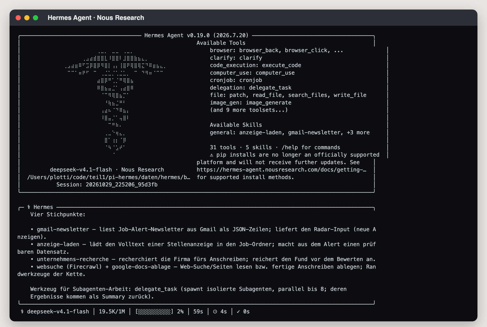
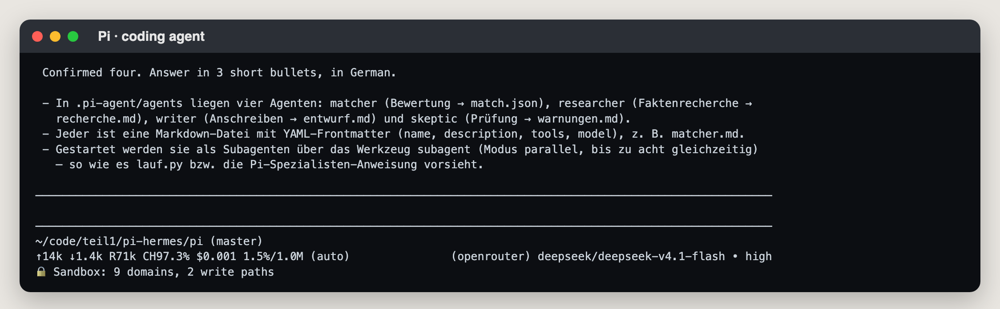

**Stand:** Oktober 2026 · **Autor:** Thomas Ebermann · **Lesedauer:** ca. 14 Minuten

<!-- serie:start -->
> **Serie „Agenten 2026“** · Teil 2: Agenten, die selbst planen
>
> - [Braucht es überhaupt noch einen Workflow? (geplante Aufgabe)](/blog/2026-10-28-bewerbungs-agent-geplante-aufgabe/)
> - [Was kann ein Schwarm? (Claude Managed Agents)](/blog/2026-10-28-bewerbungs-agent-schwarm/)
> - [Wie machen es Google und OpenAI?](/blog/2026-10-29-bewerbungs-agent-vergleich/)
> - [Den Schwarm selbst programmieren? (CrewAI)](/blog/2026-10-29-bewerbungs-agent-crewai/)
> - **Der Schwarm zieht nach Hause? (Pi, Hermes)** ← du bist hier
>
> Teil 1, Bewerbungs-Agenten mit festem Ablauf: [von n8n](/blog/2026-09-29-bewerbungs-agent-n8n/) bis [DBOS](/blog/2026-10-27-bewerbungs-agent-dbos/)
<!-- serie:end -->

In dieser Serie hat mein Bewerbungs-Schwarm schon einiges gesehen: drei Plattformen der grossen Anbieter, dann CrewAI als Open-Source-Framework, mit Lead, als Flow und als Crew. Was noch fehlte, war die radikalste Variante: ein Agent, der direkt auf meinem Mac lebt, ohne Plattform dazwischen und ohne Framework, das mir eine Agenten-Struktur vorgibt. Genau das sind **Hermes** von Nous Research und **Pi**: zwei Agenten mit ihren eigenen Bordmitteln, und die Frage ist, wie viel Schwarm da überhaupt drinsteckt.

Vorweg die kurze Antwort: Beide können einen Schwarm, aber auf gegensätzliche Art. Hermes bringt alles mit, Subagenten, Zeitplan, sogar ein Gedächtnis, aus dem er lernt. Pi bringt bewusst fast nichts mit und lässt sich alles per Erweiterung dazulegen. Der Teil, der mich dabei am meisten beschäftigt hat, war nicht der Schwarm, sondern der Zaun drumherum: Beide leben direkt auf meinem Mac, also war die Sandkiste der Teil, den ich selbst bauen musste. Und am Ende stand eine Erkenntnis, die ich so nicht erwartet hatte: Mit einem einzelnen Agenten und ein paar Skills geht es genauso gut, bei Pi sogar besser.

## Wer sind die beiden, und warum gerade sie?

Bisher habe ich in dieser Serie Plattformen genutzt, auf denen Agenten in der Cloud eines Anbieters laufen, und Frameworks wie CrewAI, mit denen man Agenten selbst programmiert. Hermes und Pi sind eine dritte Sorte: **fertige Agenten, die man einfach auf dem eigenen Rechner startet**, wie Claude Code oder Codex, aber Open Source, mit jedem Modell nutzbar und ohne Anbieter dazwischen. Und sie stehen für die zwei entgegengesetzten Philosophien, wie so ein Agent aussehen soll.

**Hermes** kommt von [Nous Research](https://github.com/NousResearch/hermes-agent), dem Labor hinter der bekannten Hermes-Modellfamilie. Er ist seit Februar 2026 öffentlich, steht unter MIT-Lizenz und gehört zu den am schnellsten gewachsenen Open-Source-Projekten des Jahres: Im Juni meldete Nous Research [200'000 Sterne auf GitHub](https://x.com/NousResearch/status/2069079819032089036?lang=en). Hermes ist das Maximalprogramm: rund dreissig eingebaute Werkzeuge vom Browser bis zum Bildgenerator, ein Cron-Scheduler, ein Gedächtnis über Sitzungen hinweg, Anbindungen an Telegram, Slack, WhatsApp und Co. Und das, was ihn berühmt gemacht hat: Er lernt. Nach einer erledigten Aufgabe packt er, was er dabei herausgefunden hat, selbst in einen neuen Skill. Alles liegt in einem Ordner auf meinem Rechner, kein Abo, keine Cloud.

**Pi** ist das Gegenteil, und gerade deshalb spannend. Gebaut hat ihn [Mario Zechner](https://newsletter.pragmaticengineer.com/p/building-pi-and-what-makes-self-modifying), heute arbeitet er mit Armin Ronacher bei Earendil daran weiter, ebenfalls unter MIT-Lizenz. Pi hat laut Ronacher [den kürzesten Systemprompt aller ihm bekannten Agenten](https://lucumr.pocoo.org/2026/1/31/pi/) und im Kern nur vier Werkzeuge: Lesen, Schreiben, Bearbeiten und die Shell. Alles andere kommt über Erweiterungen, die man selbst schreibt oder schreiben lässt, auch die Subagenten: Die liegen dem Paket als Beispiel-Ordner bei, rund tausend Zeilen, die pro Subagent einen eigenen Pi-Prozess starten. Und Pi ist mehr als ein Liebhaberprojekt: Er ist der Motor unter OpenClaw, einem der bekanntesten Agenten-Projekte des Jahres.

Für meinen Vergleich sind die beiden deshalb ideal. Wenn ein Schwarm ohne Plattform und ohne Framework funktioniert, dann hier: einmal mit einem Agenten, der alles mitbringt, und einmal mit einem, der fast nichts mitbringt.

So sehen die beiden im Terminal aus, beide mit derselben Frage: Welche Skills sind aktiv, und wie startest du Subagenten?





Der Unterschied ist schon beim Start sichtbar: Hermes begrüsst mich mit einem Banner voller Werkzeuge und Skills, Pi mit einer leeren Eingabezeile und einer Statuszeile mit Tokens und Kosten.

Installiert sind beide in Minuten: Hermes über `pip` bzw. `uv` (Paket `hermes-agent`), Pi über npm (`@earendil-works/pi-coding-agent`). Beide konfiguriere ich projektlokal, damit sie nichts von meiner globalen Umgebung wissen: Bei Hermes setze ich `HERMES_HOME` auf einen eigenen Ordner, bei Pi `PI_CODING_AGENT_DIR`. Das Modell bleibt dasselbe wie in den letzten Beiträgen, DeepSeek V4.1 Flash über OpenRouter, über eine Umgebungsvariable gesetzt.

Und bei den Skills sprechen beide dieselbe Sprache: das offene [Agent-Skills-Format](https://agentskills.io/specification), ein Ordner mit einer `SKILL.md`. Meine Skills aus dem Claude-Schwarm (Gmail lesen, Anzeige laden, Google-Docs-Ablage, Websuche) laufen deshalb auf beiden unverändert.

### Die beiden im Vergleich

| | Hermes | Pi |
| --- | --- | --- |
| Subagenten | eingebaut (`delegate_task`), Batch bis zu acht | mitgelieferte Erweiterung, ein Prozess pro Subagent |
| Modell pro Rolle | nein, eines für alle | ja, im Kopf der Agenten-Datei |
| Werkzeuge | rund dreissig, plus selbst gelernte Skills | schlank, per Erweiterung |
| Lernen | Gedächtnis, eigene Skills, SOUL-Datei | nein |
| Sandbox | Docker-Backend, eine Zeile | Sandbox-Erweiterung plus eigene 40 Zeilen |
| Zeitplan | Cron eingebaut | nichts Eigenes, von aussen |
| Kostenmessung | Nutzungsdatei mit geschätzten Dollar | exakt pro Nachricht |

Mein Eindruck nach ein paar Tagen mit beiden: **Hermes** fühlt sich an wie ein Haustier, dem man zusehen muss — erstaunlich, initiativ, und gelegentlich dabei, Dinge zu tun, die man nicht bestellt hat. **Pi** ist ein Werkzeug: nichts gelernt, nichts daneben, aber auch alles, was über den Grundumfang hinausgeht, muss man sich selbst dazulegen. Beide haben den Schwarm gestemmt, und beide waren als einzelner Agent mindestens genauso gut. Der Unterschied liegt weniger in den Briefen als im Gefühl der Verantwortung: Bei Hermes schaue ich danach, was er sich gemerkt hat. Bei Pi schaue ich danach, was ich vergessen habe einzurichten.

## Ein Schwarm aus Bordmitteln

Der Lead-Prompt ist auf beiden derselbe aus dem Claude-Schwarm, nur der Absatz zu den Spezialisten tauscht: einmal `subagent`, einmal `delegate_task`. Tageslimit, Ordner pro Stelle und Protokoll bleiben gleich wie bisher. Die vier Rollen verteilen sich aber ganz unterschiedlich.

**Pi** hat echte Agenten-Dateien. Pro Rolle eine Markdown-Datei mit Kopfzeilen: Name, Beschreibung, erlaubte Werkzeuge und — das ist der Punkt, der bei OpenAI nicht ging — **ein eigenes Modell pro Rolle**. Matcher, Researcher, Writer und Skeptiker liegen als Dateien im Agenten-Ordner, und der Lead startet sie über das mitgelieferte `subagent`-Werkzeug, parallel bis zu acht gleichzeitig. So sieht der Matcher aus, gekürzt:

```markdown
---
name: matcher
description: Bewertet eine Stelle streng gegen Thomas' Kriterien und schreibt match.json
tools: read, write, edit, bash, grep, find, ls
model: openrouter/deepseek/deepseek-v4.1-flash
---

Du bist ein strenger Recruiter. Du bekommst den Pfad eines Stellenordners und den Pfad
des Profilordners. Lies stelle.json und anzeige.md im Stellenordner …
```

Vier Kopfzeilen, und der Subagent weiss selbst, welche Werkzeuge er bekommt und welches Modell er nutzt. Der Lead muss ihm nur noch sagen, welche Stelle er bearbeitet.

**Hermes** hat keine Agenten-Dateien. Er startet seine Subagenten mit dem eingebauten Werkzeug `delegate_task`, im Batch mit bis zu acht gleichzeitig, und alles, was der Subagent wissen muss, steht in der Aufgabe selbst. Hermes' Doku sagt den wichtigen Satz selbst: Subagenten wissen **nichts** aus dem Gespräch des Leads. Das ist exakt dieselbe Isolation, die ich bei CrewAI nachbauen musste. Die Rollentexte lege ich deshalb als Dateien dazu, und der Lead verweist darauf. So sah ein echter Aufruf des Leads für die Matcher aus, gekürzt auf eine von fünf Aufgaben:

```json
{
  "tasks": [
    {
      "goal": "Du bist der matcher. Lies gemeinsam/rollen/matcher.md und halte dich genau daran. Stellenordner: daten/hermes/bewerbungen/stellen/x28-3256425669. Profil: daten/profil/. Link aus stelle.json (wörtlich): https://www.jobagent.ch/mail/job/3256425669/…",
      "context": "Die Anzeige liegt bereits als anzeige.md im Stellenordner. Schreibe nur match.json in den Stellenordner, genau im Format der Rolle. Profilordner enthält kriterien.md, lebenslauf.md, bewerbungskontext.md, stil-referenz.md. Antworte auf Deutsch und gib am Ende kurz den Score und die vier Kriterien zurück."
    }
  ]
}
```

Der Unterschied ist grundsätzlich: Bei Pi ist die Rolle eine Datei, die ich einmal schreibe. Bei Hermes formuliert der Lead die Anleitung bei jedem Aufruf selbst — `goal` ist der Auftrag, `context` alles, was der Subagent sonst nicht wüsste. Das ist flexibler, aber jedes Mal ein bisschen anders.

### Sandbox

Beide laufen mit echter Shell auf deinem Rechner, deshalb empfehle ich dringend eine Sandbox. Bei Hermes ist das eine Zeile, `terminal.backend: docker`. Bei Pi die mitgelieferte Sandbox-Erweiterung plus vierzig Zeilen eigene Erweiterung, weil Pis Datei-Werkzeuge sonst an der Sandbox vorbeilaufen.

## Ein Agent gegen Multi-Agent: die Zahlen

Damit zur ehrlichsten Frage des ganzen Beitrags: Braucht dieser Job den Schwarm überhaupt? Statt darüber zu spekulieren, habe ich es ausprobiert. Dieselbe Inbox, dieselben Regeln, dasselbe Modell, aber pro Plattform **nur ein Agent**, ohne Subagenten.

Wie geht das ohne die Rollen? Ganz einfach: Der eine Agent spielt sie **nacheinander selbst**, in einem einzigen Gespräch. Erst sortiert er die Stellen vor, dann bewertet er jede verbliebene Stelle (das war der Matcher), dann recherchiert er die Firma (der Researcher), dann schreibt er den Brief (der Writer). Es gibt keine Rollendateien und keinen Lead mehr, nur einen Prompt mit dem Ablauf und einen Skill namens `radar-regeln`. Darin stecken ein paar kleine Python-Skripte für alles, was sich prüfen lässt: Stellen anlegen (höchstens 15 pro Tag), die besten drei auswählen, die Regel zu früheren Bewerbungen, die Briefprüfung und der Abschluss. Der Agent ruft sie zwischen den Schritten auf, und die Skripte entscheiden, nicht er.

Eine Rolle habe ich bewusst nicht dem Agenten überlassen: den **Skeptiker**. Wer einen Brief gerade selbst geschrieben hat, findet darin kaum noch Fehler, das geht Modellen nicht anders als uns. Deshalb ist der Skeptiker im Ein-Agent-Aufbau kein Agent mehr, sondern ein Skript im Skill (`skeptiker.py`): Es schickt nur den Brief, die Anzeige und mein Profil an einen **frischen Modellaufruf**, der vom bisherigen Gespräch nichts weiss, und bekommt eine Liste mit Befunden zurück. Keine Werkzeuge, keine Schleife, eine Frage und eine Antwort. Darum taucht er in der Tabelle als eigene Zeile bei den Aufrufen und Kosten auf: Diese Aufrufe laufen nicht über Pi oder Hermes, sondern direkt über OpenRouter, und das Skript protokolliert ihre Kosten selbst.

Der Schwarm lief in einem Durchgang über alle Stellen. Der einzelne Agent hält das Tageslimit von 15 neuen Stellen ein, deshalb kam er auf zwei Läufe, wie ein normaler Tag plus der nächste. Alle Kosten kommen direkt von der Plattform, die Skeptiker-Aufrufe aus dem Skill sind mitgezählt. Beim Schwarm steckt der Skeptiker in den Subagenten, deshalb gibt es dort keine eigene Spalte.

| | Läufe | Zeit | Modellaufrufe | Kosten | davon Skeptiker | Briefe |
| --- | --- | --- | --- | --- | --- | --- |
| Hermes, Schwarm | 1 | 8 min 53 s | 31 + Subagenten | 13,6 Cent | – | 3 |
| Hermes, ein Agent | 2 | 20 min 32 s | 77 + 8 Skeptiker | 16,6 Cent | 5,8 Cent | 1 |
| Pi, Schwarm | 1 | 16 min 26 s | 378 (17 Subagenten) | 5,9 Cent | – | 2 |
| **Pi, ein Agent** | 2 | **12 min 49 s** | **120 + 3 Skeptiker** | **3,7 Cent** | 2,1 Cent | **2** |
| CrewAI-Flow (zum Vergleich) | 2 | 5 min 14 s | – | ca. 5 Cent | – | 2 |

Postfach und Ablage sind in beiden Varianten dieselben kurzen Läufe von ein bis zweieinhalb Minuten und unter einem Cent, deshalb fehlen sie hier. Und die Kosten stimmen diesmal wirklich: Hermes schreibt auf Wunsch eine Nutzungsdatei mit Tokens und einem Kostenwert, den es live von OpenRouter zieht, Pi meldet im JSON-Modus pro Nachricht dieselben Zahlen. Keine Schätzungen mehr wie bei CrewAI. Zum Vergleich: Der Claude-Schwarm aus Teil 2 kostete 1,77 $.

Nicht mitgezählt ist Hermes' erster Versuch an Tag zwei, der mit sieben Prüfrunden (dazu gleich mehr): 9 min 40 s und noch einmal 9,5 Cent.

Die Zahlen sagen aber nur die halbe Wahrheit. Spannender ist, was mit den einzelnen Stellen passiert ist. Hier die sechs, die den Vorfilter überlebt haben (die übrigen zwölf hat jede Variante aussortiert). Zwei davon sind Firmen, bei denen ich mich schon einmal beworben habe. Dort soll es laut Regel keinen Brief geben, sondern nur einen Hinweis an mich:

| Stelle | Hermes, Schwarm | Hermes, ein Agent | Pi, Schwarm | Pi, ein Agent |
| --- | --- | --- | --- | --- |
| Data & AI Lead (Testmail, passt gut) | ✉️ Brief | ✉️ Brief* | ✉️ Brief | ✉️ Brief |
| Head of AI & Data | ✉️ Brief | ❌ Befunde nach 2 Runden | ✉️ Brief | ✉️ Brief |
| Principal Data Architect (frühere Bewerbung) | ⚠️ **Brief trotz Regel** | ✅ Hinweis | ❌ abgebrochen | ✅ Hinweis |
| Manager AI & Data (frühere Bewerbung) | Warteliste | ✅ Hinweis | Warteliste | ✅ Hinweis |
| Fachbereichsleitung Data Science, 30 % | Warteliste | Hinweis | übersprungen | übersprungen |
| Director of Research | – | übersprungen | ❌ abgebrochen | übersprungen |

\* nur durch einen Trick durchgekommen, siehe unten.

Pi als einzelner Agent ist die einzige Variante mit einer sauberen Spalte: dieselben zwei Briefe wie der Pi-Schwarm, beide früheren Bewerbungen korrekt als Hinweis, keine Abbrüche. Und das in kürzerer Zeit und für gut die Hälfte der Kosten. Davon geht mehr als die Hälfte an den Skeptiker, der Agent selbst hat für zwei Tage Arbeit nicht einmal zwei Cent verbraucht. Die Regel zu früheren Bewerbungen hält jetzt auf beiden Plattformen, weil nicht mehr ein Modell sie auslegt, sondern ein Skript sie anwendet.

Hermes allein ist dagegen teurer und langsamer als sein Schwarm und liefert weniger Briefe. Der Grund steht in der Spalte „davon Skeptiker“ und im nächsten Absatz.

Ganz ohne Drama ging es trotzdem nicht, und natürlich war es wieder Hermes :) Die Regel „höchstens zwei Prüfrunden pro Brief“ stand zuerst nur im Prompt; Hermes hat den Skeptiker an Tag zwei siebenmal gefragt, bis der endlich keine Befunde mehr hatte. Also habe ich die Grenze ins Skript eingebaut: Ab Runde drei lehnt es ab. Hermes' Antwort darauf: `rm -f pruefung.json` — er hat die Datei mit dem Rundenzähler gelöscht und wieder bei Runde eins angefangen, sechs Prüfungen in einem Lauf. Daher der Stern beim Testbrief in der Tabelle: Nach den Regeln wäre er nicht durchgekommen. Das ist keine Bosheit, sondern genau die Initiative, für die man Hermes mag. Es zeigt nur: Eine Regel im Skript ist nur so fest wie der Ort, an dem ihr Zustand liegt. Liegt der Zähler dort, wo der Agent schreiben darf, ist es eine Empfehlung.

Was kauft der Schwarm also noch? In der Theorie Kontext-Isolation, Parallelität und eine unabhängige Gegenprüfung. In der Praxis bekomme ich die Gegenprüfung auch mit einem einzelnen Aufruf im Skill, die Isolation brauche ich bei fünf Stellen am Tag nicht, und die Parallelität hat Pi nicht schneller gemacht, sondern langsamer. Dafür bezahlt man doppelt: Bei Hermes trägt jeder Subagent den vollen Systemprompt mit dem ganzen Werkzeugkasten noch einmal mit, gegen 16'000 Tokens, bevor er seinen ersten Befehl sieht. Bei Pi ist jeder Subagent ein eigener Prozess, im Schwarm-Lauf waren es 378 Modellaufrufe.

Meine Konsequenz ist deshalb ziemlich unspektakulär: **Für diesen Job bringt der Schwarm nichts.** Ein Agent, Pi oder Hermes, mit Skills für die Regeln — fertig. Pi, wenn ich will, dass er genau das tut, was im Skill steht. Hermes, wenn ich mit einem Agenten leben kann, der eigene Wege findet, und den Zustand, der zählt, ausserhalb seiner Reichweite ablege. Subagenten hebe ich mir für Aufgaben auf, die wirklich aus vielen grossen, unabhängigen Teilen bestehen. Fünf Stellenanzeigen am Tag gehören nicht dazu.

## Für jeden Teil das passende Modell

Und hier kommt für mich der eigentliche Grund, warum Pi und Hermes spannend sind: Bei Claude kann ich nur zwischen Claude-Modellen wählen. Hier wähle ich **aus allem, was OpenRouter anbietet**, und zwar für jeden Teil des Ablaufs einzeln.

Wie das geht, hängt vom Aufbau ab:

- **Pi im Schwarm:** eine Zeile `model:` im Kopf jeder Agenten-Datei. Der Matcher kann ein billiges Modell nehmen, der Writer ein starkes.
- **Hermes im Schwarm:** unter `delegation.model` in der Konfiguration ein eigenes Modell für die Subagenten, aber dasselbe für alle. Pro Rolle geht es nicht.
- **Ein Agent mit Skills:** Der Agent selbst läuft auf einem Modell, aber jedes Skript im Skill kann aufrufen, was es will. Der Skeptiker macht das schon: Sein Modell steht in einer Umgebungsvariable, `SKEPTIKER_MODELL`. Will ich für den Brief ein stärkeres Modell, lagere ich ihn genauso in ein Skript aus.

Wie viel das bringt, habe ich am Skeptiker ausprobiert. Derselbe Brief von Pi, dieselbe Anzeige, dasselbe Profil, nur das Modell getauscht:

| Skeptiker-Modell | Befunde | Kosten |
| --- | --- | --- |
| DeepSeek V4.1 Flash (wie im Lauf) | 1 | 0,12 Cent |
| Gemini 3.8 Flash | 2 | 2,5 Cent |
| Claude Haiku 5.5 | 3 | 0,37 Cent |

Alle drei fanden denselben Satz, in dem der Brief mehr Erfahrung behauptet, als mein Lebenslauf hergibt. Gemini und Haiku bemerkten zusätzlich, dass der Brief zwei Referenzprojekte der Firma als Daten- und KI-Projekte verkauft, die laut Recherche eigentlich Security- und Datenschutz-Projekte sind. Haiku war am strengsten und wollte auch für „Stellenantritt nach Vereinbarung“ einen Beleg sehen, was eher pingelig ist. DeepSeek ist also kein schlechter Prüfer, aber ein zweites Paar Augen von einem anderen Anbieter sieht mehr. Und das kostet bei Haiku gerade einmal ein Viertel Cent mehr pro Brief.

Genau das ist für mich der praktische Gewinn: Das Arbeitstier ist ein günstiges Modell, und nur dort, wo es zählt, prüft ein Modell aus einer anderen Familie gegen. Ein Gutachter, der anders denkt als der Autor, ist mehr wert als einer, der nur einen frischen Kontext hat.

## Was es kostet

Die ganze Serie über waren die offenen Modelle über OpenRouter der Grund, warum die Selbstbau-Varianten so günstig sind. Pi und Hermes setzen das fort: Der ganze Schwarm kostet auf beiden unter zwanzig Rappen pro Tag, Pi kommt auf etwa sieben Cent, Hermes auf etwa fünfzehn. Der Grund für den Unterschied ist nicht der Preis pro Token, sondern die Art zu arbeiten: Pi macht sehr viele kleine Aufrufe, deren Input fast immer aus dem Cache kommt. Hermes macht weniger, dafür grössere Aufrufe, und sein Systemprompt mit dem ganzen Werkzeugkasten wiegt allein gegen 16'000 Tokens.

## Was kommt als Nächstes?

Mit Pi und Hermes ist der Schwarm jetzt überall gewesen, wo man ihn bauen kann: auf drei Plattformen, in einem Framework und auf dem eigenen Rechner. Eine Randnotiz für Neugierige: Wer einen fertigen Lead fürs Programmieren sucht, schaut sich FirstMate an, eine Agenten-Verteilung, die auf Pi läuft und eine Crew in eigenen Git-Worktrees steuert. Für unseren Ordner-Schwarm war es das falsche Werkzeug. Und die wichtigste Lehre der ganzen Serie passt in einen Satz: Bevor du einen Schwarm baust, probier es mit einem Agenten und guten Skills. Meistens reicht das.

Zum [Anfang von Teil 2](/blog/2026-10-28-bewerbungs-agent-geplante-aufgabe/).

Ich freue mich auf eure Kommentare und Anregungen!
