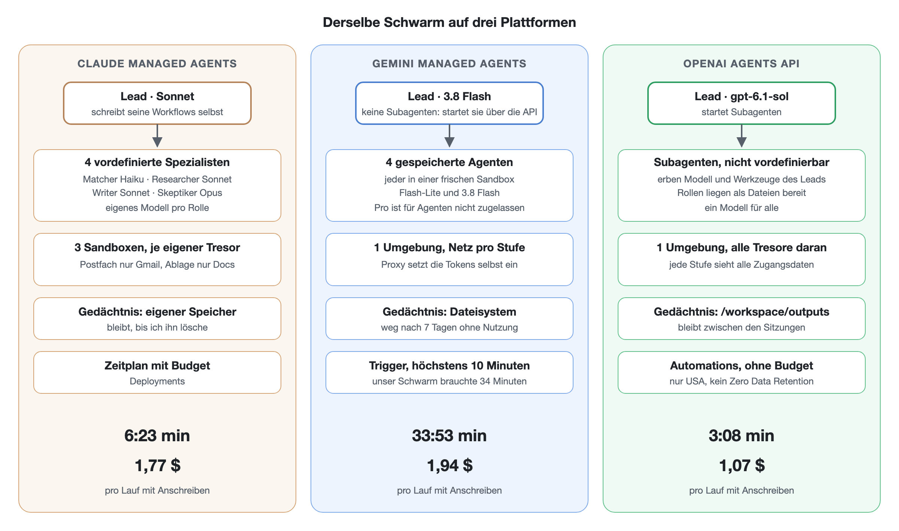

**Stand:** Oktober 2026 · **Autor:** Thomas Ebermann · **Lesedauer:** ca. 12 Minuten

<!-- serie:start -->
> **Serie „Agenten 2026“** · Teil 2: Agenten, die selbst planen
>
> - [Braucht es überhaupt noch einen Workflow? (geplante Aufgabe)](/blog/2026-10-28-bewerbungs-agent-geplante-aufgabe/)
> - [Was kann ein Schwarm? (Claude Managed Agents)](/blog/2026-10-28-bewerbungs-agent-schwarm/)
> - **Wie machen es Google und OpenAI?** ← du bist hier
> - [Den Schwarm selbst programmieren? (CrewAI)](/blog/2026-10-29-bewerbungs-agent-crewai/)
> - [Der Schwarm zieht nach Hause? (Pi, Hermes)](/blog/2026-10-29-bewerbungs-agent-pi-hermes/)
> - [Ich bau mir meinen Schwarm komplett selbst (Microsoft Agent Framework)](/blog/2026-10-30-bewerbungs-agent-microsoft/)
>
> Teil 1, Bewerbungs-Agenten mit festem Ablauf: [von n8n](/blog/2026-09-29-bewerbungs-agent-n8n/) bis [DBOS](/blog/2026-10-27-bewerbungs-agent-dbos/)
<!-- serie:end -->

Im [letzten Beitrag](/blog/2026-10-28-bewerbungs-agent-schwarm/) habe ich meinen Bewerbungs-Agenten als Schwarm auf Claude Managed Agents gebaut: Ein Lead verteilt die Arbeit an einen Matcher, einen Researcher, einen Writer und einen Skeptiker, und am Ende liegt ein geprüftes Anschreiben in meiner Google-Docs-Vorlage. Am Schluss hatte ich versprochen, dasselbe bei Google und OpenAI nachzubauen. Beide haben inzwischen ein sehr ähnliches Angebot, nämlich **Gemini Managed Agents** und die **OpenAI Agents API**.

Klingt nach einem Nachmittag Arbeit? Das dachte ich auch :) Die kurze Antwort ist: Beide Schwärme laufen, von der Gmail-Mail bis zur Push-Nachricht auf dem Handy. Die längere Antwort ist dieser Beitrag, denn auf dem Weg dahin habe ich ziemlich viel darüber gelernt, wie unterschiedlich drei Anbieter dieselbe Idee umsetzen.

## Die Spielregeln

Damit der Vergleich fair ist, habe ich mir eine einfache Regel gesetzt: **alles gleich wie bei Claude.** Dieselben drei Teile (Postfach um 6:40, Schwarm um 7:00, Ablage um 8:30), dieselben fünf Rollen, dieselben Regeln für den Lead, dasselbe Profil mit Lebenslauf, Bewerbungskontext, Stil-Referenz und Kriterien und dieselbe Ordnerstruktur pro Stelle. Wo eine Plattform etwas nicht kann, nehme ich ihre nächstbeste eigene Lösung. Genau diese Lücken sind am Ende das eigentliche Ergebnis.

Getestet habe ich alle drei mit denselben Daten: vier echte Job-Alerts von jobs.ch und x28 mit 17 Stellen, plus eine Testmail mit einer Stelle, von der ich wusste, dass sie gut passt. So kommt der Schreibteil sicher dran.

## Was es auf den drei Plattformen gibt

Auf dem Papier sehen die drei Angebote fast gleich aus. Alle drei betreiben die Agenten-Schleife für dich, geben jedem Agenten eine Sandbox mit Shell, kennen Skills, haben einen Tresor für Zugangsdaten und einen Zeitplan. Der Teufel steckt, wie so oft, im Detail:

| | Claude Managed Agents | Gemini Managed Agents | OpenAI Agents API |
| --- | --- | --- | --- |
| Gedächtnis | eigener Speicher, in jeder Sitzung als Ordner | das Dateisystem einer Umgebung | das Dateisystem einer Umgebung (`/workspace/outputs`) |
| Spezialisten | vordefinierte Agenten, der Lead schreibt Workflows | **keine Subagenten**, ich starte sie selbst über die API | Subagenten, aber **nicht vordefinierbar**, sie erben Modell und Werkzeuge vom Lead |
| Modell pro Rolle | frei wählbar | frei wählbar, aber nur Flash-Modelle | ein Modell für den ganzen Schwarm |
| Zugangsdaten | Platzhalter, echter Wert erst beim Verlassen der Sandbox | der Proxy holt und setzt den Token selbst ein | Platzhalter wie bei Claude |
| Netz pro Teil | drei Umgebungen, je eigenes Netz | eine Umgebung, jede Stufe setzt ihr Netz beim Start neu | eine Umgebung, ein Netz für alles |
| Zeitplan | Deployments mit Budget | Trigger, **höchstens 10 Minuten** | Automations, ohne Budget |

Schauen wir uns die spannenden Zeilen genauer an.

## Gemini: Spezialisten zum Selbermachen

Bei Gemini steht in der Doku ein unscheinbarer Satz: „Subagent delegation is not yet supported.“ Ein Lead, der Spezialisten startet, ist aber der Kern des ganzen Schwarms. Was also tun?

Die Lösung ist ein kleiner Skill namens `spezialisten`. Der Lead ruft ihn mit einer Rolle und einer Liste von Stellenordnern auf, und das Skript startet pro Stelle einen eigenen gespeicherten Agenten über die Gemini-API, jeden in einer frischen Sandbox, bis zu acht gleichzeitig. Der Spezialist bekommt die Dateien seiner Stelle mitgeschickt und antwortet mit genau einer Datei, die das Skript dann ablegt. Den API-Schlüssel dafür sieht der Lead nie, den setzt der Proxy beim Verlassen der Sandbox ein.

Zuerst hatte ich es übrigens einfacher versucht: Spezialisten in derselben Umgebung wie der Lead starten. Das funktioniert, nur hat ein einzelner Aufruf geschlagene 19 Minuten gedauert, weil die Umgebung belegt war, solange der Lead lief. Mit einer frischen Sandbox waren es 27 Sekunden.

Was mir bei Gemini richtig gut gefallen hat, ist der Umgang mit Zugangsdaten. Ich hinterlege bei Google nur den Refresh-Token, und der Proxy holt sich selbst ein Access-Token und setzt es in jede Anfrage an Gmail oder Google Docs ein. Die Skripte in der Sandbox rufen einfach die API auf, ganz ohne Token. Im letzten Beitrag hatte ich mich noch darüber geärgert, dass bei Claude das Access-Token nach dem Tausch in der Sandbox landet. Hier gibt es das Problem gar nicht.

Und noch ein Kniff, den ich erst beim Lesen des SDK-Codes gefunden habe: Jede Interaktion kann die Netzregeln einer bestehenden Umgebung neu setzen. So bekommt das Postfach nur Gmail, der Schwarm nur Firecrawl und die Gemini-API, die Ablage nur Docs und ntfy, und trotzdem teilen alle drei dasselbe Dateisystem als Gedächtnis. Probiert habe ich es natürlich: In der Ablage-Stufe kam Google Docs durch, Gmail und Firecrawl hat der Proxy mit 403 abgewiesen.

## OpenAI: Subagenten mit Erbschaft

OpenAI hat Subagenten, allerdings mit einem Haken: Man kann sie nicht vordefinieren. Der Lead startet einfach Subagenten, und die erben sein Modell und seine Werkzeuge. Die Rollen liegen deshalb als Dateien in der Umgebung, und der Lead gibt jedem Subagenten den Auftrag „Du bist der Matcher, lies `/workspace/rollen/matcher.md` und halte dich daran“. Das funktioniert erstaunlich gut, bedeutet aber auch, dass mein Skeptiker auf demselben Modell läuft wie der Writer, den er prüfen soll. Bei Claude lief er bewusst auf dem stärksten Modell.

Schön war, wie wenig ich umbauen musste. Die Tresore funktionieren wie bei Claude, mit einem Platzhalter in einer Umgebungsvariable, der erst beim Verlassen der Sandbox und nur für freigegebene Adressen ersetzt wird. Meine drei Claude-Skills für Gmail, Anzeigen und Google Docs liefen deshalb **unverändert**. Und anders als bei Gemini kann ich live zuschauen, welcher Subagent gerade was tut.

Der grösste Unterschied liegt bei der Sicherheit. Bei OpenAI sind die Tresore fest an die Umgebung gebunden, und jede Sitzung muss genau dieselben verwenden. Wenn sich alle drei Teile ein Gedächtnis teilen sollen, hat also jeder Teil Zugriff auf alle Zugangsdaten, auch der Lead, der fremde Stellenanzeigen liest, und jeder seiner Subagenten, die dieselbe Shell haben. Die saubere Trennung aus dem letzten Beitrag lässt sich so nicht nachbauen.

## Die Zahlen

Kommen wir zum Teil, auf den du wahrscheinlich gewartet hast. Alle Werte stammen aus der Abrechnung der einzelnen Läufe:

| | Claude | Gemini | OpenAI |
| --- | --- | --- | --- |
| Postfach | 50 s · 0,01 $ | 1 min 12 s · 0,07 $ | 1 min 4 s · 0,04 $ |
| Schwarm | 6 min 23 s · 1,77 $ | **33 min 53 s** · 1,94 $ | **3 min 8 s** · 1,07 $ (+ 3 min 17 s · 1,36 $) |
| Ablage | 37 s · 0,01 $ | 2 min 20 s · 0,06 $ | 58 s · 0,06 $ |
| Tokens rein, Schwarm | 2,5 Mio. | 10 Mio. | 2,4 Mio. (+ 2,9 Mio.) |
| Anschreiben | 1, mit einer Überarbeitung | 2 | 2, über zwei Läufe |
| Modelle | Haiku, Sonnet, Opus je nach Rolle | 3.5 Flash-Lite und 3.8 Flash | gpt-6.1-sol für alle Spezialisten |

Ganz Äpfel mit Äpfeln ist das nicht, das gebe ich zu. Bei Claude hat der Skeptiker im ersten Entwurf fünf Befunde gefunden, deshalb gab es eine zweite Runde. Bei Gemini und OpenAI hat er beide Entwürfe gleich durchgewunken. Pro Anschreiben gerechnet landen alle drei irgendwo zwischen einem und zwei Dollar.

Und warum zwei Läufe bei OpenAI? Weil sich der Lead dort am strengsten an meine Regeln gehalten hat. In der Inbox lagen 18 Stellen, erlaubt sind 15 pro Lauf, also hat er drei auf „morgen“ verschoben, und ausgerechnet meine Teststelle war dabei. Regelkonform, aber für einen Test ein bisschen ärgerlich :) Der zweite Lauf hat sie dann nachgeholt und nebenbei bewiesen, dass das Gedächtnis über mehrere Sitzungen hinweg funktioniert.

Der Ausreisser ist ganz klar Gemini mit über einer halben Stunde. Wo bleibt die Zeit? Die Spezialisten selbst waren nicht das Problem. Ein Matcher braucht 20 bis 70 Sekunden, ein Writer zwei bis fünf Minuten. Es ist der Lead: gut zehn Minuten, bevor er überhaupt den ersten Matcher gestartet hat, noch einmal fünf Minuten für die Auswahl danach und drei für den Abschluss, mit 7,4 Millionen gelesenen Tokens. Er hat in 244 Schritten gearbeitet, viele davon waren Python-Einzeiler, die an Anführungszeichen gescheitert sind, und ein paar davon waren, sagen wir, neugierig (dazu gleich mehr). Dass es trotzdem nicht teurer ist als bei Claude, liegt an den günstigen Flash-Preisen und daran, dass 98 Prozent der Tokens des Leads aus dem Cache kamen.

OpenAI ist dagegen mit gut drei Minuten der schnellste der drei, sogar doppelt so schnell wie Claude. Der Lead hat seine Spezialisten früh gestartet, und keiner davon brauchte länger als eine halbe Minute.

## Wo es weh tat

**Gemini hat 200-mal ins Leere getippt.** Im allerersten Postfach-Lauf hat Flash-Lite jeden Shell-Befehl mit leerem Inhalt geschickt, 200-mal hintereinander, und sich jedes Mal über einen Syntaxfehler gewundert. Fünf Minuten, 2,3 Millionen Tokens und 22 Cent später lag keine einzige Datei im Gedächtnis. Beim zweiten Versuch lief derselbe Agent mit derselben Anweisung sauber durch. Reproduzieren konnte ich es nie mehr, was es nicht gerade beruhigender macht.

**Der Gemini-Lead hat geschnüffelt.** Weil im Betreff meiner Testmail „TEST“ stand, wollte der Lead offenbar herausfinden, woher sie kommt. Er hat `git log` aufgerufen, mit `find / -name "*test*"` die ganze Festplatte durchsucht und sogar die `.bash_history` gelesen. Gefunden hat er nichts, und am Ende hat er die Stelle ganz normal bearbeitet. Aber es zeigt schön, warum die Sandbox und die getrennten Zugangsdaten so wichtig sind: Was ein Agent alles ausprobiert, steht in keinem Prompt.

**Ein geplanter Gemini-Lauf darf höchstens zehn Minuten dauern.** Das habe ich erst beim Anlegen der Trigger gemerkt, als die API eine Laufzeit von einer Stunde mit „cannot exceed 600 seconds“ abgelehnt hat. Unser Schwarm brauchte 34 Minuten. Als Zeitplan würde er also jeden Morgen mitten in der Arbeit abgebrochen. Im Moment kann ich den Gemini-Schwarm nur von Hand starten.

**Fertige OpenAI-Subagenten bleiben „aktiv“.** Mein Messskript hat brav gewartet, bis alle Subagenten fertig sind, und das über 20 Minuten lang. Der Lauf war aber schon nach drei Minuten durch. Der Lead schliesst seine Subagenten nach getaner Arbeit einfach nicht, deshalb stehen sie weiter auf „active“. Fertig ist ein Lauf, wenn alle Turns abgeschlossen sind, auch die der Subagenten, und die muss man separat abfragen.

**Kein Budget bei OpenAI.** Das SDK kennt zwar einen Parameter für ein Ausgabelimit pro Sitzung, die API lehnt ihn aber mit „Unknown parameter“ ab. Bei Claude kann ich jedem Zeitplan ein Budget mitgeben, bei Gemini zumindest eine Höchstzahl an Tokens pro Agent.

**Wer ist eigentlich die Ansprechperson?** Das fand ich den lehrreichsten Fund. Für meine Teststelle haben die Researcher bei Claude und OpenAI unabhängig voneinander dieselbe Kontaktperson gefunden, die auf der Bewerbungsseite genau dieser Stelle steht. Der Gemini-Researcher hat dagegen einen Recruiter von der allgemeinen Karriereseite und von Kununu genommen und den Brief an ihn adressiert. Plausibel, aber für diese Stelle nicht belegt, und der Skeptiker hat es durchgewunken, weil in der Recherche ja eine Quelle stand. Eine Gegenprüfung prüft eben nur, ob eine Behauptung belegt ist, nicht, ob der Beleg auch passt.

## Und die Anschreiben?

Ehrlich gesagt waren alle drei gut, und zwar besser, als ich nach den ganzen Stolpersteinen erwartet hätte. Alle halten sich an die Längenregel, verwenden die richtigen Zahlen aus meinem Lebenslauf, beschreiben die NZZ im Präsens und meine früheren Stationen in der Vergangenheit und verlinken meine Webseite. Gemini schreibt etwas ausführlicher und nennt mehr Produkte der Firma, OpenAI eher knapp und sachlich. Bei OpenAI und Claude beginnt der Brief mit „Guten Tag“ und dem vollen Namen. In der Claude-Recherche steht auch, warum: Das Geschlecht der Kontaktperson war nirgends angegeben, und „Frau“ wäre nur eine Vermutung aus dem Vornamen. Lieber nicht raten, das finde ich ziemlich vorbildlich.

## Mein Fazit

Welche Plattform würde ich nehmen? Für meinen Bewerbungs-Agenten ganz klar weiterhin **Claude**, und zwar nicht wegen der Geschwindigkeit oder der Kosten, sondern weil es die einzige der drei Plattformen ist, auf der ich den Schwarm so bauen kann, wie ich ihn haben will: mit einem eigenen Modell pro Rolle, einem stärkeren Skeptiker, drei sauber getrennten Sandboxen, einem Budget pro Zeitplan und einem Gedächtnis, das nicht nach sieben Tagen ohne Nutzung mitsamt der Umgebung gelöscht wird, wie bei Gemini.

**OpenAI** ist die angenehmste Überraschung. Am schnellsten, am günstigsten pro Lauf, meine Skills liefen ohne Änderung, und ich kann live zuschauen. Wenn OpenAI Tresore pro Sitzung und vordefinierte Subagenten nachliefert, wird es richtig spannend. Bis dahin würde ich dort keinen Agenten fremde Webseiten lesen lassen, der gleichzeitig an mein Postfach kommt. Ausserdem läuft die Agents API nur in den USA und ohne Zero Data Retention, das muss man für persönliche Daten wie einen Lebenslauf mögen.

**Gemini** hat die eleganteste Lösung für Zugangsdaten und die günstigsten Modelle. Es fühlt sich aber noch am meisten nach Preview an: keine Subagenten, Trigger mit zehn Minuten Limit, kein Mitschauen während des Laufs und ein Lead, der eine halbe Stunde braucht und dabei in meiner Shell-History stöbert :)

Was mich am meisten überrascht hat: Bei allen dreien war der teuerste und langsamste Agent nicht der Writer und auch nicht der Skeptiker, sondern der Lead. Wer koordiniert, liest ständig alles wieder, und das kostet. Ich vermute, dass genau da in den nächsten Monaten am meisten passieren wird.

Den Code für Gemini und OpenAI habe ich wie den Claude-Schwarm in einem eigenen Repo abgelegt, mit allen Agenten, Skills, Setup-Skripten und den Messwerten, aber natürlich ohne meinen Lebenslauf.

## Was kommt als Nächstes?

Bisher lief jeder meiner Schwärme auf der Plattform eines Anbieters, der mir Sandbox, Tresor, Gedächtnis und Zeitplan fix und fertig hinstellt. Im nächsten Beitrag drehe ich den Spiess um und baue denselben Schwarm mit **CrewAI**, also mit Open Source. Dort ist das Team mit Rollen wie Matcher, Writer und Skeptiker sozusagen eingebaut. Dafür muss ich mich um alles andere selbst kümmern, was mir die drei Plattformen hier abgenommen haben. Ich bin gespannt, wie viel davon man wirklich vermisst, und was es kostet, wenn man es selbst betreibt.

<!-- serie:next -->
**Weiter in der Serie:** [Der Schwarm zum Selberbauen: CrewAI, offene Modelle und ein eigener Docker-Stack](/blog/2026-10-29-bewerbungs-agent-crewai/)
<!-- serie:next-end -->

Ich freue mich auf eure Kommentare und Anregungen!
