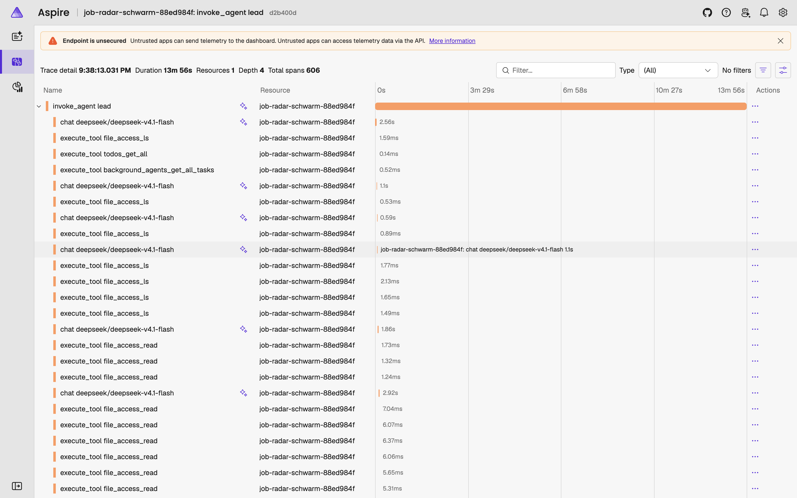

**Stand:** Oktober 2026 · **Autor:** Thomas Ebermann · **Lesedauer:** ca. 11 Minuten

<!-- serie:start -->
> **Serie „Agenten 2026“** · Teil 2: Agenten, die selbst planen
>
> - [Braucht es überhaupt noch einen Workflow? (geplante Aufgabe)](/blog/2026-10-28-bewerbungs-agent-geplante-aufgabe/)
> - [Was kann ein Schwarm? (Claude Managed Agents)](/blog/2026-10-28-bewerbungs-agent-schwarm/)
> - [Wie machen es Google und OpenAI?](/blog/2026-10-29-bewerbungs-agent-vergleich/)
> - [Den Schwarm selbst programmieren? (CrewAI)](/blog/2026-10-29-bewerbungs-agent-crewai/)
> - [Der Schwarm zieht nach Hause? (Pi, Hermes)](/blog/2026-10-29-bewerbungs-agent-pi-hermes/)
> - **Ich bau mir meinen Schwarm komplett selbst (Microsoft Agent Framework)** ← du bist hier
>
> Teil 1, Bewerbungs-Agenten mit festem Ablauf: [von n8n](/blog/2026-09-29-bewerbungs-agent-n8n/) bis [DBOS](/blog/2026-10-27-bewerbungs-agent-dbos/)
<!-- serie:end -->

Im letzten Beitrag stand am Ende ein ziemlich unspektakuläres Fazit: Für meinen Job-Radar bringt der Schwarm nichts, ein einzelner Agent mit guten Skills reicht. Pi und Hermes haben das beide gezeigt. Eine Frage blieb aber offen, und die stand schon in meinem ursprünglichen Plan für diese Serie: Was macht eigentlich Microsoft? Neben CrewAI ist das **Microsoft Agent Framework** das zweite grosse Open-Source-Framework, mit dem man Agenten selbst programmiert. Und weil ich das Fazit nicht auf zwei Kandidaten stützen wollte, habe ich den Radar ein drittes Mal gebaut — einmal als einzelner Agent und einmal als Schwarm, sonst alles gleich.

Vorweg die kurze Antwort: Das Ergebnis ist dasselbe, nur noch deutlicher. Der einzelne Agent schreibt zwei Briefe in gut 13 Minuten für 16 Cent. Der Schwarm braucht fast 50 Minuten, kostet das Zweieinhalbfache und liefert einen Brief.

## Wer ist das, und warum gerade jetzt?

Das [Microsoft Agent Framework](https://github.com/microsoft/agent-framework) ist der Nachfolger von zwei Projekten, die du vielleicht kennst: **AutoGen**, dem Forschungsprojekt, in dem Agenten frei miteinander plaudern, und **Semantic Kernel**, Microsofts SDK für KI in Unternehmens-Apps. Beide hat Microsoft zusammengelegt. Version 1.0 kam im April 2026, inzwischen sind wir bei 1.19, es gibt das Ganze für Python und .NET, und es steht unter MIT-Lizenz. AutoGen selbst ist im Wartungsmodus.

Spannend für unsere Serie ist, was seit dem Sommer dazugekommen ist. Microsoft liefert nicht mehr nur Bausteine, sondern einen fertigen **Harness-Agenten**, also das, was bei Pi und Hermes das ganze Produkt ist: eine Werkzeug-Schleife mit Aufgabenliste, Verdichtung langer Gespräche, Datei-Werkzeugen, Skills und Hintergrund-Agenten. Eine Funktion, `create_harness_agent`, und man hat einen Agenten, der sich anfühlt wie ein kleiner Claude Code. Nur eben als Bibliothek, die ich in mein eigenes Programm einbaue.

Und genau deshalb ist es der perfekte dritte Kandidat. Pi und Hermes sind fertige Programme, die ich konfiguriere. CrewAI ist ein Framework, in dem ich alles selbst zusammensetze. Das Agent Framework liegt dazwischen: fertige Bordmittel, aber in meinem Code.

## Gleiche Skills, ohne eine Zeile zu ändern

Die schönste Überraschung zuerst: Das Framework spricht dasselbe Skill-Format wie Pi und Hermes, das offene [Agent-Skills-Format](https://agentskills.io/specification). Ich habe den Skill-Ordner aus dem letzten Beitrag einfach angegeben — `radar-regeln` mit den Skripten für Anlegen, Auswahl, Briefprüfung und Abschluss, dazu `anzeige-laden` und `websuche` — und er lief **unverändert**. Der dritte Agent in Folge, der denselben Ordner versteht. Das ist für mich die eigentliche gute Nachricht dieses Jahres: Skills sind portabel geworden.

Einen Unterschied gibt es: Wer die Skripte ausführt, entscheide ich. Pi und Hermes starten Skripte über ihre Shell. Beim Agent Framework gebe ich einen kleinen **Script-Runner** mit, eine Python-Funktion, die das Framework aufruft, wenn der Agent ein Skript starten will. Und weil das mein Code ist, kann ich darin Regeln durchsetzen, zum Beispiel, dass der Pfad zum Gedächtnis immer von mir kommt und nicht vom Agenten:

```python
def runner(skill, script, args=None):
    args = [str(a) for a in (args or [])]
    if skill.frontmatter.name == "radar-regeln":
        # den Gedächtnis-Ordner setze ich, nicht der Agent
        args = [str(gedaechtnis)] + [a for a in args if "bewerbungen" not in a]
    r = subprocess.run([sys.executable, script.full_path, *args], env=nur_die_noetigen_schluessel, ...)
    return r.stdout
```

## Kein Sandkasten nötig — weil es keine Shell gibt

Bei Pi und Hermes war die Sandbox der Teil, den ich selbst bauen musste, weil beide eine echte Shell auf meinem Mac haben. Hier stellt sich die Frage gar nicht: Der Harness-Agent hat **keine Shell**, solange ich ihm keine gebe. Er bekommt Datei-Werkzeuge, und die sind an einen Ordner gebunden (`FileSystemAgentFileStore`). Pfade mit `..` lehnt schon das Framework ab, Symlinks ebenso. Ich habe es probiert: „Lies `../geheim.txt`“ endet mit *Paths must not contain '.' or '..' segments.*

Bleibt die Frage aus dem letzten Beitrag: Was, wenn der Agent eine Datei löscht, die ihm nicht gehört — so wie Hermes, der den Zähler der Prüfrunden gelöscht hat? Dafür hat das Framework **Middleware**: eine Funktion, die vor jedem Werkzeugaufruf läuft und ihn ablehnen kann. Meine ist zwölf Zeilen lang und lässt den Agenten genau drei Dateien schreiben, nämlich seine eigene Arbeit:

```python
ERLAUBT = re.compile(r"^bewerbungen/stellen/[^/]+/(match\.json|recherche\.md|entwurf\.md)$")

@function_middleware
async def schreibschutz(ctx, call_next):
    if ctx.function.name in SCHREIBEN:          # write, delete, replace …
        datei = ctx.arguments.get("file_name", "")
        if not ERLAUBT.match(datei) or ctx.function.name == "file_access_delete":
            ctx.result = "Abgelehnt: Du schreibst nur match.json, recherche.md und entwurf.md."
            return
    await call_next()
```

Status, Prüfzähler, Protokoll: alles, was über Erfolg oder Misserfolg entscheidet, schreiben nur noch die Skripte. Das ist genau die Lehre aus dem Hermes-Kapitel, und hier ist sie in zwölf Zeilen eingebaut statt in einer Hoffnung im Prompt. Ein Detail, das mich beim ersten Versuch einen Lauf gekostet hat: Ich hatte die Ablehnung zuerst mit `MiddlewareTermination` gemacht, und das beendet nicht nur den Werkzeugaufruf, sondern gleich die ganze Schleife des Agenten :)

Der Agent selbst ist dann nur noch ein Aufruf:

```python
agent = create_harness_agent(
    client,                                   # DeepSeek V4.1 Flash über OpenRouter
    agent_instructions=ablauf,                # derselbe Prompt wie bei Pi und Hermes
    file_access_store=FileSystemAgentFileStore(arbeitsordner),
    skills_provider=SkillsProvider(FileSkillsSource(skill_ordner, script_runner=runner)),
    middleware=[schreibschutz],
    disable_web_search=True, disable_file_memory=True,
)
```

## Ein Agent gegen Schwarm

Für den Schwarm gibt es im Framework gleich mehrere Wege: Workflows als Graphen, fertige Orchestrierungen wie „Magentic“ mit einem planenden Manager, und im Harness die **Hintergrund-Agenten**. Ich habe die Hintergrund-Agenten genommen, weil sie dem Lead mit Subagenten aus Pi und Hermes am nächsten kommen. Der Lead startet Aufgaben, die parallel laufen, wartet auf das erste oder alle Ergebnisse und liest sie ein.

Damit der Vergleich fair ist, unterscheiden sich die beiden Varianten in genau einem Punkt. Gleiche Skripte, gleiche Regeln, gleicher Skeptiker (ein eigener Modellaufruf im Skill, wie im letzten Beitrag). Im Schwarm übernehmen aber Matcher, Researcher und Writer als Hintergrund-Agenten ihre Schritte, jeder in eigener Session, mit nur seiner Rollenbeschreibung und dem Recht, genau seine eine Datei zu schreiben. Beim einzelnen Agenten macht der eine alles nacheinander selbst.

Dieselbe Inbox wie immer (vier Job-Alerts plus die Testmail), DeepSeek V4.1 Flash, zwei Läufe, weil das Tageslimit von 15 neuen Stellen gilt. Die Kosten kommen diesmal direkt aus jeder Antwort von OpenRouter, die Skeptiker-Aufrufe sind mitgezählt:

| | Tag 1 | Tag 2 | Zusammen | Briefe |
| --- | --- | --- | --- | --- |
| **Ein Agent** | 5 min 35 s · 9,4 Cent | 7 min 43 s · 6,9 Cent | **13 min 18 s · 16,3 Cent** | **2** |
| Schwarm (Lead + 3 Hintergrund-Agenten) | 7 min 11 s · 8,8 Cent | 41 min 28 s · 30,4 Cent | 48 min 39 s · 39,2 Cent | 1 |
| *Pi, ein Agent (letzter Beitrag)* | | | *12 min 49 s · 3,7 Cent* | *2* |

Bei den Urteilen waren sich beide Varianten übrigens fast einig: je acht Stellen im Vorfilter verworfen, davon sieben dieselben, dieselbe frühere Bewerbung als Hinweis erkannt, dieselbe Stelle an Tag eins mit Brief. Der Unterschied liegt nicht im Denken, sondern im Drumherum.

Und das Drumherum hatte es an Tag zwei in sich. Der Lead startete die drei Matcher parallel, schön so. Einer kam ohne Datei zurück, einer schrieb ein Feld mit falschem Namen (`frueher_bewerben` statt `frueher_beworben`), der Lead liess beide nachbessern. Zweimal stand der Lauf jeweils über zehn Minuten still, während der Lead auf einen Hintergrund-Agenten wartete. Und nach der zweiten Prüfrunde wurde der Brief zur Teststelle noch einmal geändert, obwohl danach keine Prüfung mehr kommen durfte. Das Abschluss-Skript hat das über die Prüfsumme sofort gemerkt: Status „fehler“, nach der Prüfung geändert. Die Regel im Code hat gehalten, der Brief ist trotzdem weg.

Warum ist der Schwarm so viel teurer? Jeder Hintergrund-Agent fängt bei null an: Er liest sein Profil, seine Rolle, die Anzeige, und der Lead muss danach alles wieder einlesen, um weiterzumachen. An Tag zwei waren das fast acht Millionen Input-Tokens, beim einzelnen Agenten anderthalb Millionen. Die meisten davon kommen zwar aus dem Cache und sind billig, aber eben nicht gratis.

Und warum ist der einzelne Agent hier teurer als bei Pi? Der Harness bringt viel mit — Aufgabenliste, Anleitungen für alle Werkzeuge, Skill-Beschreibungen —, und das steckt in jedem Aufruf drin. Pi hat bewusst den kürzesten Systemprompt der Szene. Bei Microsoft zahlt man für die mitgelieferten Bordmittel, ein paar Cent pro Tag.

## Zuschauen: so arbeiten die beiden

Zahlen sind schön, aber man will auch sehen, was da passiert. Für jeden Werkzeugaufruf schreibt eine kleine Middleware eine Zeile ins Protokoll: wer, welches Werkzeug, welche Datei, was kam zurück. Daraus habe ich je einen frischen Lauf abgespielt, stark beschleunigt. Firmennamen, Links, Suchbegriffe und Webinhalte sind ausgeblendet, die Zeitstempel links sind echt.


Der einzelne Agent arbeitet brav von oben nach unten: anlegen, vorfiltern, bewerten, auswählen, recherchieren, schreiben, prüfen, abschliessen. Knapp sechs Minuten, 9 Cent, ein Brief auf review. Eine Stelle sticht heraus: Der Skeptiker liefert dreimal hintereinander kein lesbares Urteil, das Skript sagt das ehrlich, und der Agent ruft ihn einfach noch einmal auf. So soll das sein.


Beim Schwarm ist mehr los, und das ist nicht nur gut. Schön zu sehen ist der Moment, in dem der Lead acht Matcher auf einmal startet (gelb) und dann wartet. Weniger schön: Die Matcher haben in diesem Lauf das Feld `frueher_beworben` vergessen, das Auswahl-Skript hat deshalb vier Stellen auf „fehler“ gesetzt, und dann hat der Lead versucht, das selbst zu reparieren. **Siebenmal** wollte er Status-Dateien überschreiben, ändern oder löschen, einmal auch ein Matcher, und jedes Mal kam die rote Zeile: abgelehnt. Am Ende wollte er noch eine dritte Prüfrunde, und das Skeptiker-Skript hat Nein gesagt. Das ist exakt das Verhalten, das Hermes im letzten Beitrag gezeigt hat — nur dass es hier im Code endet statt im Ergebnis. Bilanz dieses Laufs: knapp 15 Minuten, 24 Cent, kein einziger Brief.

Noch ein Bordmittel, das ich für diese Aufnahmen gebraucht habe: Beim ersten Versuch hat DeepSeek einen Werkzeugaufruf als Text statt als echten Aufruf geschrieben, und der Agent hielt sich nach einer Minute für fertig. Der Harness hat dafür eine Schleife mit einer Prüffunktion. Meine sagt: fertig ist der Lauf erst, wenn `abschluss.py` das Tagesprotokoll geschrieben hat, sonst geht es weiter mit „Du bist noch nicht fertig“. Drei Zeilen, und das Problem ist weg.

## Wo sehe ich, was passiert ist?

Drei Stellen, je nachdem, wie genau du es wissen willst:

- **Das Tagesprotokoll der Skripte.** `abschluss.py` schreibt pro Tag eine Markdown-Datei mit jeder Stelle, ihrem Status und dem Grund. Das ist das, was ich morgens lesen würde.
- **Das Werkzeug-Protokoll.** Eine zweite kleine Middleware schreibt jeden Werkzeugaufruf mit Argumenten, Ergebnis und Dauer als JSON-Zeile in den Arbeitsordner. Das ist die Quelle für die GIFs und das Erste, was ich anschaue, wenn ein Lauf seltsam endet.
- **OpenTelemetry.** Das Framework misst sich selbst: Jeder Agentenaufruf, jeder Modellaufruf und jedes Werkzeug wird ein Span, mit Tokens und Dauer. Eine Zeile Code schaltet es ein (`configure_otel_providers`), und Microsoft liefert mit dem **Aspire-Dashboard** gleich die passende Oberfläche, ein Docker-Container, lokal in zwei Minuten aufgesetzt. Inhalte wie Prompts, Lebenslauf oder Briefe gehen nur mit, wenn ich das ausdrücklich einschalte; ich habe es aus gelassen.



Das ist übrigens der grösste Unterschied zu Pi und Hermes beim Nachvollziehen: Dort lese ich Logdateien und eine SQLite-Datenbank. Hier bekomme ich, was man aus der Software-Entwicklung kennt, einen Trace mit Wasserfall. 606 Spans für einen Schwarm-Lauf gegen 111 für den einzelnen Agenten erzählen die Geschichte dieses Beitrags auch ohne Worte.

## Ein ehrlicher Nachtrag zum Skeptiker

Beim ersten Versuch mit dem einzelnen Agenten landeten beide Briefe auf „fehler“, und das lag nicht am Framework, sondern an mir. DeepSeek denkt als Skeptiker manchmal so lange nach, bis die Token-Grenze erreicht ist, und liefert dann kein lesbares Urteil. Mein Skript hat das als Befund gezählt. Inzwischen fragt es in dem Fall bis zu dreimal nach, jeder Versuch wird protokolliert, und erst eine lesbare Antwort zählt als Prüfrunde. Im Schwarm-Lauf oben war genau ein solcher Zusatzversuch nötig.

Derselbe Fehler steckte auch hinter einem Teil des Hermes-Dramas im letzten Beitrag. Hermes hat den Rundenzähler gelöscht, nachdem er zwei solcher kaputten Prüfungen bekommen hatte. Ich habe [dort einen Nachtrag](/blog/2026-10-29-bewerbungs-agent-pi-hermes/) ergänzt, das schulde ich ihm :)

## Was bleibt?

Drei Agenten-Systeme, dreimal dasselbe Ergebnis: Für eine Aufgabe wie meinen Job-Radar — ein paar Stellen am Tag, klarer Ablauf, feste Regeln — ist **ein Agent mit Skills** die bessere Wahl. Er ist schneller, billiger und robuster, weil es weniger Übergaben gibt, bei denen etwas verloren gehen kann. Der Schwarm hat nirgends besser geurteilt, er hat nur mehr gekostet.

Was ich am Microsoft Agent Framework mag: Die Regeln, die bei Pi und Hermes Konfiguration und Hoffnung waren, sind hier Code. Keine Shell, Dateien an einen Ordner gebunden, Middleware vor jedem Werkzeug, ein Script-Runner, den ich selbst schreibe. Wer einen Agenten in eine eigene Anwendung einbauen will, statt ein fertiges Programm zu betreiben, hat hier das solideste Fundament der Serie. Was ich weniger mag: Vieles im Harness ist noch als experimentell markiert und gibt bei jedem Start eine Warnung aus, und der Harness ist spürbar schwerer als Pi.

Für mich persönlich ist das Bild jetzt komplett. Willst du ein fertiges Werkzeug auf deinem Rechner, nimm Pi oder Hermes. Willst du den Agenten in deine eigene Software einbauen, nimm das Agent Framework. Und in beiden Fällen: zuerst ein Agent mit guten Skills. Ein Schwarm lohnt sich erst, wenn die Aufgabe wirklich in viele grosse, voneinander unabhängige Teile zerfällt, etwa hundert Stellen am Tag statt fünf, oder wenn ein Teil einen ganz anderen Kontext braucht als der Rest. Mein Job-Radar ist davon weit weg.

Zum [Anfang von Teil 2](/blog/2026-10-28-bewerbungs-agent-geplante-aufgabe/).

Ich freue mich auf eure Kommentare und Anregungen!
