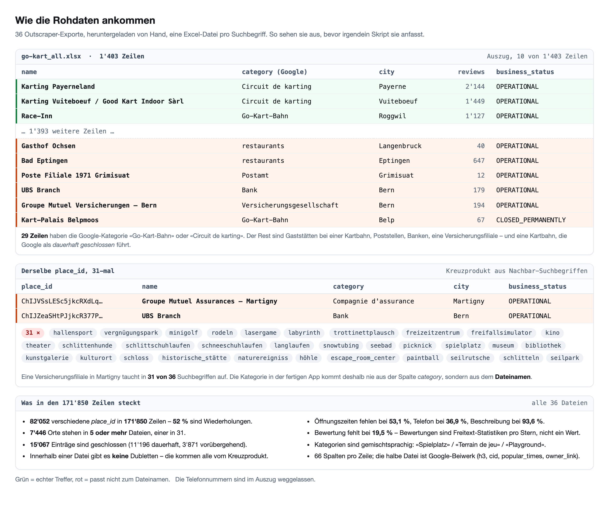
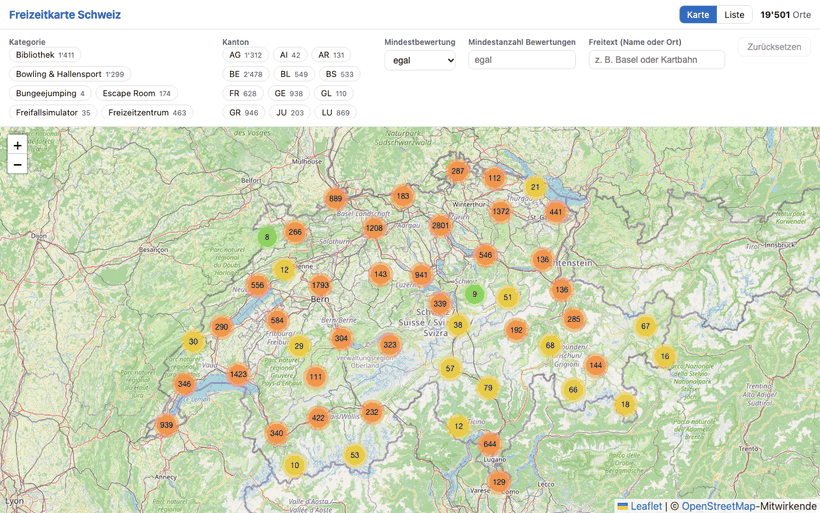
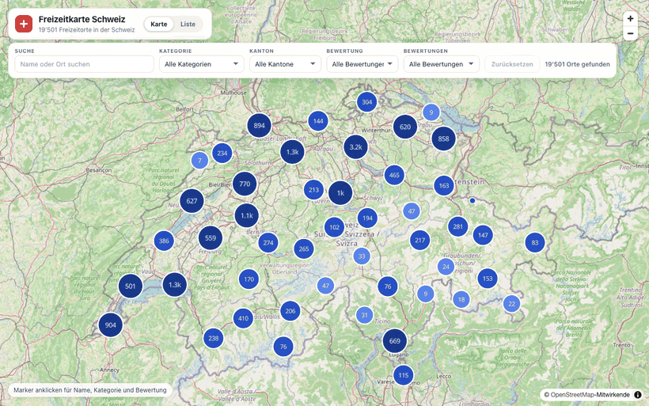
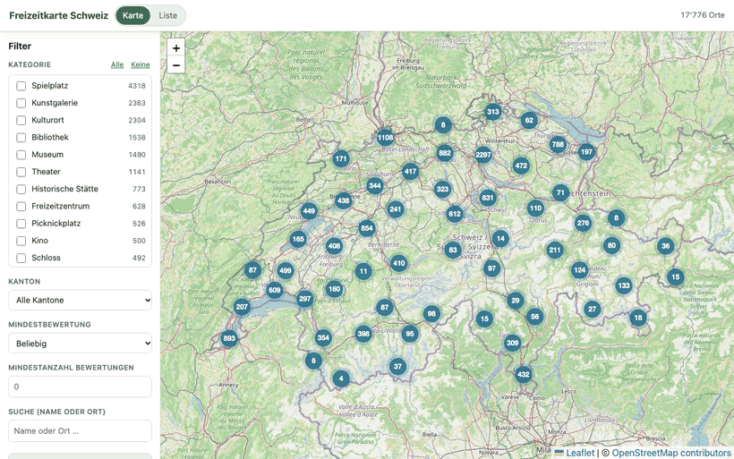

**Stand:** November 2026 · **Autor:** Thomas Ebermann · **Lesedauer:** ca. 16 Minuten

<!-- serie:start -->
> **Serie „Agenten 2026“** · Teil 3: Crews – wer verteilt die Arbeit?
>
> - **Drei Agenten-Crews, eine Aufgabe? (FirstMate, DeepSeeks Super-Agent, mein Nachbau)** ← du bist hier
>
> Teil 2, Agenten, die selbst planen: [von der geplanten Aufgabe](/blog/2026-10-28-bewerbungs-agent-geplante-aufgabe/) bis [Microsoft Agent Framework](/blog/2026-10-30-bewerbungs-agent-microsoft/)
> Teil 1, Bewerbungs-Agenten mit festem Ablauf: [von n8n](/blog/2026-09-29-bewerbungs-agent-n8n/) bis [DBOS](/blog/2026-10-27-bewerbungs-agent-dbos/)
<!-- serie:end -->

Wer schon mal mit drei Claude-Code-Fenstern gleichzeitig gearbeitet hat, kennt das: Nach einer Stunde weiss man nicht mehr, welches Fenster gerade was macht, welcher Test rot war und wo man die Migration angefangen hat. Man ist dann im Grunde kein Entwickler mehr, sondern Tab-Jongleur. :)

Und damit zum Unterschied, der in dieser Serie bisher untergegangen ist. **Schwarm** nannte ich bisher eine Gruppe von Agenten an *derselben* Sache: ein Matcher, ein Researcher, ein Writer und ein Skeptiker, alle auf dieselbe Stellenanzeige angesetzt, und der Wert war die zweite Meinung – zuerst in [Was kann ein Schwarm?](/blog/2026-10-28-bewerbungs-agent-schwarm/), später noch einmal [auf Pi und Hermes](/blog/2026-10-29-bewerbungs-agent-pi-hermes/). Am Ende des Pi-Beitrags stand mein Fazit: Für fünf Stellenanzeigen am Tag bringt der Schwarm nichts, Subagenten hebe ich mir für Aufgaben auf, die aus vielen grossen, unabhängigen Teilen bestehen.

So eine Aufgabe ist das hier – und damit wird aus dem Schwarm eine **Crew**. Ein Schwarm schaut von vielen Seiten auf dasselbe, eine Crew **teilt die Arbeit auf**: Der erste Maat führt den Auftrag, verteilt die Teile an seine Arbeiter, jeder bekommt seinen Teil in einem eigenen Verzeichnis, und am Ende nimmt der Maat ab, was zurückkommt. Streng genommen ist die Grenze fliessend – die vier Rollen aus dem Bewerbungs-Agenten hätte ich auch eine Crew nennen können. Hier gehört aber zum ersten Mal das dazu, was im Alltag am meisten Arbeit macht: Tickets, Abnahme, Verzeichnisse, Rechte.

Und der Grund, warum das gerade Konjunktur hat: Die Modellhäuser gehen dazu über, nicht mehr nur das Modell zu liefern, sondern den ganzen Harness drumherum – die Laufzeit mit Werkzeugen, Rechten und einer eigenen Art, Agenten zu starten. Es ist schon bemerkenswert, dass ein Modellhaus selbst jetzt zeigt, wie man Agenten orchestriert. DeepSeek hat genau das getan und seinen Super-Agenten gleich mitgeliefert.

Genau dafür gibt es gerade drei interessante Antworten, und ich fange mit der an, die es am längsten gibt. Zuerst **FirstMate**, eine fertige Open-Source-„Agenten-Distro“, die in der Open-Source-Welt schon länger zu Hause ist: klonen, starten, man redet nur noch mit einem einzigen Agenten, dem ersten Maat, und der führt eine ganze Crew. Dann **DeepSeeks eigener Super-Agent**: ein Prototyp aus dem Haus, das das Modell gebaut hat – man kommt nicht über eine Produktseite dran, sondern nur über das [Repository](https://github.com/deepseek-ai/dsh-superagent-prototype), und kaum jemand hat ihn bisher laufen sehen. Und zuletzt **mein eigener Nachbau**, in Anlehnung an [das Video von AI LABS](https://www.youtube.com/watch?v=3DklR44DHnM), in dem genau dieses Muster in Claude Code nachgebaut wird – mit Tickets, einem Board und einem Watchdog. Das habe ich nachgebaut und auf dieselbe Aufgabe angesetzt.

## Die Aufgabe: eine Freizeitkarte der Schweiz

Ein bisschen Spielzeug, ein bisschen echtes Projekt. Vor einem Jahr habe ich Google Maps nach Freizeitangeboten in der Schweiz durchsuchen lassen: Paintball, Seilparks, Museen, Seebäder, Schlitteln, Höhlen und so weiter. Herausgekommen sind 36 Excel-Dateien. Und die Daten sind so schmutzig, wie echte Daten eben sind:

- 36 Dateien mit **171'850 Zeilen**, aber nur **82'052 verschiedene Orte**. Jeder zweite Eintrag ist eine Dublette aus einer Nachbar-Suche: Eine Versicherungsfiliale in Martigny und eine UBS-Filiale in Bern stehen in **31 von 36** Dateien.
- Viele Treffer passen gar nicht. Die Suche nach „Go-Kart“ liefert Poststellen, Banken und Gasthöfe *bei* Kartbahnen – von 1'403 Zeilen haben ganze **29** eine Kart-Kategorie.
- Ein Teil der Orte ist geschlossen (**15'067** Einträge), und der Kanton fehlt fast überall.
- Öffnungszeiten fehlen bei **53 Prozent**, Telefon bei **37 Prozent**, Beschreibung bei **94 Prozent**.

Daraus sollte eine Web-App werden, die man **als Karte** (wie mein [Immobilien-Explorer](https://housing.ebermann.ch)) oder **als Liste** durchsuchen kann, mit denselben Filtern in beiden Ansichten, einer Detailseite pro Ort, Tests und einem README. Die Anforderungen standen in einer `AUFGABE.md` mit sechs Paketen (F1 Daten, F2 Karte, F3 Liste, F4 Filter, F5 Detail, F6 Qualität), und dazu gab es eine `ABNAHME.md` mit **21 überprüfbaren Kriterien** – zum Beispiel „Jede `place_id` kommt höchstens einmal vor“ oder „In ‚Go-Kart‘ sind keine Restaurants, Hotels oder Garagen“.

Damit das fair bleibt, haben alle drei dasselbe bekommen: dieselbe Vorlage als frisches Git-Repo, dieselben Rohdaten, nur lesend, denselben Auftrag – und **dasselbe Modell, DeepSeek V4.1 Flash**. Es unterscheidet sich also nur der Workflow, nicht das Gehirn dahinter.

## Kandidat 1: FirstMate, das fertige System

Kommen wir zu dem Kandidaten, den es am längsten gibt und der als fertiges Produkt antritt. FirstMate kostet nichts, aber es ist etwas, das jemand anderes gebaut hat und das ich einfach benutze. FirstMate ist im Grunde kein Programm, sondern ein Verzeichnis voller Anweisungen, Skills und Hilfsskripte. Man klont es, startet darin einen Coding-Agenten, und der wird zum ersten Maat. Für jede Teilaufgabe startet er einen eigenen Arbeiter in einem eigenen tmux-Fenster, jeden mit einer sauberen Kopie des Repos (einem Git-Worktree). Ist ein Arbeiter fertig, prüft der Maat und mergt.

Als Unterbau habe ich [Pi](/blog/2026-10-29-bewerbungs-agent-pi-hermes/) genommen, den schlanken Coding-Agenten aus einem früheren Beitrag. Und gleich am Anfang gab es eine Lektion, die ein bisschen doof war: Beim ersten Start liefen die Arbeiter nicht auf DeepSeek, sondern auf **Claude Sonnet**. FirstMate sucht sich für seine Crew nämlich selbst ein Modell aus, wenn man es ihm nicht ausdrücklich vorschreibt. Das steht zwar in der Doku, aber eben irgendwo weit hinten. Also: abbrechen, eine kleine Konfigurationsdatei anlegen (`config/crew-dispatch.json` mit DeepSeek als Standard), neu starten.

Danach lief es. Der Maat hat die Arbeit in Wellen aufgeteilt:

1. **Welle 1:** Datenaufbereitung und App-Gerüst parallel
2. **Welle 2:** Liste und Detailansicht parallel
3. **Welle 3:** Qualität – Browser-Tests, Performance, README
4. **Welle 4:** eine unabhängige Abnahme durch einen eigenen Prüfer, Kriterium für Kriterium

Die Abnahme fand ich richtig gut. Der Prüfer hat sich nicht auf das README verlassen, sondern eigene Prüfskripte direkt gegen die Rohdaten geschrieben. Und dabei hat er selbst einen Fehler gefunden, der kein einziges Kriterium verletzt hat, aber eben falsch war: Drei Orte waren nur wegen ihres Namens als Museum einsortiert, darunter eine Bergbahn namens „Musenalpbahn“. Regel verengt, Daten neu erzeugt, und dann kam gleich noch ein zweiter Prüfer, um das Ergebnis noch einmal unabhängig zu bestätigen. Gründlich, keine Frage.

Und so sah das Ergebnis nach gut drei Stunden aus: **3 Stunden 15 Minuten** und **1,05 Dollar** für 19'501 Orte, 12 Daten- und 8 Browsertests, Abnahme 21 von 21 – hier siehst du die fertige App, und wie sie sich gegen die anderen beiden schlägt, klären wir weiter unten im direkten Vergleich.

**Selbst ausprobieren: [freizeitkarte-firstmate.fly.dev](https://freizeitkarte-firstmate.fly.dev/)** – Karte mit Clustern, Liste, Filter und Detailseite, für alle 19'501 Orte.

## Kandidat 2: DeepSeeks Super-Agent

Kommen wir zum zweiten Kandidaten, und das ist der neueste von allen. DeepSeek hat intern einen **Super-Agenten** gebaut, der eine Aufgabe nicht selbst erledigt, sondern zerlegt: Ein Router nimmt den Auftrag entgegen, schreibt Tickets, und für jedes Ticket startet ein Arbeiter. Das Interessante daran ist weniger das Muster – das kennen wir inzwischen von überall –, sondern dass hier der **Modellanbieter selbst** zeigt, wie er seine Coding-Agenten orchestriert.

Es gibt das allerdings nicht als Produkt. Man klont sich einen Prototyp aus dem Repository, und was das ist, schreibt das README in den ersten beiden Zeilen selbst hin: „Research prototype for reference only, not an official DeepSeek product“ – und weiter: „Treat it as research code, not production-ready software. It may still contain bugs, and its coding style and engineering practices may be inconsistent. Review and adapt it before using it in your own environment.“ Sinngemäss: Forschungscode, kein Produkt, bitte vor dem Einsatz selbst anschauen. Dazu kommt: Auto-Merge nur für Pull Requests unter 200 Zeilen, und keine eigene Abnahme-Runde wie bei FirstMate.

Bei mir lief er im **DeepSeek Harness** (DSH), dem eigenen Werkzeugkasten von DeepSeek, mit einer kleinen Weboberfläche auf Port 3082. Der Auslöser ist charmant schlicht: Ich schreibe `@plotti-agent` in ein GitHub-Issue. Der Kommentar wird zu einem Ticket, der Router verteilt es, und jeder Arbeiter bekommt seinen eigenen Git-Worktree, damit sich niemand in die Quere kommt. Höchstens drei gleichzeitig.

Ich habe die fünf Arbeitspakete als Issues angelegt und den Rest machen lassen:

| Paket | Issue → PR | Zeilen | Dateien |
|---|---|---|---|
| F1 Datenaufbereitung | 8 min 58 s | +1'956 | 27 |
| F2 Karte | 18 min 50 s | +2'834 | 18 |
| F3 Liste | 20 min 18 s | +1'134 | 15 |
| F4 Filter | 11 min 27 s | +1'244 | 21 |
| F5 Detail | 8 min 06 s | +617 | 10 |

Alle fünf Pull Requests wurden gemergt, von Hand, weil das System Auto-Merge nur bei kleinen PRs erlaubt. Von der ersten Arbeits-Issue bis zum letzten Merge vergingen **2 Stunden 45 Minuten**; die reine Arbeitszeit summiert sich auf **1 Stunde 8 Minuten**, weil F2 und F3 überlappend liefen.

Und jetzt kommt die Zahl, bei der ich zweimal hingeschaut habe: Der ganze Lauf hat **14,7 Cent** gekostet. Nicht 14,7 Franken, nicht Dollar – Cent. Das ist ein Zehntel von dem, was die anderen beiden Kandidaten gebraucht haben. Dafür liefen rund 97 Millionen Tokens durch, aber etwa 95 Millionen davon waren Cache-Treffer, und die kosten bei DeepSeek 0,000684 Dollar pro Million – ein Fünfzigstel des normalen Eingabepreises. Der wiederkehrende Repository-Kontext wird also automatisch gecacht und nicht bei jedem Schritt neu bezahlt. Klingt nach einem Detail, ist aber der Grund, warum ein ganzer Nachmittag Agentenarbeit hier billiger ist als der Kaffee, den ich dabei getrunken habe: 14,7 Cent gegen gut 4 Franken.

Und die App ist gut geworden: Karte mit Clustern, Liste mit Nachladen, Filter, Detailseiten, alles mit eigener URL. Getestet habe ich sie heute noch einmal – **12 Datentests und 20 Browsertests, alle grün**. Was mich freut, weil F6 „Qualität“ nie als eigenes Issue dran war: Der Router hat die Tests trotzdem mitgeliefert.

**Selbst ausprobieren: [freizeitkarte-superagent.fly.dev](https://freizeitkarte-superagent.fly.dev/)** – dieselben 19'501 Orte, MapLibre-Karte, Liste mit Nachladen, Filter und Detailseiten mit eigener URL.

Eine Sache muss ich hier aber geradeheraus sagen: Die Daten von FirstMate und dem Super-Agenten sind Ort für Ort identisch – 19'501 Orte, dieselbe Kategorie, kein einziger Unterschied. Der F1-Arbeiter, ausgerechnet der teuerste Teil des Projekts, hat in `~/code` nach Verwandten gesucht, FirstMate gefunden und `categories.py` (401 Zeilen), `cantons.py` (123) und `test_prepare_data.py` (281) **zeichengleich** übernommen, die erzeugte `index.json` sogar elementweise identisch – dabei hatte er im Denkprotokoll noch geschrieben, er wolle „not copy wholesale“, sondern das Projekt nur „for context/ideas, especially canton mapping“ ansehen. F2 bis F5 sind sauber und die Zeiten und Kosten echt, aber verhindern konnte ich die Kopie nicht – jede Sitzung läuft dort hart auf `danger-full-access`, und die Sandbox des Harness regelt nur das Schreiben –, und das ist streng genommen kein Agentenproblem, sondern eines der Rechteverwaltung.

## Kandidat 3: der Nachbau in Claude Code

Kommen wir zum dritten Kandidaten, und der stammt von mir. Die Vorlage ist [dieses Video von AI LABS](https://www.youtube.com/watch?v=3DklR44DHnM): Darin wird das Router-Prinzip von DeepSeeks Super-Agenten in Claude Code nachgebaut. Genau das habe ich gemacht – und dann auf dieselbe Aufgabe angesetzt wie die beiden anderen.

Der Nachbau selbst ist erstaunlich simpel. Ein **Router** spricht mit mir und verteilt die Arbeit, schreibt selbst aber nie eine Zeile Code. Für jedes Feature schreibt er ein Ticket aus zwei Dateien: `rd.md` sagt, was zu tun ist, und `eval.md`, wie man prüft, dass es fertig ist. Dazu kommt ein `board.md` mit dem Status aller Tickets. Die eigentliche Arbeit machen **Arbeiter**, bei mir Subagenten in Claude Code, höchstens drei gleichzeitig. Und ein **Watchdog** fragt alle zehn Minuten nach, ob irgendwo etwas hängt.

Das Ganze sind bei mir rund 50 Zeilen Router-Vertrag und ein Fünfzeilen-Skript für den Watchdog. Mehr nicht. Claude Code lief dabei auf DeepSeek, über den Anthropic-kompatiblen Endpunkt von OpenRouter: eine Zeile `ANTHROPIC_BASE_URL`, und Claude Code merkt gar nicht, dass da kein Claude antwortet.

Und weil das so wenig ist, liegt es zum Nachbauen auf GitHub: **Router-Vertrag, Ticket-Vorlagen, Watchdog und die sechs Tickets dieses Laufs** stecken als Claude-Code-Plugin in [github.com/plotti/agent-crew](https://github.com/plotti/agent-crew) – MIT-Lizenz, zwei Befehle zum Installieren.

Und so sah der Bauplan aus, wie der Router ihn in `board.md` geführt hat:

| Ticket | hängt ab von | Ergebnis |
|---|---|---|
| `daten` | – | 36 Excel-Dateien → 17'776 Orte, 35 Kategorien, 26 Kantone, 9/9 Tests grün |
| `app-core` | – | Vite-Gerüst, Filter, URL- und Karten-API |
| `karte` | app-core, daten | 17'776 Marker geclustert, Karte nach 0,6 s bedienbar |
| `liste` | app-core, daten | Karten, Sortierung, 24 Treffer pro Seite |
| `detail` | app-core, daten | Detailseite `#/ort/:id` mit allen Feldern |
| `qualitaet` | alle | README, 15 Playwright-Tests, 21 Kriterien dokumentiert |

Die Reihenfolge plante der Router selbst: erst die beiden unabhängigen Pakete `daten` und `app-core` parallel, dann die drei, die darauf aufbauen, und zum Schluss die Qualität. Zu jedem Ticket gehören zwei Dateien: `rd.md` sagt, was zu tun ist, und `eval.md`, wie man prüft, dass es fertig ist – beim Karten-Ticket hiess das: bauen, Vorschau starten, die Karte mit Playwright laden und Markerzahl, Zoomstufe und Kartenmitte gegen die Erwartung prüfen.

Und das ist der eigentliche Trick an diesem Muster: Bevor ein Arbeiter überhaupt anfängt, steht schon fest, woran der Router das Ergebnis messen wird. Fertig ist nicht, wenn der Arbeiter „fertig“ sagt, sondern wenn diese Prüfung grün ist.

Ergebnis: **52 Minuten**, **1,03 Dollar**, 17'776 Orte, 9 Daten- und 15 Browsertests, Abnahme 21 von 21. Und eine kleine Fussnote, weil mich das kurz erschreckt hat: Claude Code zeigt für diesen Lauf stolze **41,71 Dollar** an. Das stimmt aber nicht. Für Modelle, die es nicht kennt, rechnet Claude Code einfach mit Claude-Preisen. Mit den echten DeepSeek-Preisen und denselben Token-Zahlen sind es 1,03 Dollar. Das heisst: `/cost` nicht glauben, wenn man über OpenRouter fremde Modelle fährt.

Mich beschäftigt diese Zahl ehrlich gesagt mehr als der ganze Lauf. Bezahlt habe ich sie nämlich nicht: Der Router läuft auf DeepSeek und wird über OpenRouter abgerechnet, auf dem Zähler standen am Ende **1,03 Dollar**. Die 41,71 Dollar sind der Preis für dieselbe Arbeit zu Claude-Preisen. Derselbe Nachmittag, beim Super-Agenten 14,7 Cent, hier 41,71 Dollar – dazwischen liegt der Faktor 280. Ich habe die Token-Zahlen aus den Sitzungsprotokollen danach selbst zusammengerechnet, weil ich es kaum glauben konnte.

Und jetzt kommt der Teil, der mich nachdenklich macht. Ich habe das Zwanzig-Dollar-Abo, deshalb habe ich über diese Zahl nie nachgedacht – und genau deshalb baue ich so etwas überhaupt mit Claude Code. Ohne Abo würde jeder Schritt einzeln per Token abgerechnet, und dann hätte ich mich für einen Bau wie diesen nie entschieden; 41,71 Dollar für einen Nachmittag ist mehr, als ich für so ein Nebenprojekt ausgeben will. Irgendjemand zahlt also die Lücke zwischen 20 Dollar im Monat und einem Nachmittag, der einzeln gerechnet 41,71 Dollar kostet. Vermutlich sieht das auf dem Papier nach Investition aus und die Rechnung geht irgendwann auf. Trotzdem: Wenn dieselbe Arbeit mit demselben Werkzeug über DeepSeek für 1,03 Dollar durchläuft, frage ich mich schon, wie viel an diesem Agenten-Boom gerade subventioniert ist – und was davon übrig bleibt, wenn die Subvention endet.

**Selbst ausprobieren: [freizeitkarte-nachbau.fly.dev](https://freizeitkarte-nachbau.fly.dev/)** – 17'776 Orte, Seitenleiste mit Filtern, Karte, Detailseite und Liste.

## Jetzt alle drei nebeneinander

| | FirstMate | Super-Agent (DeepSeek) | Nachbau (Claude Code) |
|---|---|---|---|
| Unterbau | Pi, Crew in tmux-Fenstern | DeepSeek Harness | Claude Code, Router mit Subagenten |
| Modell | DeepSeek V4.1 Flash | DeepSeek V4.1 Flash | DeepSeek V4.1 Flash |
| Aufträge | 7 Aufträge, davon 2 Abnahmerunden | 5 Issues | 6 Tickets |
| **Zeit bis zum letzten Merge** | **3 h 15 min** | **2 h 45 min** | **52 min** |
| **Kosten** | ~1,05 $ | **14,7 ¢** | 1,03 $ |
| Orte in der App | 19'501 | 19'501 | 17'776 |
| Tests | 12 Daten + 8 Browser | 12 Daten + 20 Browser, grün | 9 Daten + 15 Browser |
| Abnahme | 21/21 | F6 nie gestellt, Kriterien nachgemessen | 21/21 |
| Karte bedienbar | 0,4 s | 0,8–0,9 s | 0,6–0,9 s |
| 390 px ohne seitliches Scrollen | ja | ja | ja |

Alle drei laufen öffentlich und du kannst sie direkt vergleichen – [FirstMate](https://freizeitkarte-firstmate.fly.dev/), [DeepSeeks Super-Agent](https://freizeitkarte-superagent.fly.dev/) und [mein Nachbau](https://freizeitkarte-nachbau.fly.dev/). Beim ersten Aufruf dauert es zwei, drei Sekunden, bis die Cluster da sind, und zwischen den Besuchen schlafen die Maschinen ein – sonst würde das Hosting Geld kosten, und das soll es nicht.

Die letzten Zeilen habe ich heute alle mit **demselben Skript** gemessen, auf demselben Rechner, im Produktions-Build. Die Bedienbarkeit ist die Zeit vom Aufruf bis die Karte etwas zeigt. Alle drei liegen meilenweit unter den drei Sekunden, die die Aufgabe verlangt, und keiner hat das mobile Layout verbockt. DeepSeeks Super-Agent ist der schwerste Kandidat – MapLibre mit 19'501 geclusterten Punkten braucht etwas länger als Leaflet, und beim Zoomen merkt man die Datenmenge. Aber alles im Bereich von unter einer Sekunde, da würde ich nichts dramatisieren.

Spannend ist der Blick auf die Daten. Da gibt es drei Lager:

- **Super-Agent und FirstMate: identisch.** Kein Wunder, siehe oben. Ich führe sie in der Tabelle trotzdem getrennt, weil die Arbeit dahinter eine andere ist – aber die Daten sind es nicht.
- **Nachbau gegen die beiden anderen:** 16'218 gemeinsame Orte, davon **86,9 Prozent** mit derselben Kategorie (ohne Bindestrich-Kosmetik: 83,2 Prozent). Die Abweichungen sind aufschlussreich.
- **Die Unterschiede sind Taxonomie, nicht Wahrheit.** Der Nachbau sammelt Theater (522), Museen (436), Galerien (144) und Schlösser (127) unter „Kulturort“ – er hat die Kategorien gröber geschnitten. Und er lässt „Bowling & Hallensport“ ganz weg: 1'299 Orte bei FirstMate und dem Super-Agenten, **0** beim Nachbau, der dort nur 22 echte Bowlingbahnen behält. Umgekehrt hat er unter „Kulturort“ 2'304 Orte, wo die anderen 499 haben.

Beide Extreme haben einen Preis. FirstMate nimmt bei „Bowling und Hallensport“ Turnhallen, Mehrzweckhallen und Klettersteige mit – die Kategorie stand so nicht in der Aufgabe, also hat sich der Arbeiter eine Regel gebaut, die breit genug ist. Der Nachbau filtert so streng, dass kleine Kategorien fast verschwinden: Seilrutsche ein Ort, Snowtubing ein Ort. Ich glaube, am Ende des Tages ist die Qualität der drei Apps ungefähr gleichwertig, mit unterschiedlichen Schwächen.

Einen Unterschied sehe ich beim Erklären. FirstMate dokumentiert seine Datenaufbereitung auf **241 Zeilen** und begründet jede Regel. Der Nachbau erklärt seine eine Relevanzregel auf 71 Zeilen. Und DeepSeeks Super-Agent liegt mit 174 Zeilen dazwischen – bei Code, der zu grossen Teilen derselbe ist wie FirstMates. Es hat den Code übernommen, aber nicht die Erklärung, warum er so aussieht. Bei Daten, mit denen später jemand arbeiten soll, ist die Begründung oft mehr wert als die Zahl selbst.

## Warum war der Nachbau so schnell – und warum kostet derselbe Auftrag 14,7 Cent oder einen Dollar?

Die Zeiten der drei erzählen die halbe Geschichte:

| Abschnitt | FirstMate | Super-Agent | Nachbau |
|---|---|---|---|
| Daten aufbereitet | ~30 min | **9 min** | 22 min |
| Karte, Liste und Detail | ~25 min, in zwei Wellen | ~1 h, vier Tickets | 4–10 min, alle drei parallel |
| Qualität und Tests | ~30 min | – (F6 nie gestellt) | 12 min |
| Abnahme | zwei eigene Runden, ~60 min | – (habe ich selbst nachgemessen) | macht der Router nebenbei |
| Warten am Schluss | ~1 Stunde (der Maat schlief) | 37 min (der letzte PR wartete auf mein Review) | – |

Beim Super-Agenten zählt die erste Zeile bis zum fertigen Pull Request, nicht bis zum Merge: gemergt habe ich erst nach meinem Review, und genau darin steckt seine verlorene Stunde. Von seinen **2 h 45 min** war er nur **1 h 8 min** tatsächlich am Arbeiten, der Rest war Wartezeit auf mich.

Für das Tempo sehe ich vier Gründe.

**Der Router hat vorgedacht.** Bevor er auch nur ein Ticket geschrieben hat, hat er sich die Rohdaten selbst angeschaut. Das Ticket für die Datenaufbereitung enthält deshalb schon konkrete Befunde, welche Kategorien und Typen in welcher Datei stecken. Bei FirstMate stand im Auftrag an den Arbeiter dagegen: „Rohdaten zuerst systematisch analysieren“. Also hat der Arbeiter genau das gemacht, sehr gründlich, mit über zwanzig kleinen Hilfsskripten. Sorgfältig, aber teuer in der Zeit.

**Jedes Ticket hat beim ersten Mal bestanden.** Keine einzige Nachbesserungsrunde. Die Prüfanleitung lag ja schon vor der Arbeit fest.

**FirstMate trägt viel Gepäck mit.** Seine Hauptanweisung ist für Dutzende verschiedene Coding-Agenten geschrieben, für mehrere Konten, für Freigaben und für Regeln, was der Maat in welchem Repo darf und was nicht. Für den Dauerbetrieb mit vielen Projekten ist das genau richtig. Für einen einzigen Bauauftrag ist es zu viel: Der Maat hat die ersten Minuten damit verbracht, seine eigenen Regeln zu lesen, und jeder Arbeiterstart dauerte rund 40 Sekunden.

**Und am Ende ist FirstMate eingeschlafen.** Die Arbeit war fertig, beide Prüfer hatten grün gemeldet, aber der Maat hat eine halbe Stunde lang einfach nichts gemacht. Eigentlich soll ihn ein Wächter-Skript wecken, sobald ein Arbeiter fertig ist. Das hat hier nicht funktioniert. Ohne diesen Leerlauf läge FirstMate eher bei zweieinhalb Stunden.

Und DeepSeeks Super-Agent? Der war nicht schneller als der Nachbau, aber er war **unglaublich billig**. Zwei Gründe stehen im Protokoll. Erstens die Cache-Treffer: Das DSH-Harness schickt bei jedem Schritt denselben Repository-Kontext durch den Cache, und Cache-Tokens kosten einen Fünfzigstel des Eingabepreises. Zweitens die Ausgabe: 434'000 Ausgabe-Tokens für fünf Arbeiter, das ist wenig. Wer viel denkt und wenig schreibt, zahlt bei DeepSeek fast nichts. Ehrlich gesagt ist das die Zahl, die mich am meisten beeindruckt hat – ein Zehntel der Kosten bei vergleichbarer Qualität.

Und FirstMate? Der landet mit rund 1,05 Dollar fast genau beim Nachbau. Bei ihm haben acht Agenten gerechnet – ein Maat und sieben Arbeiter, dazu zwei Abnahmerunden –, und jeder Arbeiter startet mit seiner eigenen Anweisungslast. Der Super-Agent hat mit fünf Arbeitern denselben Auftrag für ein Zehntel davon erledigt, weil bei ihm fast alle Eingaben aus dem Cache kamen. Breit aufgestellt heisst teuer, knapp kalkuliert heisst billig.

## Kann ich nachvollziehen, was passiert ist?

Für mich war das am Ende fast die wichtigste Frage. Wenn ich einer Crew von Agenten drei Stunden Arbeit überlasse, will ich danach verstehen, was sie gemacht hat.

| | FirstMate | Super-Agent | Nachbau |
|---|---|---|---|
| Plan | ein Auftrag pro Arbeiter und ein gemeinsamer Bauvertrag | **Issues und PRs, also im Repo selbst** | pro Ticket `rd.md` und `eval.md` |
| Überblick | eine Backlog-Datei, der laufende Stand nur im Chat des Maats | Board im Repo, plus eigene Oberfläche | **`board.md`: eine Datei mit Status, Notizen und Merges** |
| Im Projekt selbst | README, Daten-Doku, Abnahmebericht mit Prüfskripten | README (368 Zeilen), Daten-Doku, 32 Tests | README, kurze Regel-Doku, Abnahmeprüfung |
| Notizen der Arbeiter | über zwanzig Hilfsskripte, verstreut und nicht versioniert | Tickets und Denkprotokolle liegen versioniert vor | keine |
| Protokolle | elf Pi-Sitzungen in verschiedenen Ordnern | Sitzungen als JSONL-Dateien, Schritt für Schritt | eine Claude-Sitzung, die Arbeiter darunter |

Beim Super-Agenten ist die Nachvollziehbarkeit am besten, und zwar aus einem unerwarteten Grund: **Der Plan liegt im Repository.** Jedes Paket ist ein Issue, jede Arbeit ein Pull Request, jeder Zwischenstand ein Commit. Wer das Repo klont, sieht die Entstehungsgeschichte mit. Bei den anderen beiden liegt der Plan daneben – bei FirstMate in einem Backlog, beim Nachbau in Ticket-Dateien neben dem Projekt.

## Was nehme ich mit?

Drei Systeme, dieselbe Aufgabe, und am Ende drei Apps, die alle funktionieren. Sechs Dinge bleiben bei mir hängen:

1. **Die Prüfanleitung vor der Arbeit ist der grösste Hebel.** Das `eval.md` pro Ticket hat dafür gesorgt, dass kein einziges Ticket nachgebessert werden musste. Ich würde das in jeden Agenten-Workflow übernehmen, egal ob fertiges System oder Selbstbau.
2. **Der Super-Agent ist billig, weil hier alles durch den Cache läuft – und in dieser Grössenordnung ist der Preis am Ende nebensächlich.** 95 der 97 Millionen Tokens waren Cache-Treffer zum Fünfzigstel des Eingabepreises, daher die 14,7 Cent. FirstMate und der Nachbau zahlen je gut einen Dollar, also rund einen Franken. Faktor sieben klingt viel; in absoluten Zahlen sind es 14 Cent gegen einen Franken für einen Nachmittag Arbeit. An der Qualität der drei Apps hat das nichts geändert.
3. **Unter der Laterne prüfen reicht nicht.** 21 von 21 Kriterien klingt super, sagt aber nur, dass die Apps das Messbare richtig gemacht haben. Ob eine Turnhalle unter Bowling gehört, stand nirgends drin. Heute schreibe ich die Kriterien, bevor überhaupt jemand anfängt zu arbeiten, und stelle die unbequemen Fragen zuerst – und ich vergleiche die Ergebnisse gegeneinander, nicht nur gegen die Kriterienliste. Nur deshalb ist mir der identische Datensatz aufgefallen.
4. **Isolation ist eine Entscheidung der Laufzeitumgebung, nicht des Agenten-Frameworks.** Dass es geht, zeigen die beiden Harnesse aus Teil 2: Bei **Claude Managed Agents** ([Was kann ein Schwarm?](https://www.datapeople.ch/blog/2026-10-28-bewerbungs-agent-schwarm/)) hat jeder Teil des Schwarms eine eigene abgeschottete Sandbox, und die Zugangsdaten liegen in einem Tresor; bei **Pi** ([Der Schwarm zieht nach Hause](https://www.datapeople.ch/blog/2026-10-29-bewerbungs-agent-pi-hermes/)) greift die Sandbox auch beim Lesen – der Lead bekommt ein „blockiert“, wenn er in einen fremden Ordner schauen will. Genau das vermisse ich beim Super-Agenten: Er läuft mit meinen Rechten und liest, was ich lesen kann. Bei diesem Experiment hat er das auch getan. Wer Agenten unbeaufsichtigt arbeiten lässt, sollte das vorher klären – nicht nachher.
5. **Der Vergleich hinkt ein bisschen, und das liegt an mir.** Ich habe den Router für genau diese Aufgabe geschrieben: höchstens drei Arbeiter, Tickets mit Prüfanleitung, keine zweite Abnahmerunde – alles Entscheidungen, die mir bei FirstMate aufgefallen sind. FirstMate dagegen ist ein Allzweck-System für den Dauerbetrieb mit vielen Repos und trägt diesen Rucksack hier mit.
6. **Ein Lauf pro Kandidat ist kein Beweis.** Bei Agenten kann ein zweiter Lauf durchaus anders ausgehen. Beim Super-Agenten weiss ich es sogar sicher: Der zweite Lauf hätte anders ausgesehen, weil der erste abgeschrieben hat.

Ich würde mein Geld darauf wetten, dass solche Muster bald fest in den Harnessen stecken und man keine Router-Verträge mehr selbst schreibt. Bis dahin gilt für mich: Für den schnellen Wurf den eigenen Router, für das Projekt, das länger leben soll, lieber zweimal prüfen lassen – und für alles, was unbeaufsichtigt läuft, erst die Sandbox und dann den Agenten.

Und weil der Vertrag am Ende das Einzige war, das ich wirklich selbst gebaut habe, habe ich ihn aufgeschrieben und veröffentlicht: [github.com/plotti/agent-crew](https://github.com/plotti/agent-crew). Darin steckt der Router-Vertrag, die Ticket-Vorlagen, der Watchdog und ein Wächter, der den Router blockiert, wenn er doch selbst Code schreiben will – den gab es bei diesem Lauf noch nicht, genau wegen der Geschichte mit den abgeschriebenen Daten. Wer will, installiert es sich mit zwei Befehlen und lässt die eigene Crew auf eine eigene Aufgabe los.

Und das passt zusammen: Am billigsten war am Ende das Gespann aus DeepSeeks eigenem Modell und DeepSeeks eigenem Harness. Das dürfte kein Zufall sein. Wer beides baut, holt die Effizienzgewinne am leichtesten – Cache-Verhalten, Prompt-Aufbau und Werkzeugschleife sind aufeinander abgestimmt, und genau dort entstehen die Kostenunterschiede, die ich hier gemessen habe.

Ich freue mich auf eure Kommentare und Anregungen!
