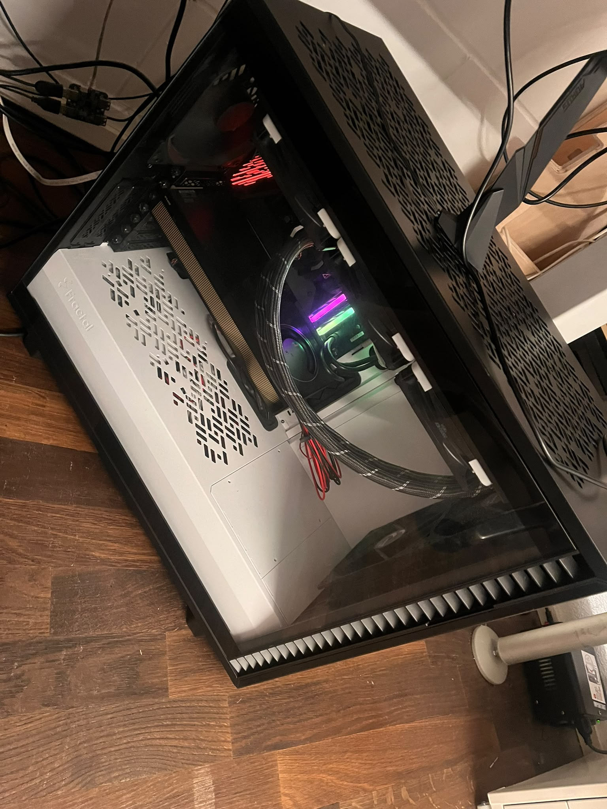
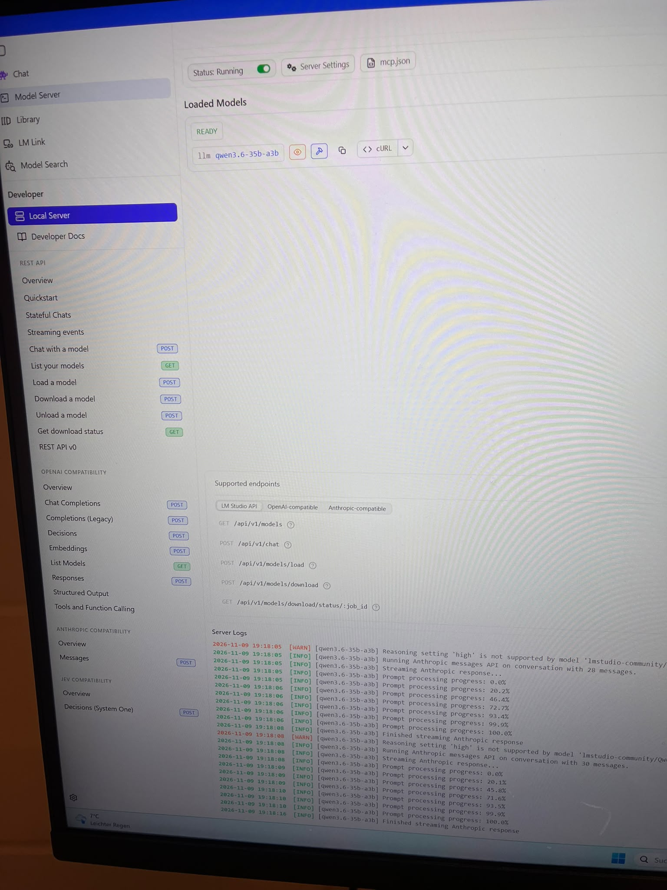
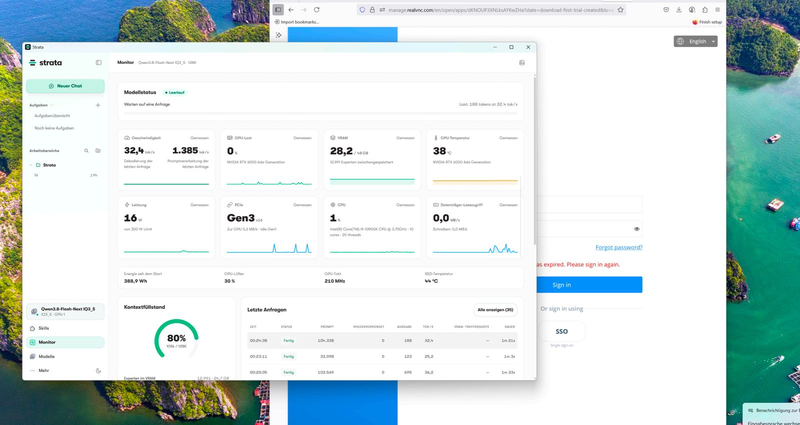

**Stand:** November 2026, Update 25. November 2026 · **Autor:** Thomas Ebermann · **Lesedauer:** ca. 14 Minuten

> **Update, 25. November 2026:** Ich habe das neue **Inkling 2 Mini** von Thinking Machines Lab nachgetestet. Auf Strata läuft es schlecht, mit llama.cpp deutlich besser, aber gegenüber meinem Champion Qwen3.8-Flash-Next ist es auf 10 Aufgaben langsamer und löst weniger. Die Zahlen stehen im [Update am Ende des Posts](#update-25-november-2026-inkling-2-mini).

Lokale KI ist gerade überall. c't 3003 hat vor gut einer Woche ein ausführliches Video dazu gemacht, [„Lokale KI: Das läuft auf deinem Rechner“](https://www.heise.de/news/Lokale-KI-Das-laeuft-auf-deinem-Rechner-11515316.html) (das Video gibt es auch direkt [auf YouTube](https://www.youtube.com/watch?v=a__Rva9Wqek)). Die Kernaussage dort: Ein Modell wie Qwen 3.8-27B erreicht lokal inzwischen ungefähr das, was die Frontier-Modelle aus der Cloud vor acht Monaten konnten, und die Hardware dafür wird gleichzeitig immer teurer. Als relevanteste lokale Modelle nennt das Video Qwen 3.8-27B und Qwen 3.8 Flash Next.

Ich hatte bei der Hardware nicht die grosse Auswahl. Ich bin durch ziemlich viel Glück an die Möglichkeit gekommen, eine **NVIDIA RTX 6000 Ada mit 48 GB Grafikspeicher** lokal zu betreiben. Dazu ein i9-10900K und 32 GB RAM, unter Windows, wassergekühlt. Wenn so eine Karte schon im Haus steht, will ich auch wissen, was das Beste ist, das ich aus ihr rausholen kann. Und zwar nicht im Chat, sondern dort, wo ich die Modelle wirklich brauche: beim Coden.

## 1. Die ersten Schritte: LM Studio und eine Liste mit 281 Modellen

Ich habe angefangen, wie wahrscheinlich die meisten anfangen: [LM Studio](https://lmstudio.ai) installiert und in die Suche einfach mal „qwen“ eingetippt. Das Ergebnis war ernüchternd, und zwar nicht wegen der Qualität, sondern wegen der Menge. Es gibt unmöglich viele Varianten: Qwen 3, 3.5, 3.6, 3.8, Coder, Instruct, Thinking, 27B, 35B-A3B, und jede davon in zehn Quantisierungen von zehn verschiedenen Leuten. Welche davon ist jetzt die richtige für meine Karte?

Danach habe ich endlos auf [willitrunai.com](https://willitrunai.com/) gesessen. Die Seite ist im Grunde ein VRAM-Rechner mit Rangliste: Du wählst deine Karte, sie sagt dir, welche Modelle in welcher Quantisierung passen und wie schnell sie ungefähr laufen sollten. Für die RTX 6000 Ada listet sie 281 kompatible Modelle, oben die mit Note S. Ich habe dann ganz pragmatisch eines der ersten Modelle von oben genommen, **Qwen 3.6 35B A3B**, und in LM Studio als lokalen Server gestartet. LM Studio spricht praktischerweise auch die Anthropic-API, das heisst, Claude Code lässt sich direkt darauf umbiegen.

### Nüchterne Erkenntnis Nummer eins: das Tempo

Am Anfang hat das Warten alles andere überstrahlt. Bei meinen ersten agentic-coding-Versuchen habe ich etliche Minuten darauf gewartet, dass überhaupt die erste Antwort kommt. Das ist eine Gewöhnungssache, sagt man. Und die Frage blieb trotzdem: Geht das nicht schneller?

Wenn man es gewohnt ist, mit Modellen aus der Cloud zu coden, mit Claude oder bei mir zusätzlich mit Z.ai, dann ist man verwöhnt. Grob gesagt kommen da 100 Token pro Sekunde rein und 200 raus, und das fühlt sich normal an. Ehrlich gesagt wäre ich lokal schon glücklich gewesen, wenn ich wenigstens 50 bekommen hätte.

### Nüchterne Erkenntnis Nummer zwei: das Kontextfenster

Was ich komplett unterschätzt habe: Wie gross der Kontext bei ganz normalen Coding-Aufgaben wird. Ein Agent wie Claude Code schleppt seinen System-Prompt, die Tool-Beschreibungen, die gelesenen Dateien und alle bisherigen Ausgaben mit. Da ist man schnell bei 100'000 bis 200'000 Token. Das heisst, bei jeder einzelnen Anfrage muss das Modell erst einmal diesen ganzen Berg einlesen, bevor es das erste Wort schreibt.

Meine erste Reaktion war, den Kontext zu komprimieren: Fenster auf 128'000 Token begrenzt, kürzere Ausgaben, sparsamer Dateien lesen. Das trägt eine Weile. Die meisten Aufgaben brauchen den Kontext aber nun mal: die gelesenen Dateien, die Testausgaben, die bisherigen Schritte. Vor allem in grösseren Repos kommt man so wieder an 200'000 heran, und die Wartezeit ist zurück.

### Der Wechsel zu Strata

Das Kontextproblem löst kein Prompt, das löst die Engine. Deshalb habe ich den Server gewechselt. [Strata](https://github.com/Niko1221/Strata) ist ein Open-Source-Projekt für genau meine Konstellation: Mixture-of-Experts-Modelle wie Qwen3.8-Flash-Next so aufteilen, dass die häufig gebrauchten Experten im Grafikspeicher liegen und der Rest im RAM oder sogar auf der SSD. Dazu kommt spekulatives Dekodieren mit der Zusatzschicht, die das Modell mitbringt. Strata spricht die OpenAI- und die Anthropic-API und lässt sich komplett über die Kommandozeile steuern.

Wie das in der Praxis aussieht, zeigt der Monitor von Strata: Kontext zu 80 Prozent voll, 105'000 von 128'000 Token. Eine Anfrage mit 104'338 Token Prompt und 188 Token Antwort hat 1 Minute 21 Sekunden gedauert. Und das ist pro Schritt. Ein Agent macht für eine Aufgabe gerne 30 oder 50 solche Schritte.

Aber bringt der Wechsel wirklich Tempo? Das habe ich nachgemessen, mit genau denselben Q2_0-Dateien einmal in Strata und einmal im offiziellen llama.cpp-Server, also der Engine, die auch in LM Studio steckt. Gleiche Karte, gleicher Test mit 20'000 Token Kontext:

| Q2_0 auf der RTX 6000 Ada | Ausgabe | Einlesen |
|---|---|---|
| Strata | 184 tok/s | 4'300 tok/s |
| llama.cpp | 84 tok/s | 3'550 tok/s |

Beim Schreiben ist Strata also gut doppelt so schnell. llama.cpp hat die 62 GB an Dateien einfach auf Grafikkarte und RAM verteilt, Strata platziert die Experten gezielt und nutzt das spekulative Dekodieren. Dadurch läuft bei Strata sogar die IQ3_S-Variante, die laut Doku 54,8 GB braucht, auf einer Karte mit 48 GB.

Für Modelle, die Strata nicht unterstützt, bleibt der offizielle [llama.cpp](https://github.com/ggml-org/llama.cpp)-Server. Strata sagt das bei fremden Modellen übrigens selbst: „add it as a Custom model API with llama-server instead“.

Bleibt die Frage, welches Modell in diesem Setup am besten läuft.

## 2. Wie misst man, ob ein lokales Modell gut genug ist?

Also habe ich gemessen, und zwar so nah an meinem Alltag wie möglich:

- **Harness:** [Claude Code](https://claude.com/claude-code), weil ich damit jeden Tag arbeite. Das Modell wird über die Umgebungsvariablen auf den lokalen Server umgebogen, alles andere bleibt gleich. Web-Suche und Web-Abruf waren aus.
- **Aufgaben:** [SWE-bench Lite](https://www.swebench.com), echte GitHub-Issues aus Projekten wie Django, Sympy oder scikit-learn. Davon eine feste Stichprobe von 50 Aufgaben, für alle Modelle dieselbe.
- **Bewertung:** Claude Code arbeitet im offiziellen Docker-Container der jeweiligen Aufgabe, am Ende wird der `git diff` genommen und mit der offiziellen SWE-bench-Auswertung geprüft. Gelöst heisst: Die versteckten Tests laufen grün.
- **Streng nacheinander:** Immer nur ein Modell, eine Aufgabe, und die Auswertung erst, wenn das Modell fertig ist. Als die Auswertung einmal parallel zum nächsten Modell lief, ist dessen Tempo von 160 auf 92 Token pro Sekunde eingebrochen. Das hätte die Messung verfälscht.

Den Aufbau selbst habe ich mit Claude Code gemacht, von meinem Mac aus per SSH auf den Windows-Rechner und dort in WSL. Das waren am Ende rund drei Tage Rechenzeit und einige Lektionen über Windows, zu denen ich weiter unten noch komme.

## 3. Die Ergebnisse

| Modell | Gelöst | Ø Zeit pro Aufgabe | Ausgabe | Server |
|---|---|---|---|---|
| Qwen3.8-Flash-Next Q2_0 | **47/50** | 112 s | 184 tok/s | Strata |
| Qwen3.8-Flash-Next IQ3_XXS | **47/50** | 166 s | 169 tok/s | Strata |
| Qwen3.8-Flash-Next IQ3_S | 45/50 | 172 s | 160 tok/s | Strata |
| *Claude Opus 5.5 (Cloud, zum Vergleich)* | *40/50* | *42 s* | – | *Anthropic* |
| Qwen3.8-Flash-Next IQ2_XS | 40/50 | 123 s | 209 tok/s | Strata |
| Qwen3.8-Flash-Next Coder IQ1_M | 39/50 | 148 s | 155 tok/s | Strata |
| Ornith 1.5 35B A3B (Q6_K) | 31/50 | 279 s | 158 tok/s | llama.cpp |
| Ornith 1.0 35B A3B (Q6_K) | 22/50 | 143 s | 159 tok/s | llama.cpp |
| Qwen 3.6 35B A3B (Q4) | 20/50 | 399 s | 122 tok/s | Strata |
| Gemma 4 31B (Q6_K) | 15/50 | 447 s | 28 tok/s | llama.cpp |
| Nemotron Cascade 2 30B A3B (Q6_K) | 11/50 | 104 s | 167 tok/s | llama.cpp |

Was sagen die Zahlen? Die Qwen3.8-Flash-Next-Familie über Strata liegt klar vorne. Und lustigerweise ist die kleinste der guten Varianten, **Q2_0**, die laut Strata-Doku rund 38 GB Speicher braucht, gleichzeitig die schnellste und gleichauf mit der besten. Der direkte Vergleich der beiden Spitzenreiter: 46 Aufgaben lösen beide, je eine nur der eine oder der andere. Die IQ2_XS-Variante, die ähnlich gross ist wie Q2_0, löst dagegen sieben Aufgaben weniger. Bei 2 Bit kommt es also sehr darauf an, wie quantisiert wird.

Bevor jemand mit diesen Zahlen eine Grafikkarte kauft, ein paar ehrliche Einschränkungen:

1. **SWE-bench Lite ist alt.** Die Issues stammen aus 2023 und früher. Es ist sehr wahrscheinlich, dass die Modelle die Lösungen im Training gesehen haben. Die absoluten Prozente sind deshalb zu hoch, für den Vergleich der Modelle untereinander taugen sie trotzdem.
2. **50 Aufgaben sind eine Stichprobe.** Das heisst, rund 6 Prozentpunkte Unsicherheit, also etwa drei Aufgaben. 47 gegen 45 ist ein Unentschieden, 47 gegen 22 nicht.
3. **Ungleiche Bedingungen bei llama.cpp.** Die Modelle dort liefen mit 128'000 Token Kontext statt 256'000 und mit den Standard-Sampling-Einstellungen des Servers. Die 128'000 waren eine vorsichtige Wahl von mir, damit der Kontext bei allen vier Modellen sicher neben den Gewichten in die 48 GB passt, vor allem beim dichten Gemma. Ausprobiert habe ich 256'000 nicht, und bei Ornith und Cascade hätte es wahrscheinlich gepasst. Bei Gemma ist mindestens eine Aufgabe genau an dieser Grenze abgebrochen. Das hätte ich vorher testen sollen.

### Und Claude in der Cloud?

Als Referenz habe ich zum Schluss denselben Test noch mit Claude Opus 5.5 laufen lassen, über mein normales Abo, mit derselben Stichprobe, demselben Prompt und denselben Containern. Ich hatte damit gerechnet, dass Opus die Messlatte setzt. Ehrlich gesagt: nicht ganz.

| | Claude Opus 5.5 (Cloud) | Qwen3.8 Q2_0 (lokal) |
|---|---|---|
| Gelöst | 40/50 | 47/50 |
| Ø Zeit pro Aufgabe | 42 s | 112 s |
| Schritte pro Aufgabe (Median) | 5 | 33 |

39 Aufgaben lösen beide, 8 nur das lokale Modell, eine nur Opus. Das ist verrückt, oder? Ein Modell, das auf meiner Karte unter dem Tisch läuft, schlägt das Flaggschiff aus der Cloud. Ich würde trotzdem nicht zu viel hineinlesen. Opus arbeitet auffallend knapp: Datei lesen, Änderung machen, fertig, meist ohne die Tests laufen zu lassen. Mein Prompt sagt ausdrücklich „ändere so wenig wie möglich und hör dann auf“, und daran hält sich Opus genauer als die lokalen Modelle, die mit 30 und mehr Schritten viel öfter nachprüfen und dabei eigene Fehler abfangen. Dazu kommt das Alter der Aufgaben: Wenn Qwen3.8 die Lösungen aus dem Training kennt, hilft ihm das mehr als jede Gründlichkeit. Das heisst: Dieser Benchmark belohnt Sorgfalt und Gedächtnis, nicht Tempo. Und beim Tempo liegt Opus mit unter einer Minute pro Aufgabe klar vorne.

### Und die Liste von willitrunai.com?

Alle sechs Modelle, die ich über llama.cpp getestet habe, stehen in der Rangliste von willitrunai.com, alle mit Note S. Daneben steht jeweils, wie schnell das Modell auf meiner Karte laufen sollte. Ich habe die Versprechen neben meine Messung gelegt:

| Modell | Note bei willitrunai | tok/s laut Liste | tok/s gemessen | Gelöst (von 50) |
|---|---|---|---|---|
| Ornith 1.0 35B A3B | S91 | 218 | 159 | 22 |
| Nemotron Cascade 2 30B | S90 | 174 | 167 | 11 |
| Qwen 3.6 35B A3B | S90 | 113 | 122 | 20 |
| Nemotron 3 Nano 30B | S88 | 182 | – | nicht auswertbar |
| Gemma 4 31B | S88 | 45 | 28 | 15 |
| Ornith 1.5 35B A3B | S86 | 215 | 158 | 31 |
| Qwen3.8-Flash-Next Q2_0 | nicht gelistet | – | 184 | 47 |

Das Tempo trifft die Liste erstaunlich gut, vier von sechs liegen nah beieinander, und Qwen 3.6 ist sogar schneller als versprochen. Bei der Güte sieht es anders aus. Mein Sieger ist in der Liste gar nicht zu finden: Qwen3.8-Flash-Next taucht in den Empfehlungen nicht auf, nur ein anderes Qwen3.8-Modell, der dichte 27B, mit Note A84 weit unten. Die Note bewertet, ob ein Modell auf die Karte passt und wie schnell es laufen dürfte. Wie gut es mit meinem Werkzeug arbeitet, sagt sie nicht.

## 4. Was mich überrascht hat

**Nemotron und Ornith.** Beide haben auf willitrunai.com Note S und laufen schnell. Ornith wirbt mit 75,6 Prozent auf SWE-bench Verified, in meinem Aufbau waren es 44 Prozent für Version 1.0 und 62 Prozent für 1.5. Nemotron Cascade 2 kam auf 22 Prozent, Nemotron 3 Nano war gar nicht auswertbar: Es ist in llama.cpp bei längeren Antworten reproduzierbar in leere Token gekippt, mit dem Server aus LM Studio genauso wie mit dem offiziellen Build. Woran liegt das? Ich glaube, an der Kombination. Herstellerzahlen entstehen mit dem eigenen Agenten und der eigenen Abstimmung, ich habe Claude Code und llama.cpp mit Standardwerten genommen. Damit harmonieren diese Modelle offensichtlich nicht gut, und ich würde nicht ausschliessen, dass sie mit dem richtigen Harness deutlich besser wären. Für meinen Alltag zählt aber, wie sie mit meinem Werkzeug funktionieren.

Dazu kamen technische Stolpersteine, die man aus der Cloud nicht kennt. Das Chat-Template von Ornith lehnt System-Nachrichten mitten im Gespräch ab, und Claude Code schickt genau solche. Und Claude Codes Tool-Suche liefert einen Inhaltstyp, den nur die Anthropic-API kennt. Beides musste ein kleiner Proxy zwischen Claude Code und llama.cpp geradebiegen. Das heisst: Lokal ist die Schnittstelle zwar „Anthropic-kompatibel“, aber eben nicht ganz.

Warum ich dabei direkt den offiziellen llama.cpp-Server genommen habe und nicht Ollama, das dieselbe Engine einpackt? Der Artikel [Stop Using Ollama](https://sleepingrobots.com/dreams/stop-using-ollama/) listet die Gründe auf: Ollama läuft auf einem eigenen Fork, der laut Artikel 1,8-mal langsamer ist, hält neue Modelle und Quantisierungen im eigenen Katalog zurück und driftet in die Cloud. Mit dem llama-server bekomme ich die Engine unverbaut, jede Quantisierung direkt von Hugging Face und volle Kontrolle über Build und Parameter. Was das bringt, zeigt die Tabelle oben: Bei Ornith und Cascade lag das Tempo genau auf dem Niveau der Versprechen. Die rauen Kanten bei Agent-Verkehr und der Nemotron-Bug bleiben trotzdem: Auch die direkte Engine ist kein Selbstläufer, und die Wahl der Engine ist Teil des Ergebnisses.

**Gemma 4.** Das viel gelobte Gemma 4 31B hat technisch ohne Murren funktioniert, kaum Template-Ärger, saubere Tool-Aufrufe. Mit 15 von 50 lag es im Ergebnis aber hinten, und vor allem war es viel zu langsam: 28 Token pro Sekunde und im Schnitt siebeneinhalb Minuten pro Aufgabe. Das ist der Preis eines dichten Modells: Bei jedem Token rechnen alle 31 Milliarden Parameter mit, bei den Mixture-of-Experts-Modellen sind es rund 3 Milliarden. Vielleicht sollte ich schauen, ob es Varianten gibt, die deutlich schneller laufen, zum Beispiel das kleinere Gemma 4 26B A4B, das selbst ein Mixture-of-Experts-Modell ist.

**Windows als Server.** Der grösste Ausfall kam übrigens gar nicht vom Modell. In der ersten Nacht stand der Benchmark plötzlich still, und der Rechner war aus. Im Ereignisprotokoll stand dann, was passiert war: Windows Update hatte um 00:38 Uhr neu gestartet. Seitdem sind die Updates für eine Woche pausiert und automatische Neustarts gesperrt, solange jemand angemeldet ist. Und Prozesse, die man per SSH startet, sterben unter Windows mit der Verbindung. Alles Lange musste deshalb als geplante Aufgabe laufen. Das funktioniert, aber es ist Bastelei: Am Ende lief der Benchmark in WSL, also in einem Linux innerhalb von Windows, gesteuert über geplante Windows-Aufgaben, die wiederum Windows-Programme aus dem Linux heraus aufriefen. Die Konsequenz ziehe ich deshalb jetzt: Windows fliegt runter, auf die Kiste kommt ein Linux. Dort laufen Server, SSH-Sitzungen und Updates so, wie ich es erwarte, und das System ist schlicht einfacher zu warten.

## 5. Lokal oder Cloud: Wie würde ich das kombinieren?

Ersetzt mir das jetzt Claude in der Cloud? Nach den Zahlen oben müsste ich ja sagen. Im Alltag sieht es anders aus: Opus war rund zweieinhalbmal schneller pro Aufgabe, und bei echten Aufgaben ohne Musterlösung im Training zählt das Urteil des Modells mehr als hier. Eine Spielerei ist das Lokale aber definitiv nicht mehr.

Ich überlege mir, ob ich für lokale Modelle eher mit [pi](https://pi.dev) arbeiten sollte, einem schlankeren Agenten mit deutlich weniger Overhead im Kontext als Claude Code. Dazu kommt pi mit einem Modell-Router. Eingebaut ist das in pi nicht, es gibt aber Erweiterungen dafür, zum Beispiel den [system-one-router](https://pi.dev/packages/system-one-router), der pro Schritt nach Komplexität der Aufgabe zwischen günstigen und starken Modellen wechselt. Einfache Aufgaben gehen an das lokale Modell, schwierige an ein starkes Modell aus der Cloud. Gerade bei [Schwärmen](/blog/2026-10-28-bewerbungs-agent-schwarm/) oder [Crews](/blog/2026-11-08-drei-agenten-crews/), wie ich sie in den letzten Wochen gebaut habe, liegt das nahe: Die vielen Arbeiter laufen lokal, und der Judge-Agent, der am Ende prüft, ob der Schwarm oder die Crew gut gearbeitet hat, läuft auf Opus 5.5 oder Fable aus der Cloud.

Im Grunde braucht man bei einer Crew oder einem Schwarm dafür gar keinen Router. Dort weiss ich vorher, welche Rolle welches Modell bekommt, und kann das von Hand verdrahten. Bei normalen Aufgaben ist es schwieriger: Da müsste der Router bei jeder Anfrage erst einschätzen, wie komplex sie ist. Und genau diese Einschätzung ist selbst schon eine kleine KI-Aufgabe, die schiefgehen kann.

## 6. Lärm, Strom und der Keller

Was im Video und auf willitrunai.com eher am Rand vorkommt: So eine Karte zieht unter Last bis zu 300 Watt, und zwar dauerhaft, solange der Agent arbeitet. Die GPU lag in meinen Läufen meist zwischen 77 und 85 Grad. Der Lärm hält sich dank Wasserkühlung in Grenzen, aber er ist da. Rund um die Uhr unter Last sind das gut 7 kWh am Tag. Beim [Schweizer Median von 27,7 Rappen pro kWh](https://strompreis.elcom.admin.ch) für 2026 sind das rund 2 Stutz täglich, nur für die Karte. Wie viel es bei dir genau ist, zeigt die Strompreis-Seite der ElCom für jede Gemeinde.

Was ich mir deshalb überlege: den ganzen Rechner als Server in den Keller stellen, mit einer Glasfaser mit 1 Gbit hoch und runter. Dort könnten dann auch die vielen kleinen Deployments meiner Hobbyprojekte laufen, die heute verteilt bei Cloudflare und fly.io hängen: [housing.ebermann.ch](https://housing.ebermann.ch/) und die [LosDemokratie-Videos](https://losdemokratie-videos.fly.dev/). Die Hardware würde das locker hergeben. Ob sich ein Serverbetrieb allerdings mit LLM-Inferenz beisst, wenn die Karte gerade 300 Watt zieht und die CPU mit Experten aus dem RAM beschäftigt ist, müsste der Alltag zeigen. Und die Sicherheit ist ein eigenes Thema: Ein Rechner, auf dem ein Agent Code ausführt und der gleichzeitig ins Internet hängt, braucht eine saubere Trennung, eine Firewall-Regel allein reicht da nicht.

## 7. Der Agent läuft weiter, wenn der Mac zuklappt

Der Benchmark selbst lief komplett auf dem Rechner mit der Karte, mein Mac war nur die Fernbedienung. Im Alltag ist es bei mir umgekehrt: Wer heute mit Claude Code einen langen Auftrag laufen lässt, muss den Mac offen und am Stromkabel lassen, sonst ist die Sitzung weg.

Genau das lässt sich mit dem Rechner im Keller lösen. Statt die Agenten auf dem Mac laufen zu lassen, laufen sie direkt auf der Kiste, und zwar in [herdr](https://herdr.dev). Das ist im Grunde ein Terminal-Multiplexer wie tmux, nur für Coding-Agenten gebaut: In einer Seitenleiste sieht man, welcher Agent gerade arbeitet, welcher fertig ist und welcher auf eine Antwort wartet. Und die Sitzungen leben auf dem Server weiter. Das heisst, ich verbinde mich vom Mac per SSH, starte abends einen langen Auftrag, klappe den Laptop zu, und am Morgen hänge ich mich wieder an dieselbe Sitzung und schaue, was passiert ist.

Damit fallen zwei Dinge weg, die mich heute nerven: Ich muss nicht mehr darauf achten, dass der Mac über Nacht am Strom hängt, und das lokale Modell läuft auf derselben Maschine wie der Agent. Kein Netzwerk dazwischen, keine Sitzung, die abreisst, wenn das WLAN kurz weg ist. Ob ich am Ende mit Claude Code oder mit pi in herdr arbeite, probiere ich als Nächstes aus.

## Was nehme ich mit?

1. **Die Liste ist nicht das Ergebnis.** Meine sechs Listenkandidaten von willitrunai.com tragen alle Note S, gelöst haben sie 11 bis 31 von 50 Aufgaben. Mein Sieger Qwen3.8-Flash-Next steht in der Liste gar nicht. Die Note sagt, ob ein Modell passt und wie schnell es laufen dürfte. Wie gut es mit meinem Werkzeug arbeitet, sagt sie nicht.
2. **Kleiner kann besser sein.** Die Q2_0-Variante, laut Strata-Doku mit rund 38 GB Speicherbedarf, war gleichzeitig die schnellste und gleichauf mit der besten. Ich hätte vorher auf die grösste getippt, die gerade noch passt.
3. **Die Cloud ist schneller, nicht automatisch besser.** Opus 5.5 hat 40 von 50 Aufgaben gelöst, das lokale Q2_0 47, aber Opus brauchte nur gut ein Drittel der Zeit. Wer lokal arbeitet, tauscht Tempo gegen Kontrolle, und auf diesem Benchmark nicht gegen Qualität.
4. **Der Kontext ist das eigentliche Nadelöhr.** Nicht die Token pro Sekunde beim Schreiben, sondern das Einlesen von 100'000 Token bei jedem einzelnen Schritt entscheidet, ob sich lokales Coden flüssig anfühlt.

## Update, 25. November 2026: Inkling 2 Mini

Kaum war der Post draussen, kam das nächste Modell: [Inkling 2 Mini](https://thinkingmachines.ai/news/inkling-2-mini/) von Thinking Machines Lab. 26,4 Milliarden Parameter, davon 3,4 Milliarden pro Token aktiv, und ein sogenannter Looped Transformer: Die mittleren Layer laufen für jedes Token dreimal durch. Der Hersteller meldet 79,2 Prozent auf SWE-bench Verified. Klingt nach einem Herausforderer für meinen Champion, also habe ich es auf denselben Aufbau losgelassen, allerdings nur auf die ersten 10 der 50 Aufgaben.

Auf Strata lief es ehrlich gesagt überhaupt nicht gut. Ich habe das [offizielle Strata-Pack](https://huggingface.co/strata-engine/Inkling-2-Mini-Strata) in der grössten Variante genommen, die laut Strata identisch zum Original rechnet. Trotzdem hat sich Inkling ständig im Kreis gedreht: Bei einer Django-Aufgabe hatte es den richtigen Fix nach wenigen Minuten drin und hat danach 91-mal denselben Testbefehl abgesetzt, bis das Zeitlimit kam. Beim Nachgraben habe ich zwei Gründe gefunden. Strata schaltet das Denken bei Inkling fest ab, und weil Claude Code keine Temperatur mitschickt, nimmt Strata immer das wahrscheinlichste Token. Genau in diesem Modus bleibt Inkling laut Bugreports in Schleifen hängen. Strata hat für Qwen empfohlene Sampling-Werte eingebaut, für Inkling nicht. Auch mit Temperatur 1.0 und eingeschaltetem Denken wurde es nicht wirklich besser. Mit [llama.cpp](https://github.com/ggml-org/llama.cpp) und denselben Einstellungen sah das gleiche Modell plötzlich ganz anders aus:

| Setup (10 Aufgaben) | Gelöst | Zeitlimit erreicht | Ø pro Aufgabe |
|---|---:|---:|---:|
| Inkling 2 Mini, Strata, Standard | 2 / 9 | 6 | ca. 30 min |
| Inkling 2 Mini, Strata, Temperatur 1.0 + Denken | 3 / 10 | 5 | ca. 27 min |
| Inkling 2 Mini, llama.cpp Q8_0 | 7 / 10 | 0 | 5,7 min |
| **Qwen3.8-Flash-Next Q2_0 (Strata)** | **10 / 10** | **0** | **ca. 2 min** |

*Den Standard-Lauf habe ich nach 9 Aufgaben abgebrochen. Eine weitere Aufgabe darin ist abgebrochen, weil eine einzelne Antwort über 32'000 Token lang wurde.*

Und wirklich schnell ist Inkling auch nicht. Die wenigen aktiven Parameter täuschen: Weil die mittleren Layer dreimal laufen, schreibt es auf Strata bei 20'000 Token Kontext 89 Token pro Sekunde, Qwen schafft 184. Mit llama.cpp sind es nur noch 54.

Das heisst: Mein Champion bleibt Qwen3.8-Flash-Next. Inkling ist langsamer und löst auf denselben Aufgaben weniger. Zehn Aufgaben sind natürlich nur eine Stichprobe, da kann eine einzelne Aufgabe das Bild schon verschieben. Die eigentliche Lektion ist für mich aber eine andere: Dasselbe Modell kommt auf 3 oder auf 7 von 10, je nachdem, welche Engine darunter läuft und welche Standardwerte sie stillschweigend setzt. Ich glaube, bei ganz neuen Modellen sollte man deshalb erst ein paar Wochen warten, bis die Engines nachgezogen haben, bevor man ein Urteil fällt.

Ich freue mich auf eure Kommentare und Anregungen! Vor allem, wenn jemand Ornith oder Nemotron mit einem anderen Harness deutlich besser zum Laufen gebracht hat.
