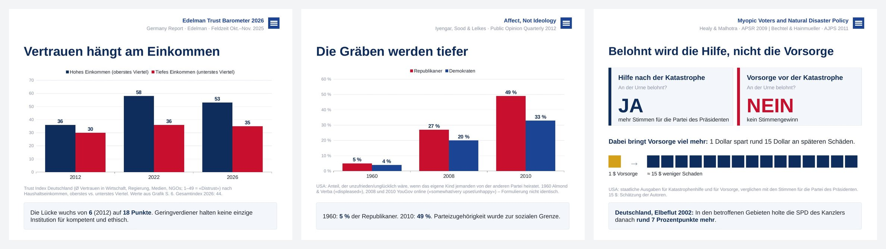
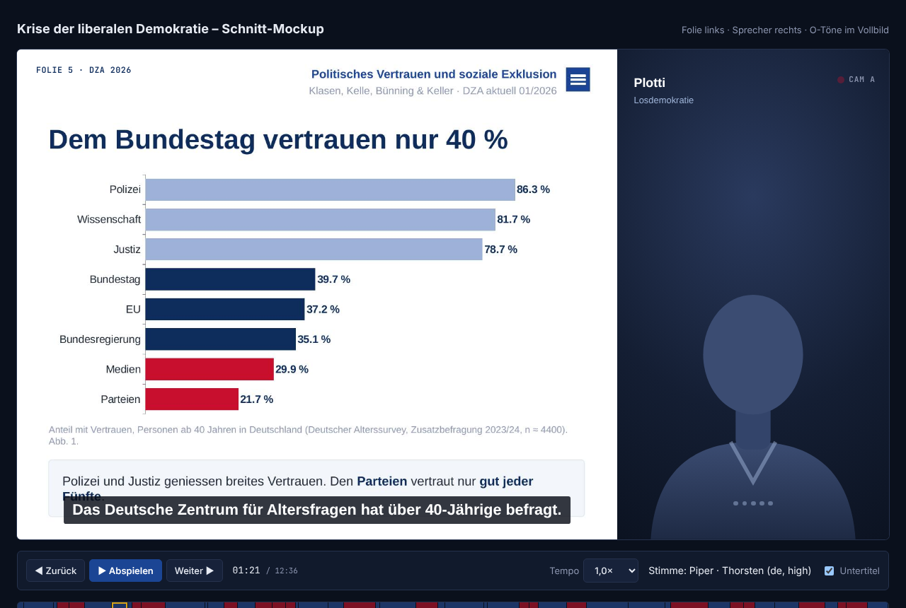
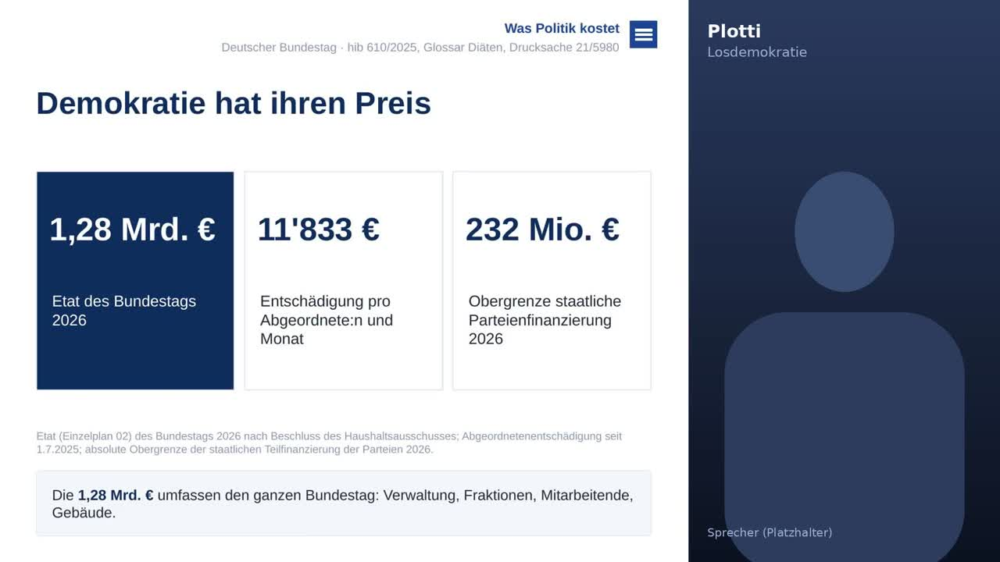

**Stand:** November 2026 · **Autor:** Thomas Ebermann · **Lesedauer:** ca. 8 Minuten

Ich mache nebenbei YouTube-Videos zu Politik und Demokratie. Das Format: Ich rede, neben mir läuft eine Folie mit der Studie, die meine Aussage belegt, dazwischen kommen O-Töne von Politikerinnen, Forschern oder Bürgern. Jede Behauptung soll belegt sein. Keine gefühlten Wahrheiten.

Mein letztes Video, «Krise der liberalen Demokratie?», hat gut zwölf Minuten. Darin stecken 20 Studien, 26 Folien und 19 O-Töne. Gemacht habe ich das allein, zusammen mit Claude. Und als ich danach zurückgeschaut habe, ist mir erst klar geworden, wie viele Leute man für so etwas vor ein paar Jahren gebraucht hätte.

## Früher: ein ganzer Think Tank

Spielen wir einmal durch, wie so ein Video klassisch entstanden wäre.

**Die Recherche.** Am Anfang braucht es Leute, die das Thema kennen. Sie suchen die relevanten Studien zusammen, lesen die Papers, verdichten sie auf ein paar Kernaussagen und bereiten einzelne Grafiken aus den Papers neu auf, damit man sie überhaupt zeigen kann. Das ist schon eine ganze Mannschaft, im Grunde ein kleiner Think Tank.

**Die Idee fürs Video.** Dann kommt jemand und sagt: Mit diesen Beobachtungen will ich ein Video machen. Das ist eine andere Person mit einem anderen Blick. Sie denkt nicht in Studien, sondern in einer Geschichte.

**Der Faktencheck.** Die nächste Person muss das alles noch einmal prüfen. Stimmt die Zahl wirklich so im Paper, oder nur in der Pressemitteilung? Gilt der Durchschnitt über zwanzig Länder auch für Deutschland? Ist «sinkendes Vertrauen» eine Zeitreihe oder ein Eindruck? Das dauert wieder ewig, und es ist undankbare Arbeit, weil man am Ende vor allem Dinge streicht.

**Das Skript.** Dann schreibt jemand den Teleprompter-Text. Was will ich erzählen, in welcher Reihenfolge, mit welchem Bogen? Und vor allem: Wie verheirate ich das Material aus der Recherche mit der Story, die ich erzählen will? Welche Folie kommt bei welchem Satz?

**Die O-Töne.** Die nächste Person sucht Soundbytes. Wo gibt es einen Politiker, der genau das sagt? Einen Forscher, der es erklärt? Einen Bürger, der es erlebt? Das heisst stundenlang Videos schauen, Zeitstempel notieren, Ausschnitte schneiden.

**Review und Rohschnitt.** Dann muss das Ganze zusammengesetzt werden, damit man sieht, ob es funktioniert. Jemand baut einen Rohschnitt oder zumindest ein Storyboard. Man schaut es an, merkt, dass Kapitel drei zu lang ist und zwei O-Töne hintereinander nicht tragen, und iteriert. Dann rendert man es nochmals raus, schaut, wie lang das Video wird, und erst dann geht man vor die Kamera.

**Rechte und Schnitt.** Und zum Schluss klärt jemand, ob man die Ausschnitte überhaupt zeigen darf, und bereitet das Material für den Cutter auf.

Rechercheure, Grafikerin, Faktenchecker, Autorin, O-Ton-Rechercheur, Cutter, jemand für die Rechte. Sechs, sieben Rollen, Wochen an Arbeit. Für ein YouTube-Video.

## Heute: eine Person und ein Gespräch

Aus diesem ganzen Kram ist eine One-Man-Show geworden. Alle diese Rollen gibt es noch, aber sie sind in einem Gespräch mit Claude zusammengefallen. Ich gebe das Thema, meine Thesen und eine lose Ideensammlung mit Links, und dann arbeiten wir das zusammen durch.

**Recherche und Faktencheck in einem.** Claude lädt jede Studie im Original herunter und sucht die Zahl im PDF, nicht in der Zusammenfassung. Schon beim ersten Testlauf haben in 9 von rund 15 Aussagen aus meinen Notizen Details nicht gestimmt. Eine Zahl stand auf der Presseseite anders als im offiziellen Bericht. Ein Effekt, der im Länderdurchschnitt negativ ist, war für Deutschland positiv. Ein «sinkendes» Vertrauen war im neusten Bericht gestiegen. Alles landet in einer Korrekturtabelle, und das Skript sagt, was im Original steht.

**Grafiken neu aufbereitet.** Für jede Kernaussage baut Claude eine Folie mit der Grafik aus der Studie nach, als echtes, editierbares Diagramm in meinem Design, mit Fundstelle in den Notizen.



**Skript und Material verheiratet.** Der Teleprompter ist ein Dokument, in dem bei jedem Satz steht, welche Folie gerade läuft und wo ein O-Ton kommt. Ich lese, streiche, schreibe um und sage im Chat Dinge wie «Nimm die 52 Prozent bei Grossbritannien raus, das ist zu polemisch» oder «Ich will Zwischenüberschriften für die einzelnen Probleme». Und regelmässig: «Was ist die schwächste Stelle im Skript?»

**O-Töne.** Claude sucht pro Kapitel passende Ausschnitte, schlägt mir eine Tabelle mit Sprecher, Zitat und Zeitstempel vor, und ich wähle aus. Geschnitten wird auf die Zehntelsekunde.

**Review vor dem Dreh.** Aus dem Skript entsteht ein klickbarer Schnitt-Mockup: links die Folie, rechts ein Platzhalter für mich, eine Computerstimme liest meinen Text, die O-Töne laufen im Vollbild. Daraus wird ein Preview-Video. So habe ich mein Video gesehen, bevor ich es aufgenommen habe, und wusste, dass es 12 Minuten 42 lang wird.



**Iterieren.** Wenn mir beim Durchklicken etwas nicht gefällt, sage ich es, und ein paar Minuten später ist der neue Rohschnitt da. Diese Schleife, die früher Tage zwischen Autorin und Cutter gedauert hat, dauert jetzt so lange, wie ich brauche, um den Satz zu tippen.

**Rechte und Schnitt-Material.** Am Ende bekomme ich alle O-Töne als 1080p-Clips mit Vor- und Nachlauf für das Schnittprogramm und eine Rechte-Ampel pro Ausschnitt nach Schweizer und deutschem Zitatrecht. Keine Rechtsberatung, aber eine Liste, mit der ich weiss, wen ich anfragen muss.



## Was sich dabei wirklich verändert

Der offensichtliche Teil ist die Zeit. Spannender finde ich aber, was mit den Rollen passiert.

**Die Übergaben fallen weg.** In einem Team geht bei jeder Übergabe etwas verloren. Die Rechercheurin weiss, dass die Zahl nur für Leute über 40 gilt, aber im Skript steht es nicht mehr. Wenn Recherche, Faktencheck und Skript im selben Gespräch passieren, wandert dieses Wissen mit.

**Die mühsamen Rollen werden plötzlich gemacht.** Ehrlich gesagt hätte ich als Einzelperson nie jede Zahl im Original-PDF nachgeschlagen. Und ich hätte nie einen Rohschnitt gebaut, bevor ich drehe. Das waren genau die Rollen, die man sich in einem kleinen Projekt spart. Jetzt sind sie billig genug, dass ich sie immer mache. Das Video wird dadurch nicht nur schneller fertig, sondern besser.

**Meine Rolle ist die des Chefredakteurs.** Ich entscheide, welche These ich vertreten will, welche Zahl zu polemisch ist, welcher O-Ton bleibt und wo die Geschichte hängt. Das Handwerk dazwischen macht Claude. Die Verantwortung für das, was am Ende im Video gesagt wird, bleibt bei mir.

## Der Skill: generisch und für jedes Thema

Den ganzen Ablauf habe ich in einen **Claude-Skill** gepackt und [auf GitHub veröffentlicht](https://github.com/plotti/ai-video-toolkit). Er ist nicht an mein Thema und nicht an meine Werkzeuge gebunden. Er funktioniert für jedes YouTube-Video, das auf Belegen aufbaut, ob es um Klimapolitik, Ernährung oder Wirtschaftsgeschichte geht, und in jeder Sprache. Die O-Töne kommen standardmässig von YouTube; wer ein eigenes Video-Archiv hat, kann es anbinden.

Ein Skill ist im Kern eine Anleitung, die Claude liest, wenn sie zur Aufgabe passt, plus die Skripte, die Claude dafür braucht: Faktencheck-Regeln, Ablauf, Text-to-Speech, Mockup, Preview, Clip-Export und Rechte-Ampel. Bedient wird er nicht über Befehle, sondern indem man mit Claude redet.

**In Claude Code:**

```
/plugin marketplace add plotti/ai-video-toolkit
/plugin install ai-video-toolkit@ai-video-toolkit
```

**In der Claude-App:** die ZIP-Datei aus dem Ordner `dist/` im [Repository](https://github.com/plotti/ai-video-toolkit) unter *Customize → Skills* hochladen. Dafür muss in den Einstellungen die Code-Ausführung aktiviert sein.

Danach reicht ein Satz wie: «Mach mir ein Video von acht Minuten darüber, warum das Vertrauen in Parlamente sinkt. Meine Notizen hängen an.» Das komplette Demokratie-Projekt liegt als Beispiel dabei.

## Was nehme ich mit?

1. **Aus einem Team wird ein Gespräch.** Recherche, Faktencheck, Grafik, Skript, O-Töne, Rohschnitt und Rechte waren früher sechs, sieben Rollen. Heute sind es Abschnitte in einem Chat.
2. **Billig heisst nicht schlechter.** Weil Faktencheck und Rohschnitt fast nichts mehr kosten, mache ich sie immer. Das hätte ich allein früher nie gemacht.
3. **Die Arbeit verschiebt sich zum Urteil.** Was bleibt, ist die Frage, was man erzählen will und was man verantworten kann. Das ist der Teil, den ich nicht abgeben will.

Der Code steht unter MIT-Lizenz auf [GitHub](https://github.com/plotti/ai-video-toolkit). Ich freue mich auf eure Kommentare, und vor allem auf Erfahrungen, falls jemand den Skill für ein ganz anderes Thema ausprobiert.
