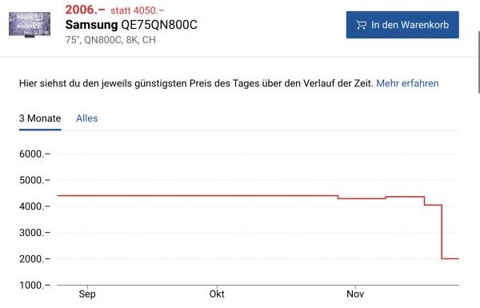

**Stand:** November 2026 · **Autor:** Thomas Ebermann · **Lesedauer:** ca. 9 Minuten

Black Friday ist die Woche, in der jedes zweite Preisschild rot wird. «-50%», «statt 4050.–», und so weiter. Die Frage, die mich dabei jedes Jahr beschäftigt: Wie viele dieser Rabatte sind echt? Also nicht gemessen an einem Listenpreis, den nie jemand bezahlt hat, sondern an dem, was das Produkt in den letzten Monaten tatsächlich gekostet hat.

Meine Regel war simpel: **Ein Produkt muss mindestens drei Monate lang einen stabilen Preis gehabt haben und jetzt mehr als 30 Prozent darunter liegen.** Das heisst, kein Preis, der im Oktober kurz hochgeschraubt wurde, damit der Rabatt im November schöner aussieht.

Von Hand geht das nicht. Digitec zeigt zwar zu jedem Produkt einen Preisverlauf, aber niemand klickt sich durch ein paar tausend Produktseiten. Also habe ich es Claude Code machen lassen, über ein MCP. Und lustigerweise war der Weg dorthin spannender als das Ergebnis.

## Erster Versuch: das offizielle Galaxus-MCP

Kurz zur Einordnung: Ein MCP-Server (Model Context Protocol) gibt einem KI-Assistenten Werkzeuge in die Hand, hier also «suche Produkte», «hole Produktdetails», «zeig mir den Preis». Und lustigerweise gibt es seit ein paar Wochen ein offizielles: Galaxus hat eine [MCP-Schnittstelle für KI-Assistenten](https://www.digitec.ch/de/page/galaxus-startet-mcp-schnittstelle-fuer-ki-assistenten-44216) gestartet, auf derselben Datenbank wie der Shop. Kein Konto nötig, vorerst nur für den Schweizer Shop, in Claude über Einstellungen → Connectors → Discovery → «Galaxus» hinzuzufügen.

Die Einrichtung ist tatsächlich in einer Minute erledigt, ohne Klonen, ohne Build, ohne Konfiguration. Der Server bietet genau ein Werkzeug: `search_products`, mit Suchbegriff, optionalem Preisbereich und bis zu 50 Treffern pro Anfrage. Ein Test mit dem Samsung QE75QN800C kommt mit dem aktuellen Preis von 2'006 Franken zurück, dazu Beschreibung, Bewertungen und eine Zusammenfassung der Pro- und Contra-Punkte aus den Reviews. Für «zeig mir 65-Zoll-Fernseher unter 1'000 Franken mit guten Bewertungen» ist das im Grunde alles, was man braucht.

Was fehlt, ist genau das, was ich für meine Frage gebraucht hätte:

- **kein «statt»-Preis** und damit kein Rabatt
- **kein Preisverlauf**
- **keine Angabe, wer verkauft**, Digitec selbst oder ein Marketplace-Händler
- **weder Sortierung noch Weiterblättern**, also maximal 50 Treffer pro Suche

Das heisst, mit dem offiziellen MCP findest du gut, was es gibt und was es kostet. Ob das ein guter Preis ist, sagt es dir nicht. Eigentlich ist das auch logisch: Ein Shop baut sein MCP zuerst fürs Finden und Kaufen. Das Nachrechnen der eigenen Rabatte steht auf dieser Liste vermutlich weit unten. Meine Bewertung: für die Produktsuche im Chat gut und angenehm unkompliziert, für eine Deal-Analyse unbrauchbar.

## Plan B: die inoffiziellen MCPs

Auf GitHub gibt es zwei Community-Projekte, die nicht die offizielle Schnittstelle nutzen, sondern dieselben internen GraphQL-Endpunkte, die auch der Shop im Browser benutzt:

- **[LeonardoRO/galaxus-mcp](https://github.com/LeonardoRO/galaxus-mcp).** MIT-Lizenz, fünf Tools: `search_products`, `get_product`, `check_price_availability`, `compare_products`, `list_category`. Und das Entscheidende: `get_product` liefert einen Preisverlauf mit.
- **[sven-borden/galaxus-mcp](https://github.com/sven-borden/galaxus-mcp).** Mit Suche, Kategorien und Bewertungen, aber ohne Preisverlauf.

Für meine Frage blieb also nur das erste.

## Installieren: in zwei Minuten erledigt, dann ging gar nichts

Die Installation ist unspektakulär:

```bash
git clone https://github.com/LeonardoRO/galaxus-mcp.git
cd galaxus-mcp && npm install && npm run build
claude mcp add -s user galaxus -e GALAXUS_SITE=digitec.ch -e GALAXUS_LANGUAGE=de -- node "$PWD/dist/index.js"
```

Vorher habe ich kurz in den Code geschaut, weil man fremde Server ja nicht blind laufen lässt: zwei Abhängigkeiten (MCP-SDK und zod), keine Shell-Aufrufe, keine Dateizugriffe, Netzwerk nur Richtung Digitec. `claude mcp get galaxus` meldet «Connected». Schön.

Der erste echte Aufruf, eine Suche nach «kopfhörer», kam dann so zurück:

```
The specified persisted operation key is invalid.
```

Und zwar bei jedem Tool. Was ist da los? Nun, die kurze Antwort: Der Shop schickt keine GraphQL-Abfragen im Klartext, sondern nur einen Hash, der auf eine bei Digitec hinterlegte Abfrage zeigt (Relay «persisted queries»). Wenn Digitec den Shop neu ausrollt, ändern sich diese Hashes, und der MCP-Server klopft mit einem Schlüssel an, den es nicht mehr gibt. Das README warnt sogar davor. Der letzte Commit war vom 30. Oktober, seither hatte Digitec offenbar deployt.

## Die Reparatur: einfach dem Shop zuschauen

Die Lösung war im Grunde Detektivarbeit. Ich habe digitec.ch im Browser geöffnet, eine Suche gemacht, auf ein Produkt geklickt und die Netzwerk-Anfragen mitgelesen:

```
POST /graphql/o/962e640b1ea7f6d290639faecd3f0037/useSearchDataQuery
POST /graphql/o/120a53f00dfde7a1b7f827e2624cf6f2/productDetailPageQuery
```

Ein Stolperstein dabei: Lädt man eine Produktseite direkt, kommt sie fertig gerendert vom Server und die Produkt-Abfrage taucht im Browser gar nicht auf. Erst ein Klick aus der Trefferliste heraus löst sie aus.

Der Server liest die Hashes zum Glück aus Umgebungsvariablen, also war es kein Code-Fix, sondern zwei Zeilen Konfiguration:

```bash
claude mcp add -s user galaxus \
  -e GALAXUS_SITE=digitec.ch -e GALAXUS_LANGUAGE=de \
  -e GALAXUS_SEARCH_HASH=962e640b1ea7f6d290639faecd3f0037 \
  -e GALAXUS_PRODUCT_HASH=120a53f00dfde7a1b7f827e2624cf6f2 \
  -- node /pfad/zu/galaxus-mcp/dist/index.js
```

Danach lief es. Die Sony WH-1000XM6 zum Beispiel: CHF 274, Preisverlauf mit Tief 299 und Hoch 319, Position «LOW», Historie älter als drei Monate. Das heisst, die 274 Franken sind ein echter Tiefpunkt, aber gemessen an den 299 nur rund 8 Prozent. Für meine Regel zu wenig.

## Was in den Daten steckt

Bevor ich losgescannt habe, wollte ich wissen, was die Rohdaten hergeben. Das MCP reicht nur eine Zusammenfassung durch, die Antwort von Digitec enthält aber zwei Felder, mit denen sich die Frage sauber beantworten lässt:

- **`priceHistory`**: Tief und Hoch der jüngeren Vergangenheit, eine Einordnung des aktuellen Preises (LOW, TYPICAL, HIGH) und das Flag `hasHistoryOlderThan3Months`.
- **`insteadOfPrice`**: der «statt»-Preis mit Rabatt in Prozent und einem Typ. `SALES_PRICE_BEFORE` heisst «so viel hat es vorher gekostet». `LAST_NEW` heisst «so viel kostete es neu», das sind Occasionen und Retouren ohne eigenen Preisverlauf.

Eine Einschränkung muss ich ehrlich dazusagen: Das ist kein Preis pro Tag, sondern eine Zusammenfassung. Für «stabil» habe ich deshalb definiert: Tief und Hoch liegen höchstens 15 Prozent auseinander. Und für «wirklich reduziert»: Der heutige Preis liegt mindestens 30 Prozent unter dem **Tief**, nicht unter dem «statt»-Preis. Das ist strenger, und genau das wollte ich.

## Der erste Lauf: viel Lärm

Für die Breite habe ich nicht jedes Produkt einzeln über das MCP abgefragt, sondern ein kleines Skript dieselben beiden Abfragen machen lassen, mit 0,8 Sekunden Pause zwischen den Anfragen, um Digitec nicht zu belasten. 85 Suchbegriffe von «fernseher» über «saugroboter» bis «schlafsack», je 300 Treffer.

Lustigerweise liefert die Suche nach «black friday» übrigens null Treffer.

Das Ergebnis: 411 Produkte mindestens 30 Prozent unter ihrem «statt»-Preis, davon 142 Occasionen ohne Preisverlauf, und am Ende 47, die meine Regel bestanden. Klingt gut, war aber ziemlich unbrauchbar: VR-Kabel von Marketplace-Händlern für 10.95 statt 19.95, ein Mähroboter, der drei Monate lang konstant 2'599 Franken «gekostet» hat und jetzt 899 kostet. Ein flacher Preis von einem Drittanbieter beweist im Grunde nur, dass niemand ihn angepasst hat, nicht, dass jemand ihn bezahlt hat.

## Der zweite Lauf: nur Digitec selbst, ab 200 Franken

Also nachgeschärft: nur Produkte, die Digitec selbst verkauft, nur ab 200 Franken, und pro Kategorie 500 statt 300 Treffer. Übrig blieben 93 Kandidaten und 20 Treffer, das sind nach dem Zusammenfassen der Varianten neun Produkte:

| Produkt | Jetzt | Stabiler Preis vorher | Rabatt |
|---|---|---|---|
| Samsung QE75QN800C (75", 8K) | 2'006 | 4'295 – 4'408 | 53% |
| Wrk21 Schreibtisch Work (13 Varianten) | 374 – 444 | 710 – 815 | 43 – 51% |
| Philips 50PQS8701 (50", QLED, 4K) | 519 | 949 | 45% |
| LG 55NU850B (55", 4K) | 399 | 669 – 749 | 40% |
| Gorenje R619 DAXL6 (Kühlschrank, 398 l) | 1'033 | 1'696 | 39% |
| LG F11WM17TS2 (Waschmaschine, 17 kg) | 734 | 1'104 – 1'208 | 34% |
| Acer TravelMate P4 Spin 14" | 999 | 1'459 – 1'518 | 32% |
| Anker Nebula Cosmos Laser 4K SE | 886 | 1'287 – 1'400 | 31% |
| Siemens EQ700 iAroma | 699 | 1'014 – 1'034 | 31% |

Zwei davon habe ich im Preisverlauf auf der Produktseite nachgeprüft, weil ich einer Zusammenfassung nicht blind traue. Beim Samsung sieht das so aus:



Drei Monate flach bei gut 4'300 Franken, kurz vor Black Friday eine Stufe auf 4'050 (das ist der «statt»-Preis), dann der Absturz auf 2'006. Fairerweise: Das ist ein Modell von 2023, ein Teil des Rabatts ist schlicht Lagerräumung. Ein echter Preissturz ist es trotzdem.

## Und was davon steht auf der Black-Friday-Seite?

Die nächste Frage lag nahe: Finde ich diese Produkte einfach unter [digitec.ch/de/promotion](https://www.digitec.ch/de/promotion)? Die Seite listet 3'343 Aktionsprodukte. Lädt man die Liste über dieselbe Schnittstelle, die die Seite selbst benutzt, ist lustigerweise nach rund 2'060 Produkten Schluss mit Blättern. Mit drei Sortierungen (Relevanz, Preis auf- und absteigend) kam ich auf 3'345, also vollständig.

Das Ergebnis hat mich zweimal überrascht:

1. **Nur drei meiner neun Treffer sind überhaupt in der Aktion:** das Acer TravelMate, der Anker-Beamer und die Siemens-Kaffeemaschine. Der Samsung-TV mit 53 Prozent, der Philips, der LG und die Haushaltsgeräte laufen als normale Rabatte, ohne Black-Friday-Schild.
2. **Die grossen «statt»-Zahlen auf der Aktionsseite halten oft nicht.** 39 Aktionsprodukte von Digitec ab 200 Franken sind laut Schild mindestens 30 Prozent reduziert. Die 13, die mein Scan noch nicht kannte, habe ich nachgeprüft. Vier bestehen meine Regel (ein Gaming-Tisch von Ultradesk für 259 statt stabil 419, der Saugroboter Anker eufy L60 für 249 statt 377, die eufy HomeBase S1 und ein TV-Möbel). Der Rest nicht: Der Sony Bravia 3 (55") steht mit 399 statt 747 drin, hat aber monatelang stabil 499 gekostet, das sind 20 Prozent. Bei einem Weinkühlschrank, einem Acer-PC und einem Babyphone schrumpft der Rabatt gegen den echten Preis auf 5 bis 14 Prozent.

Das heisst, die Aktionsseite ist eine Auswahl dessen, was Digitec bewerben will, und nicht die Liste der besten Deals. Eigentlich logisch, aber ich hätte die Überschneidung grösser geschätzt.

## Was nehme ich mit?

1. **Das offizielle MCP hilft beim Finden, nicht beim Bewerten.** Für die Produktsuche im Chat ist es in einer Minute eingerichtet und gut. Für die Frage, ob ein Preis wirklich gut ist, fehlen ihm Rabatt, Preisverlauf und Verkäufer.
2. **Ein «statt»-Preis ist eine Behauptung, der Preisverlauf ist der Beleg.** Von 3'345 Aktionsprodukten haben am Ende sieben meine Regel bestanden (die drei aus meinem Scan plus die vier nachgeprüften), über den ganzen Shop gesehen dreizehn Produkte.
3. **Inoffizielle MCPs sind Prototypen, keine Infrastruktur.** Sie hängen an internen Schnittstellen, und die ändern sich ohne Vorwarnung. Wer weiss, wo man nachschaut (Netzwerk-Tab, Umgebungsvariablen), repariert das in zehn Minuten. Und für einen Scan über ein paar tausend Produkte war ein kleines Skript auf denselben Abfragen schneller und kontrollierbarer als das MCP selbst.

Ich würde mein Geld darauf wetten, dass solche Preisverlauf-Prüfungen in ein, zwei Jahren direkt in die offiziellen Shop-MCPs wandern. Die Daten liegen ja schon da, Digitec zeigt sie auf jeder Produktseite. Bis dahin gilt: Vor dem Kauf zwei Sekunden auf den Preisverlauf schauen, und bei Marketplace-Angeboten mit flachem Fantasiepreis lieber auf toppreise.ch gegenprüfen. Und weil sich die Preise diese Woche stündlich ändern: Alle Zahlen hier sind vom 24. und 25. November 2026.

Ich freue mich auf eure Kommentare und Anregungen!
